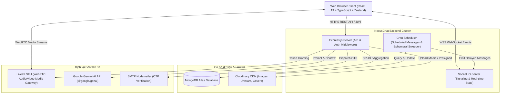
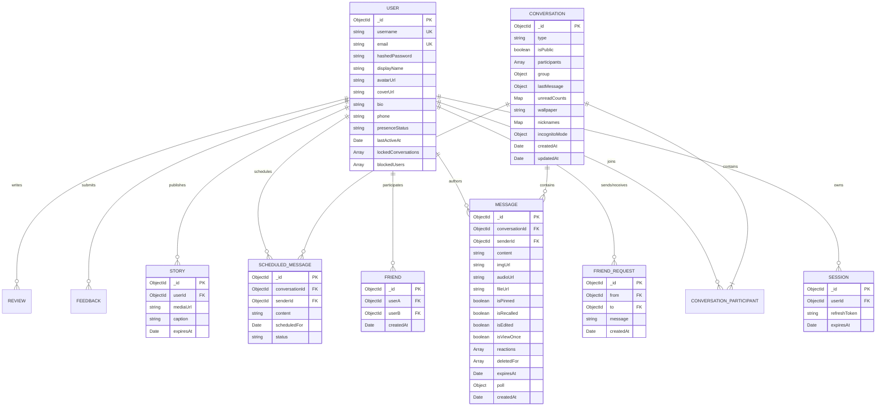

# TÀI LIỆU ĐẶC TẢ YÊU CẦU PHẦN MỀM (SRS)
## SOFTWARE REQUIREMENTS SPECIFICATION
### DỰ ÁN: HỆ THỐNG NHẮN TIN THỜI GIAN THỰC VÀ GỌI TRỰC TUYẾN NEXUSCHAT

---

| Thông tin dự án | Chi tiết |
|:---|:---|
| **Tên sản phẩm** | NexusChat (Real-time Messaging & SFU Calling Platform) |
| **Mã dự án** | NC-2026 |
| **Phiên bản tài liệu** | 2.0.0 |
| **Ngày ban hành** | Học kỳ 2 - Năm học 2025 - 2026 |
| **Tiêu chuẩn áp dụng** | IEEE Std 830-1998 / ISO/IEC/IEEE 29148:2018 |
| **Trạng thái** | Chính thức (Approved for Verification & Testing) |

---

### LỊCH SỬ THAY ĐỔI TÀI LIỆU (REVISION HISTORY)

| Phiên bản | Ngày | Tác giả | Mô tả thay đổi |
|:---|:---|:---|:---|
| `1.0.0` | 15/01/2026 | Nhóm phát triển | Khởi tạo tài liệu đặc tả MVP: Đăng ký, đăng nhập, chat 1-1 |
| `1.2.0` | 20/02/2026 | Nhóm phát triển | Bổ sung Chat nhóm, quản lý bạn bè, chia sẻ tệp/hình ảnh |
| `1.5.0` | 15/03/2026 | Nhóm phát triển | Tích hợp WebRTC Call (LiveKit SFU), AI Gemini (@NexusAI), Kênh công khai |
| `2.0.0` | 21/04/2026 | Nhóm phát triển & QA | Chuẩn hóa theo chuẩn IEEE 830, bổ sung ma trận truy vết yêu cầu (RTM) và tiêu chí kiểm thử |

---

## MỤC LỤC TỔNG QUAN

- [1. GIỚI THIỆU (INTRODUCTION)](#1-giới-thiệu-introduction)
  - [1.1. Mục đích tài liệu (Purpose)](#11-mục-đích-tài-liệu-purpose)
  - [1.2. Phạm vi sản phẩm (Product Scope)](#12-phạm-vi-sản-phẩm-product-scope)
  - [1.3. Định nghĩa, từ viết tắt (Definitions & Acronyms)](#13-định-nghĩa-từ-viết-tắt-definitions--acronyms)
  - [1.4. Tài liệu tham khảo (References)](#14-tài-liệu-tham-khảo-references)
  - [1.5. Cấu trúc tài liệu (Document Overview)](#15-cấu-trúc-tài-liệu-document-overview)
- [2. MÔ TẢ TỔNG QUAN HỆ THỐNG (OVERALL DESCRIPTION)](#2-mô-tả-tổng-quan-hệ-thống-overall-description)
  - [2.1. Bối cảnh và kiến trúc tổng thể (Product Perspective)](#21-bối-cảnh-và-kiến-trúc-tổng-thể-product-perspective)
  - [2.2. Tóm tắt các nhóm chức năng chính (Product Functions Summary)](#22-tóm-tắt-các-nhóm-chức-năng-chính-product-functions-summary)
  - [2.3. Phân loại người dùng và vai trò (User Classes & Characteristics)](#23-phân-loại-người-dùng-và-vai-trò-user-classes--characteristics)
  - [2.4. Môi trường vận hành (Operating Environment)](#24-môi-trường-vận-hành-operating-environment)
  - [2.5. Ràng buộc thiết kế và triển khai (Design Constraints)](#25-ràng-buộc-thiết-kế-và-triển-khai-design-constraints)
  - [2.6. Giả định và phụ thuộc (Assumptions & Dependencies)](#26-giả-định-và-phụ-thuộc-assumptions--dependencies)
- [3. YÊU CẦU CHỨC NĂNG CHI TIẾT (SPECIFIC FUNCTIONAL REQUIREMENTS)](#3-yêu-cầu-chức-năng-chi-tiết-specific-functional-requirements)
  - [3.1. Phân hệ 1: Xác thực & Quản lý Tài khoản (Auth & Account)](#31-phân-hệ-1-xác-thực--quản-lý-tài-khoản-auth--account)
  - [3.2. Phân hệ 2: Quản lý Hồ sơ & Trạng thái Người dùng (Profile & Presence)](#32-phân-hệ-2-quản-lý-hồ-sơ--trạng-thái-người-dùng-profile--presence)
  - [3.3. Phân hệ 3: Quản lý Mạng lưới Bạn bè (Friend Network)](#33-phân-hệ-3-quản-lý-mạng-lưới-bạn-bè-friend-network)
  - [3.4. Phân hệ 4: Nhắn tin Trực tiếp 1-1 & Bảo mật Hội thoại (Direct Messaging)](#34-phân-hệ-4-nhắn-tin-trực-tiếp-1-1--bảo-mật-hội-thoại-direct-messaging)
  - [3.5. Phân hệ 5: Chế độ Trò chuyện Riêng tư & Tự hủy (Privacy & Ephemeral Messaging)](#35-phân-hệ-5-chế-độ-trò-chuyện-riêng-tư--tự-hủy-privacy--ephemeral-messaging)
  - [3.6. Phân hệ 6: Nhắn tin & Quản trị Nhóm Chat (Group Chat Management)](#36-phân-hệ-6-nhắn-tin--quản-trị-nhóm-chat-group-chat-management)
  - [3.7. Phân hệ 7: Kênh Truyền thông Công khai (Public Broadcast Channels)](#37-phân-hệ-7-kênh-truyền-thông-công-khai-public-broadcast-channels)
  - [3.8. Phân hệ 8: Đa phương tiện & Tệp đính kèm (Media & Attachments)](#38-phân-hệ-8-đa-phương-tiện--tệp-đính-kèm-media--attachments)
  - [3.9. Phân hệ 9: Tiện ích Tương tác Nâng cao (Polls, Schedule, Translate, Share Contact)](#39-phân-hệ-9-tiện-ích-tương-tác-nâng-cao-polls-schedule-translate-share-contact)
  - [3.10. Phân hệ 10: Trợ lý Trí tuệ Nhân tạo (@NexusAI & Summarization)](#310-phân-hệ-10-trợ-lý-trí-tuệ-nhân-tạo-nexusai--summarization)
  - [3.11. Phân hệ 11: Tin nhanh 24h & Đánh giá Hệ thống (Stories & Feedbacks)](#311-phân-hệ-11-tin-nhanh-24h--đánh-giá-hệ-thống-stories--feedbacks)
  - [3.12. Phân hệ 12: Thoại & Video Call Thời gian thực (WebRTC SFU Calling)](#312-phân-hệ-12-thoại--video-call-thời-gian-thực-webrtc-sfu-calling)
  - [3.13. Phân hệ 13: Xử lý Ngoại tuyến & Đồng bộ hóa (Offline Handling & Sync)](#313-phân-hệ-13-xử-lý-ngoại-tuyến--đồng-bộ-hóa-offline-handling--sync)
- [4. YÊU CẦU GIAO DIỆN NGOÀI (EXTERNAL INTERFACE REQUIREMENTS)](#4-yêu-cầu-giao-diện-ngoài-external-interface-requirements)
  - [4.1. Giao diện người dùng (User Interface - UI/UX)](#41-giao-diện-người-dùng-user-interface---uiux)
  - [4.2. Giao diện phần cứng (Hardware Interfaces)](#42-giao-diện-phần-cứng-hardware-interfaces)
  - [4.3. Giao diện phần mềm & Dịch vụ ngoài (Software Interfaces)](#43-giao-diện-phần-mềm--dịch-vụ-ngoài-software-interfaces)
  - [4.4. Giao diện truyền thông & Giao thức mạng (Communications Interfaces)](#44-giao-diện-truyền-thông--giao-thức-mạng-communications-interfaces)
- [5. YÊU CẦU PHI CHỨC NĂNG (NON-FUNCTIONAL REQUIREMENTS - NFR)](#5-yêu-cầu-phi-chức-năng-non-functional-requirements---nfr)
  - [5.1. Hiệu năng & Khả năng đáp ứng (Performance Requirements)](#51-hiệu-năng--khả-năng-đáp-ứng-performance-requirements)
  - [5.2. Tính an toàn & Bảo mật (Security Requirements)](#52-tính-an-toàn--bảo-mật-security-requirements)
  - [5.3. Độ tin cậy & Tính sẵn sàng (Reliability & Availability)](#53-độ-tin-cậy--tính-sẵn-sàng-reliability--availability)
  - [5.4. Khả năng sử dụng & Trải nghiệm (Usability Requirements)](#54-khả-năng-sử-dụng--trải-nghiệm-usability-requirements)
  - [5.5. Khả năng bảo trì & Mở rộng (Maintainability & Scalability)](#55-khả-năng-bảo-trì--mở-rộng-maintainability--scalability)
- [6. THIẾT KẾ DỮ LIỆU & LƯỢC ĐỒ THỰC THỂ (DATABASE SCHEMA & ERD)](#6-thiết-kế-dữ-liệu--lược-đồ-thực-thể-database-schema--erd)
  - [6.1. Sơ đồ Quan hệ Thực thể (Mermaid ERD)](#61-sơ-đồ-quan-hệ-thực-thể-mermaid-erd)
  - [6.2. Đặc tả chi tiết các Collection MongoDB](#62-đặc-tả-chi-tiết-các-collection-mongodb)
- [7. MA TRẬN TRUY VẾT YÊU CẦU & KIỂM THỬ (REQUIREMENTS TRACEABILITY MATRIX - RTM)](#7-ma-trận-truy-vết-yêu-cầu--kiểm-thử-requirements-traceability-matrix---rtm)
  - [7.1. Bảng ma trận đối chiếu Yêu cầu - Test Cases](#71-bảng-ma-trận-đối-chiếu-yêu-cầu---test-cases)
  - [7.2. Tiêu chuẩn nghiệm thu hệ thống (System Acceptance Criteria)](#72-tiêu-chuẩn-nghiệm-thu-hệ-thống-system-acceptance-criteria)
- [8. PHỤ LỤC (APPENDIX)](#8-phụ-lục-appendix)
  - [8.1. Bảng mã phản hồi API (HTTP Status Codes)](#81-bảng-mã-phản-hồi-api-http-status-codes)
  - [8.2. Danh mục Sự kiện Socket.IO Signaling](#82-danh-mục-sự-kiện-socketio-signaling)

---

## 1. GIỚI THIỆU (INTRODUCTION)

### 1.1. Mục đích tài liệu (Purpose)
Tài liệu **Đặc tả Yêu cầu Phần mềm (SRS)** này định nghĩa đầy đủ, chi tiết và chính thức toàn bộ các yêu cầu chức năng, yêu cầu phi chức năng, ràng buộc thiết kế, kiến trúc dữ liệu và tiêu chí nghiệm thu cho sản phẩm **NexusChat**. 
Tài liệu này phục vụ cho:
- **Hội đồng Giảng viên & Người chấm đồ án**: Căn cứ đánh giá mức độ hoàn thiện, tính học thuật và chất lượng kỹ thuật của đồ án công nghệ phần mềm / kiểm thử phần mềm.
- **Đội ngũ Phát triển (Developers)**: Tài liệu chỉ dẫn thực thi kiến trúc, ràng buộc API và nghiệp vụ hệ thống.
- **Đội ngũ Đảm bảo Chất lượng (QA/Testers)**: Cơ sở để thiết kế kịch bản kiểm thử (Test Cases), kịch bản tự động hóa (Automation Tests CodeceptJS) và nghiệm thu chức năng (Acceptance Testing).

### 1.2. Phạm vi sản phẩm (Product Scope)
**NexusChat** là một nền tảng giao tiếp mạng xã hội và trao đổi thông tin trực tuyến đa phương tiện hoạt động trên nền tảng Web (Single Page Application - SPA) hỗ trợ:
- Giao tiếp tức thời (Instant Messaging) độ trễ thấp thông qua giao thức WebSocket (Socket.IO).
- Gọi thoại và gọi video đa điểm (Audio/Video Conferencing) chuẩn WebRTC ứng dụng kiến trúc SFU (Selective Forwarding Unit) của LiveKit.
- Hỗ trợ trợ lý trí tuệ nhân tạo (Generative AI) tích hợp thông qua Google Gemini API để giải đáp câu hỏi và tóm tắt cuộc họp/đoạn chat.
- Cơ chế bảo mật cao cấp: Chế độ chat ẩn danh (Incognito Mode), tin nhắn tự hủy (Disappearing Messages), mã PIN khóa cuộc hội thoại riêng tư.
- Quản trị hội nhóm phân quyền phân cấp (Trưởng nhóm, Phó nhóm, Thành viên) và Kênh phát thanh công cộng (Public Channels).

### 1.3. Định nghĩa, từ viết tắt (Definitions & Acronyms)

| Thuật ngữ / Từ viết tắt | Định nghĩa đầy đủ |
|:---|:---|
| **SRS** | Software Requirements Specification (Đặc tả yêu cầu phần mềm) |
| **MVP** | Minimum Viable Product (Sản phẩm khả dụng tối thiểu) |
| **JWT** | JSON Web Token (Cơ chế sinh chuỗi mã xác thực an toàn không lưu trạng thái) |
| **RTM** | Requirements Traceability Matrix (Ma trận truy vết yêu cầu) |
| **SFU** | Selective Forwarding Unit (Kiến trúc phân phối luồng truyền thông WebRTC hiệu năng cao) |
| **WebRTC** | Web Real-Time Communication (Giao thức truyền thông âm thanh/hình ảnh thời gian thực) |
| **Socket.IO** | Thư viện hỗ trợ truyền thông hai chiều dựa trên sự kiện (Event-driven bidirectional) |
| **OTP** | One-Time Password (Mật khẩu dùng một lần xác thực qua Email) |
| **PiP** | Picture-in-Picture (Cửa sổ nổi thu nhỏ trên màn hình) |
| **RBAC** | Role-Based Access Control (Kiểm soát truy cập dựa trên vai trò) |
| **E2E Testing** | End-to-End Testing (Kiểm thử luồng người dùng từ đầu đến cuối) |

### 1.4. Tài liệu tham khảo (References)
1. **IEEE Std 830-1998**: *IEEE Recommended Practice for Software Requirements Specifications*.
2. **ISO/IEC/IEEE 29148:2018**: *Systems and software engineering — Life cycle processes — Requirements engineering*.
3. **Mongoose Documentation**: *Schema, Indexes and Document Lifecycle (v8.19.0)*.
4. **LiveKit SFU Documentation**: *Real-time Video/Audio Engine and Token Management*.
5. **CodeceptJS Framework Guide**: *E2E Web Testing with Playwright / WebDriver*.
6. **NexusChat Repository Specification**: `PROJECT_SPEC.md` & `README.md`.

### 1.5. Cấu trúc tài liệu (Document Overview)
Tài liệu gồm 8 chương bao quát từ bối cảnh tổng quát đến chi tiết kỹ thuật:
- **Chương 1 - 2**: Giới thiệu mục tiêu, đối tượng sử dụng, bối cảnh triển khai hệ thống.
- **Chương 3**: Chi tiết 13 phân hệ chức năng với các kịch bản sử dụng chuẩn (Use Cases, Flows).
- **Chương 4**: Yêu cầu về các giao diện ngoại vi (UI, Hardware, Software, Communication).
- **Chương 5**: Tiêu chuẩn phi chức năng (Performance, Security, Reliability, Usability).
- **Chương 6**: Sơ đồ ERD và đặc tả bảng lược đồ MongoDB.
- **Chương 7**: Ma trận đối soát yêu cầu (RTM) đối với bộ Test Case trong đồ án.
- **Chương 8**: Bảng mã lỗi và danh mục sự kiện Socket.IO.

---

## 2. MÔ TẢ TỔNG QUAN HỆ THỐNG (OVERALL DESCRIPTION)

### 2.1. Bối cảnh và kiến trúc tổng thể (Product Perspective)
Hệ thống **NexusChat** áp dụng mô hình phân tách hoàn toàn giữa Frontend (Client SPA) và Backend (RESTful API Server + Realtime Socket + SFU Media Server):



### 2.2. Tóm tắt các nhóm chức năng chính (Product Functions Summary)
Hệ thống cung cấp 13 nhóm tính năng cốt lõi:
1. **Xác thực an toàn**: Đăng ký, đăng nhập, gửi mã xác thực Email OTP, cấp phát cặp Token (Access Token 15 phút, Refresh Token 7 ngày đặt trong HttpOnly Cookie).
2. **Hồ sơ cá nhân & Hiện diện**: Quản lý thông tin cá nhân, avatar, ảnh bìa, trạng thái trực tuyến (Online, Offline, Busy).
3. **Mạng lưới kết bạn**: Tìm kiếm người dùng, gửi/chấp nhận/từ chối lời mời, danh sách bạn bè, chặn giao tiếp.
4. **Nhắn tin trực tiếp 1-1**: Nhắn tin tức thì qua WebSocket, hiển thị trạng thái đã xem (seen), rich-text Markdown, thu hồi, chỉnh sửa, ghim tin nhắn, xóa phía tôi.
5. **Bảo mật & Quyền riêng tư**: Chế độ trò chuyện ẩn danh (Incognito), tin nhắn tự hủy theo bộ đếm (Disappearing Messages), xem 1 lần (View-Once Media), khóa cuộc trò chuyện bằng mã PIN 4 số.
6. **Nhóm trò chuyện đa cấp**: Tạo nhóm, phân quyền Admin (Trưởng nhóm), Phó nhóm, Thành viên; thay đổi thông tin nhóm, kick thành viên, giải tán nhóm.
7. **Kênh phát thanh công cộng (Channels)**: Tạo kênh truyền thông 1 chiều, người dùng đăng ký theo dõi (Follow/Join), cấm thành viên vi phạm.
8. **Đa phương tiện & Đính kèm**: Gửi ảnh (có bộ chỉnh sửa xoay, cắt, filter Filerobot), gửi tin nhắn thoại (Audio Waveform), tệp tài liệu (Drive/Local CDN).
9. **Tiện ích tương tác nâng cao**: Tạo bình chọn (Polls) đa lựa chọn, hẹn giờ gửi tin nhắn (Scheduled Messages), chia sẻ danh thiếp liên hệ, dịch tin nhắn trực tiếp đa ngôn ngữ.
10. **Trợ lý Trí tuệ Nhân tạo**: Tích hợp `@NexusAI` đọc ngữ cảnh 15 tin nhắn gần nhất để trả lời thông minh; nút tóm tắt hội thoại (Summarize).
11. **Bảng tin 24h & Phản hồi**: Đăng tin Story dạng ảnh/video tự xóa sau 24h; gửi Feedback & Review trải nghiệm ứng dụng.
12. **Cuộc gọi Audio/Video thời gian thực**: Gọi 1-1 và gọi nhóm, đổ chuông hai chiều kèm chuông thông báo, truyền thông LiveKit SFU độ phân giải HD, lọc tiếng ồn Krisp AI, chia sẻ màn hình, cửa sổ thu nhỏ PiP.
13. **Xử lý Ngoại tuyến & Đồng bộ**: Phát hiện mất mạng (Offline Banner), bộ đệm Zustand lưu trạng thái, khôi phục kết nối tự động.

### 2.3. Phân loại người dùng và vai trò (User Classes & Characteristics)

| Vai trò người dùng (Actor) | Mô tả & Trình độ kỹ thuật | Quyền hạn trong hệ thống |
|:---|:---|:---|
| **Khách vãng lai (Guest)** | Người dùng chưa có tài khoản, truy cập trình duyệt | Chỉ truy cập được màn hình Đăng nhập (`/signin`) và Đăng ký (`/signup`). |
| **Thành viên chính thức (Regular User)** | Người dùng đã đăng ký và xác thực tài khoản | Nhắn tin 1-1, kết bạn, tạo nhóm, tham gia kênh, gọi điện, tùy biến hồ sơ cá nhân. |
| **Trưởng nhóm (Group Leader)** | Thành viên sáng lập nhóm trò chuyện hoặc nhận nhượng quyền | Toàn quyền cấu hình nhóm, đổi tên/avatar nhóm, bổ nhiệm/bãi nhiệm phó nhóm, kick thành viên, xóa tin, giải tán nhóm. |
| **Phó nhóm (Group Deputy)** | Thành viên được Trưởng nhóm trao quyền quản trị | Mời thành viên mới, cập nhật tên/ảnh nhóm, kick thành viên cấp thường (không được kick Leader/Deputy khác). |
| **Chủ kênh phát sóng (Channel Admin)** | Người khởi tạo Channel công cộng hoặc riêng tư | Quyền duy nhất được đăng tải tin nhắn phát thanh trong kênh, quản lý cấm/ban thành viên. |

### 2.4. Môi trường vận hành (Operating Environment)
- **Hệ điều hành máy chủ**: Ubuntu Server 22.04 LTS / Windows Server 2022.
- **Node.js Runtime**: v18.x trở lên (khuyến nghị v20.x LTS).
- **Cơ sở dữ liệu**: MongoDB v6.0 trở lên (Mongoose ODM v8.x).
- **Web Server Gateway**: Nginx Reverse Proxy (SSL Termination, WebSocket upgrade).
- **Trình duyệt Client hỗ trợ**: 
  - Google Chrome (phiên bản 110+)
  - Mozilla Firefox (phiên bản 110+)
  - Microsoft Edge (phiên bản 110+)
  - Safari (phiên bản 16+)
- **Yêu cầu phần cứng người dùng**: Thiết bị có Microphone và Camera (nếu sử dụng tính năng gọi điện); RAM tối thiểu 4GB; Kết nối mạng tối thiểu 1.5 Mbps.

### 2.5. Ràng buộc thiết kế và triển khai (Design Constraints)
- **Frontend Architecture**: SPA thuần túy viết bằng React 19 kết hợp TypeScript và Vite để tối ưu thời gian nạp trang dưới 1.5 giây. Sử dụng Zustand quản lý trạng thái tập trung.
- **UI/UX Guidelines**: Thiết kế giao diện hiện đại Glassmorphism/Flat hiện đại, hỗ trợ Dark/Light Theme linh hoạt, đáp ứng Responsive trên mọi độ phân giải màn hình.
- **State Management & Authentication**: Token Access được bảo vệ trong bộ nhớ ứng dụng (Zustand) và Refresh Token bắt buộc lưu trữ trong HttpOnly Cookie để phòng ngừa tấn công XSS.
- **Real-time Channel Isolation**: Mỗi kết nối Socket.IO được gán định danh vào phòng cá nhân `user:${userId}` ngay trong quá trình Handshake để đảm bảo tính cô lập dữ liệu.

### 2.6. Giả định và phụ thuộc (Assumptions & Dependencies)
- Hệ thống phụ thuộc vào tính sẵn sàng của LiveKit Cloud/Self-hosted SFU cho luồng truyền tải WebRTC.
- Phụ thuộc vào dịch vụ Google Gemini API để thực thi tính năng AI Chatbot & Tóm tắt hội thoại.
- Phụ thuộc vào dịch vụ Cloudinary để lưu trữ ảnh đại diện, ảnh bìa và tệp đa phương tiện.
- Phụ thuộc vào tài khoản SMTP Google/Nodemailer để gửi mã xác thực OTP qua Email.

---

## 3. YÊU CẦU CHỨC NĂNG CHI TIẾT (SPECIFIC FUNCTIONAL REQUIREMENTS)

Mỗi yêu cầu chức năng được đánh mã chuẩn theo cấu trúc: `FR-[Nhóm]-[Số thứ tự]` kèm theo các yếu tố: Tác nhân, Điều kiện tiên quyết, Luồng sự kiện chính, Luồng ngoại lệ và Điều kiện sau.

```
Mã Phân hệ:
- AUT: Authentication & Account
- USR: User Profile & Presence
- FRD: Friends Management
- MSG: Direct Messaging
- SEC: Privacy & Chat Security
- GRP: Group Chat Management
- CHN: Broadcast Channels
- MED: Media & Attachments
- ADV: Advanced Chat Utilities
- AIB: Artificial Intelligence Bot
- STY: Stories & Feedbacks
- CAL: WebRTC Calling
- OFL: Offline Handling & Sync
```

---

### 3.1. Phân hệ 1: Xác thực & Quản lý Tài khoản (Auth & Account)

#### **FR-AUT-01: Đăng ký tài khoản người dùng (User Sign Up)**
- **Mã yêu cầu**: `FR-AUT-01`
- **Tác nhân**: Khách vãng lai (Guest).
- **Mục tiêu**: Cho phép người dùng mới tạo tài khoản trong hệ thống NexusChat.
- **Điều kiện tiên quyết**: Người dùng chưa đăng nhập, đang ở trang `/signup`.
- **Luồng xử lý chính (Main Flow)**:
  1. Người dùng nhập các trường thông tin: Tên đăng nhập (`username`), Email (`email`), Tên hiển thị (`displayName`), Mật khẩu (`password`), Nhập lại mật khẩu (`confirmPassword`).
  2. Người dùng nhấn nút "Đăng ký".
  3. Frontend kích hoạt kiểm tra tính hợp lệ bằng thư viện Zod (Độ dài mật khẩu >= 6 ký tự, email đúng định dạng regex, confirmPassword khớp).
  4. Hệ thống gửi yêu cầu `POST /api/auth/signup` đến Backend.
  5. Backend kiểm tra xem `username` hoặc `email` đã tồn tại trong MongoDB chưa.
  6. Backend băm mật khẩu với thư viện `bcrypt` (Salt round = 10).
  7. Backend lưu bản ghi User mới vào cơ sở dữ liệu.
  8. Hệ thống phản hồi mã trạng thái `201 Created` kèm thông báo thành công và điều hướng sang trang `/signin`.
- **Luồng ngoại lệ (Alternative/Exception Flows)**:
  - *E1 - Trường dữ liệu để trống hoặc không hợp lệ*: Hiển thị lỗi form trực tiếp ngay dưới ô nhập liệu (Client-side validation).
  - *E2 - Tên đăng nhập hoặc Email đã tồn tại*: Backend trả về mã lỗi `409 Conflict`, hiển thị toast thông báo: "Tên đăng nhập hoặc email đã được sử dụng".
- **Điều kiện sau (Post-condition)**: Bản ghi người dùng được ghi nhận trong Collection `users`.

#### **FR-AUT-02: Xác thực Email bằng mã OTP (Email Verification via OTP)**
- **Mã yêu cầu**: `FR-AUT-02`
- **Tác nhân**: Người dùng đăng ký tài khoản.
- **Mục tiêu**: Xác thực quyền sở hữu địa chỉ email thông qua mã số dùng một lần.
- **Điều kiện tiên quyết**: Đã hoàn tất bước đăng ký sơ bộ hoặc kích hoạt yêu cầu xác minh.
- **Luồng xử lý chính**:
  1. Backend tạo ngẫu nhiên mã số OTP gồm 6 chữ số với thời gian sống 5 phút.
  2. Lưu bản ghi vào Collection `otps` (chứa `email`, `otp`, `expiresAt`).
  3. Gửi email chứa mã OTP đến hòm thư người dùng qua Nodemailer.
  4. Người dùng nhập mã OTP vào hộp thoại trên màn hình.
  5. Backend kiểm tra tính hợp lệ và thời hạn của mã OTP.
  6. Đánh dấu tài khoản đã xác thực thành công.
- **Luồng ngoại lệ**:
  - *E1 - Mã OTP sai hoặc hết hạn*: Hệ thống thông báo lỗi `400 Bad Request` "Mã xác thực không đúng hoặc đã hết hạn". Cho phép bấm "Gửi lại mã OTP" sau 60 giây.

#### **FR-AUT-03: Đăng nhập hệ thống (User Sign In)**
- **Mã yêu cầu**: `FR-AUT-03`
- **Tác nhân**: Người dùng đã có tài khoản.
- **Mục tiêu**: Xác thực danh tính và thiết lập phiên làm việc an toàn.
- **Điều kiện tiên quyết**: Người dùng ở màn hình `/signin`.
- **Luồng xử lý chính**:
  1. Người dùng nhập `username` (hoặc email) và `password`.
  2. Bấm nút "Đăng nhập".
  3. Client gửi yêu cầu `POST /api/auth/signin`.
  4. Backend truy vấn người dùng trong MongoDB. Nếu tìm thấy, thực hiện so khớp mật khẩu bằng `bcrypt.compare()`.
  5. Backend tạo cặp khóa JWT:
     - `accessToken`: Hạn sử dụng 15 phút, chứa thông tin `userId`.
     - `refreshToken`: Hạn sử dụng 7 ngày.
  6. Backend lưu phiên làm việc vào Collection `sessions` và đính kèm `refreshToken` vào Cookie với cờ `HttpOnly`, `SameSite=Strict`, `Secure`.
  7. Backend trả về `accessToken` và thông tin User tóm tắt trong body phản hồi `200 OK`.
  8. Frontend lưu `accessToken` vào `useAuthStore` (Zustand), tự động kết nối Socket.IO client và điều hướng vào trang chính `/`.
- **Luồng ngoại lệ**:
  - *E1 - Sai tên đăng nhập hoặc mật khẩu*: Backend trả về mã `401 Unauthorized`. Frontend hiển thị toast thông báo: "Tài khoản hoặc mật khẩu không chính xác".

#### **FR-AUT-04: Tự động làm mới phiên làm việc (Silent Token Refresh)**
- **Mã yêu cầu**: `FR-AUT-04`
- **Tác nhân**: Hệ thống Client (Background service).
- **Mục tiêu**: Duy trì phiên đăng nhập liên tục mà không yêu cầu người dùng nhập lại mật khẩu khi `accessToken` hết hạn.
- **Luồng xử lý chính**:
  1. Khi nhận mã lỗi `401 Unauthorized` từ bất kỳ yêu cầu API nào, Axios Interceptor chặn lại.
  2. Gửi yêu cầu `POST /api/auth/refresh` kèm cookie `refreshToken`.
  3. Backend xác thực `refreshToken` từ cookie và đối chiếu trong bảng `sessions`.
  4. Backend cấp mới một `accessToken` và trả về client.
  5. Axios Interceptor cập nhật token mới vào header Authorization và gửi lại request ban đầu một cách trong suốt đối với người dùng.
- **Luồng ngoại lệ**:
  - *E1 - Refresh Token hết hạn hoặc không tồn tại*: Xóa trạng thái trong `useAuthStore`, điều hướng người dùng về trang `/signin`.

#### **FR-AUT-05: Đăng xuất khỏi hệ thống (User Sign Out)**
- **Mã yêu cầu**: `FR-AUT-05`
- **Tác nhân**: Người dùng đã đăng nhập.
- **Mục tiêu**: Hủy phiên làm việc hiện tại và thu hồi token.
- **Luồng xử lý chính**:
  1. Người dùng nhấn nút "Đăng xuất" trên thanh cài đặt hoặc menu người dùng.
  2. Client gửi `POST /api/auth/signout`.
  3. Backend xóa bản ghi tương ứng trong Collection `sessions` và xóa cookie `refreshToken`.
  4. Backend phát sự kiện cập nhật trạng thái người dùng thành `offline` tới toàn bộ bạn bè thông qua Socket.IO.
  5. Ngắt kết nối Socket.IO Client và xóa toàn bộ dữ liệu trong các Zustand Stores.
  6. Điều hướng về trang `/signin`.

---

### 3.2. Phân hệ 2: Quản lý Hồ sơ & Trạng thái Người dùng (Profile & Presence)

#### **FR-USR-01: Xem và cập nhật hồ sơ cá nhân (Manage Profile)**
- **Mã yêu cầu**: `FR-USR-01`
- **Tác nhân**: Người dùng đã đăng nhập.
- **Mục tiêu**: Chỉnh sửa thông tin hiển thị cá nhân (Tên hiển thị, tiểu sử bio, số điện thoại, ghi chú trạng thái).
- **Luồng xử lý chính**:
  1. Người dùng mở mục "Cài đặt tài khoản" hoặc click vào Avatar ở góc dưới.
  2. Hệ thống gọi `GET /api/users/me` lấy thông tin chi tiết.
  3. Người dùng sửa đổi: `displayName`, `bio` (tối đa 500 ký tự), `phone`, `note` (nội dung tối đa 60 ký tự, có thời hạn).
  4. Bấm "Lưu thay đổi", gửi `PUT /api/users/me`.
  5. Backend kiểm tra tính duy nhất của số điện thoại (nếu có) và cập nhật Document trong `users`.
  6. Phát sự kiện Socket cập nhật thông tin hiển thị cho các bạn bè đang trò chuyện.
- **Luồng ngoại lệ**:
  - *E1 - Số điện thoại trùng lặp*: Backend trả lỗi `400 Bad Request`.

#### **FR-USR-02: Tải lên Ảnh đại diện & Ảnh bìa (Upload Avatar & Cover Image)**
- **Mã yêu cầu**: `FR-USR-02`
- **Tác nhân**: Người dùng đã đăng nhập.
- **Mục tiêu**: Cập nhật ảnh đại diện (Avatar) hoặc ảnh bìa (Cover) sử dụng dịch vụ lưu trữ đám mây Cloudinary.
- **Luồng xử lý chính**:
  1. Người dùng chọn tệp ảnh từ máy (hỗ trợ JPG, PNG, WEBP, dung lượng <= 5MB).
  2. Frontend hiển thị công cụ xem trước và cắt ảnh (Crop/Rotate tool).
  3. Người dùng xác nhận, Client gửi `POST /api/users/uploadAvatar` dưới dạng `multipart/form-data`.
  4. Backend sử dụng `multer` để nhận tệp và đẩy lên Cloudinary qua SDK.
  5. Nếu người dùng đã có avatar cũ trước đó (`avatarId`), Backend gọi hàm xóa ảnh cũ trên Cloudinary để tối ưu dung lượng lưu trữ.
  6. Cập nhật `avatarUrl` và `avatarId` mới vào User document.
  7. Trả về thông tin cập nhật cho Client và bắn sự kiện realtime.

#### **FR-USR-03: Trạng thái hiện diện thời gian thực (Real-time Presence Tracking)**
- **Mã yêu cầu**: `FR-USR-03`
- **Tác nhân**: Hệ thống & Người dùng.
- **Mục tiêu**: Hiển thị chính xác trạng thái hoạt động: Trực tuyến (`online`), Ngoại tuyến (`offline`), Bận (`busy`).
- **Luồng xử lý chính**:
  1. Khi người dùng thiết lập kết nối Socket.IO thành công, máy chủ gán trạng thái `presenceStatus: 'online'` và gửi thông báo `user:status_changed` tới phòng của tất cả bạn bè liên kết.
  2. Người dùng có thể chủ động chuyển trạng thái thành `busy` từ menu cài đặt nhanh.
  3. Khi socket bị ngắt kết nối (mất mạng hoặc đóng tab), máy chủ chờ khoảng timeout 10 giây (Heartbeat/Ping-pong). Nếu không kết nối lại, cập nhật trạng thái thành `offline`, lưu thời điểm `lastActiveAt` và thông báo tới các client liên quan.

#### **FR-USR-04: Chặn và Bỏ chặn người dùng (Block/Unblock Users)**
- **Mã yêu cầu**: `FR-USR-04`
- **Tác nhân**: Người dùng.
- **Mục tiêu**: Ngăn chặn người dùng quấy rối gửi tin nhắn hoặc thực hiện cuộc gọi.
- **Luồng xử lý chính**:
  1. Người dùng chọn "Chặn người dùng" trong trang thông tin hồ sơ của đối phương.
  2. Gửi yêu cầu `POST /api/users/:id/block`.
  3. Backend thêm `targetUserId` vào danh sách `blockedUsers` của người dùng.
  4. Mọi yêu cầu gửi tin nhắn, mời gọi điện từ phía người bị chặn sẽ bị từ chối ngay lập tức ở tầng kiểm tra Middleware/Controller.
  5. Luồng "Bỏ chặn" (`POST /api/users/:id/unblock`) loại bỏ `targetUserId` khỏi mảng `blockedUsers`.

---

### 3.3. Phân hệ 3: Quản lý Mạng lưới Bạn bè (Friend Network)

#### **FR-FRD-01: Tìm kiếm người dùng (Search Users)**
- **Mã yêu cầu**: `FR-FRD-01`
- **Tác nhân**: Người dùng đã đăng nhập.
- **Mục tiêu**: Tìm kiếm người dùng khác trong hệ thống theo Tên đăng nhập hoặc Email.
- **Luồng xử lý chính**:
  1. Người dùng nhập từ khóa tìm kiếm vào ô tìm bạn.
  2. Frontend kích hoạt Debounce 300ms và gửi `GET /api/users/search?q={keyword}`.
  3. Backend truy vấn `users` theo biểu thức chính quy (Regex không phân biệt hoa thường), giới hạn 20 kết quả, loại trừ chính người đang tìm kiếm.
  4. Trả về danh sách kèm trạng thái quan hệ: Đã là bạn, Đang chờ chấp nhận, Chưa kết bạn.

#### **FR-FRD-02: Gửi lời mời kết bạn (Send Friend Request)**
- **Mã yêu cầu**: `FR-FRD-02`
- **Tác nhân**: Người dùng.
- **Mục tiêu**: Gửi yêu cầu thiết lập mối quan hệ bạn bè kèm lời nhắn.
- **Luồng xử lý chính**:
  1. Người dùng bấm "Thêm bạn" và nhập lời chào (tùy chọn).
  2. Client gửi `POST /api/friends/requests` với payload `{ toUserId, message }`.
  3. Backend kiểm tra: Không gửi cho chính mình, chưa là bạn bè, chưa có yêu cầu kết bạn nào đang ở trạng thái chờ (`pending`).
  4. Tạo bản ghi mới trong `friendrequests`.
  5. Bắn sự kiện Socket `friend:request_received` tới phòng `user:${toUserId}` để hiển thị badge thông báo đỏ ngay lập tức.
- **Luồng ngoại lệ**:
  - *E1 - Đối phương đã chặn bạn hoặc hai người đã là bạn*: Backend từ chối kèm mã `400 Bad Request`.

#### **FR-FRD-03: Chấp nhận hoặc Từ chối kết bạn (Accept/Decline Friend Request)**
- **Mã yêu cầu**: `FR-FRD-03`
- **Tác nhân**: Người nhận lời mời.
- **Luồng xử lý chính**:
  1. Người dùng mở tab "Lời mời kết bạn".
  2. Bấm "Chấp nhận" (`POST /api/friends/requests/:requestId/accept`):
     - Backend xóa lời mời trong `friendrequests`.
     - Tạo bản ghi mới trong `friends` liên kết `userA` và `userB`.
     - Tự động khởi tạo một cuộc trò chuyện trực tiếp (Direct Conversation) giữa 2 người nếu chưa tồn tại.
     - Phát sự kiện `friend:accepted` cho cả hai phía qua Socket.IO.
  3. Bấm "Từ chối" (`POST /api/friends/requests/:requestId/decline`):
     - Xóa lời mời khỏi cơ sở dữ liệu.

---

### 3.4. Phân hệ 4: Nhắn tin Trực tiếp 1-1 & Bảo mật Hội thoại (Direct Messaging)

#### **FR-MSG-01: Gửi và Nhận tin nhắn trực tiếp thời gian thực (Real-time 1:1 Messaging)**
- **Mã yêu cầu**: `FR-MSG-01`
- **Tác nhân**: Người dùng trò chuyện.
- **Mục tiêu**: Truyền nhận tin nhắn văn bản tức thời không cần tải lại trang.
- **Luồng xử lý chính**:
  1. Người dùng nhập nội dung văn bản vào ô chat và nhấn Enter (hoặc bấm nút Send).
  2. Frontend tạo tin nhắn tạm với trạng thái "Đang gửi" (Optimistic UI update) để mang lại cảm giác mượt mà tức thì.
  3. Client gọi `POST /api/messages/direct` hoặc phát qua Socket `message:send`.
  4. Backend lưu tin nhắn vào Collection `messages`, cập nhật `lastMessage` và `lastMessageAt` của `conversations`.
  5. Tăng chỉ số tin chưa đọc (`unreadCounts`) cho người nhận.
  6. Backend gửi sự kiện Socket `message:new` tới phòng người nhận và người gửi.
  7. Client cập nhật trạng thái tin nhắn thành "Đã gửi" và phát âm thanh thông báo nhẹ.

#### **FR-MSG-02: Định dạng văn bản phong phú & Markdown (Rich Text & Markdown Formatting)**
- **Mã yêu cầu**: `FR-MSG-02`
- **Tác nhân**: Người dùng gửi tin nhắn.
- **Mục tiêu**: Trình bày thông điệp chuyên nghiệp với cấu trúc code block, in đậm, in nghiêng, trích dẫn.
- **Yêu cầu chi tiết**:
  - Hỗ trợ cú pháp Markdown chuẩn: `**in đậm**`, `*in nghiêng*`, `~~gạch ngang~~`, `` `inline code` ``, khối code với highlight cú pháp đa ngôn ngữ (JavaScript, Python, C++, HTML,...), danh sách gạch đầu dòng, liên kết hyperlink có bản xem trước URL (Link Preview).

#### **FR-MSG-03: Thu hồi tin nhắn (Recall Message)**
- **Mã yêu cầu**: `FR-MSG-03`
- **Tác nhân**: Người đã gửi tin nhắn.
- **Mục tiêu**: Thu hồi nội dung tin nhắn đối với tất cả thành viên trong cuộc hội thoại.
- **Luồng xử lý chính**:
  1. Người gửi click chuột phải vào tin nhắn của mình, chọn "Thu hồi tin nhắn".
  2. Gửi yêu cầu `POST /api/messages/:messageId/recall`.
  3. Backend kiểm tra quyền sở hữu (`senderId == currentUser._id`).
  4. Cập nhật cờ `isRecalled: true` trong Document tin nhắn. Nội dung gốc được bảo vệ hoặc xóa sạch trên giao diện hiển thị.
  5. Phát sự kiện Socket `message:recalled` cho tất cả người tham gia. Giao diện thay thế nội dung tin nhắn thành text: *"Tin nhắn đã được thu hồi"*.

#### **FR-MSG-04: Chỉnh sửa tin nhắn (Edit Sent Message)**
- **Mã yêu cầu**: `FR-MSG-04`
- **Tác nhân**: Người gửi tin nhắn.
- **Luồng xử lý chính**:
  1. Người gửi chọn "Chỉnh sửa tin nhắn", hộp thoại cho phép sửa đổi nội dung.
  2. Gửi yêu cầu `POST /api/messages/:messageId/edit` với nội dung mới.
  3. Backend lưu phiên bản cũ vào mảng `editHistory`, cập nhật `content` mới và đặt cờ `isEdited: true`.
  4. Phát sự kiện Socket `message:edited`.
  5. Giao diện hiển thị nhãn nhỏ *(Đã chỉnh sửa)* cạnh thời gian tin nhắn.

#### **FR-MSG-05: Xóa tin nhắn ở phía tôi (Delete for Me)**
- **Mã yêu cầu**: `FR-MSG-05`
- **Tác nhân**: Người dùng.
- **Luồng xử lý chính**:
  1. Người dùng chọn "Xóa ở phía tôi" trên một tin nhắn bất kỳ.
  2. Gửi yêu cầu `POST /api/messages/:messageId/delete-for-me`.
  3. Backend thêm `userId` của người yêu cầu vào mảng `deletedFor` của bản ghi Message.
  4. Khi truy vấn danh sách tin nhắn (`GET /messages`), backend lọc bỏ các tin nhắn mà `deletedFor` chứa `userId` của người đang gọi API. Tin nhắn vẫn hiển thị bình thường đối với người còn lại.

#### **FR-MSG-06: Ghim tin nhắn trong cuộc trò chuyện (Pin Message)**
- **Mã yêu cầu**: `FR-MSG-06`
- **Tác nhân**: Người tham gia cuộc trò chuyện.
- **Luồng xử lý chính**:
  1. Người dùng chọn "Ghim tin nhắn" (`POST /api/messages/:messageId/pin`).
  2. Backend cập nhật `isPinned: true`.
  3. Thanh ghim tin nhắn trên đầu cửa sổ chat lập tức cập nhật thông qua Socket `message:pinned`. Người dùng bấm vào thanh ghim sẽ tự động cuộn màn hình đến vị trí tin nhắn đó.

#### **FR-MSG-07: Thả cảm xúc tin nhắn (Message Reactions)**
- **Mã yêu cầu**: `FR-MSG-07`
- **Tác nhân**: Người tham gia cuộc trò chuyện.
- **Luồng xử lý chính**:
  1. Người dùng di chuột vào tin nhắn và chọn emoji yêu thích (❤️, 👍, 😂, 😮, 😢, 😡).
  2. Gửi `POST /api/messages/:messageId/react`.
  3. Nếu người dùng đã từng thả emoji đó -> Gỡ cảm xúc. Nếu chọn emoji khác -> Cập nhật emoji mới.
  4. Đồng bộ realtime số lượng và danh sách người thả cảm xúc qua sự kiện `message:reaction_updated`.

#### **FR-MSG-08: Đánh dấu đã đọc & Đếm tin chưa đọc (Read Receipts & Unread Count)**
- **Mã yêu cầu**: `FR-MSG-08`
- **Tác nhân**: Người nhận tin nhắn.
- **Luồng xử lý chính**:
  1. Khi cửa sổ chat đang active và cuộn đến tin nhắn mới nhất, client gửi `PATCH /api/conversations/:id/seen`.
  2. Backend thêm `userId` vào mảng `seenBy` và đặt `unreadCounts[userId] = 0`.
  3. Phát sự kiện Socket `conversation:seen` để hiển thị avatar nhỏ của người xem dưới tin nhắn cuối cùng (giống Facebook Messenger).

---

### 3.5. Phân hệ 5: Chế độ Trò chuyện Riêng tư & Tự hủy (Privacy & Ephemeral Messaging)

#### **FR-SEC-01: Chế độ Trò chuyện Ẩn danh (Incognito Mode)**
- **Mã yêu cầu**: `FR-SEC-01`
- **Tác nhân**: Người dùng trong cuộc trò chuyện 1-1.
- **Mục tiêu**: Tạo không gian trao đổi bí mật tạm thời, xóa sạch dữ liệu sau khi kết thúc.
- **Luồng xử lý chính**:
  1. Người dùng bật "Chế độ ẩn danh" trong cài đặt chat.
  2. Gửi yêu cầu `POST /api/conversations/:id/incognito` với `{ isActive: true }`.
  3. Giao diện đổi sang theme tối bí mật (Dark Incognito UI) cho cả hai bên.
  4. Tất cả tin nhắn gửi trong khoảng thời gian này được đánh dấu cờ bảo mật.
  5. Khi một trong hai bên bấm "Thoát chế độ ẩn danh", Backend kích hoạt quét và xóa vĩnh viễn toàn bộ các tin nhắn được sinh ra trong phiên ẩn danh khỏi cơ sở dữ liệu.

#### **FR-SEC-02: Tin nhắn tự hủy theo bộ đếm (Disappearing Messages)**
- **Mã yêu cầu**: `FR-SEC-02`
- **Tác nhân**: Người gửi tin nhắn.
- **Mục tiêu**: Đặt thời hạn tự biến mất cho tin nhắn nhạy cảm.
- **Luồng xử lý chính**:
  1. Người dùng bật tính năng "Tin nhắn tự hủy" và chọn mốc thời gian: 5 phút, 1 giờ, hoặc 24 giờ.
  2. Các tin nhắn gửi đi kèm thuộc tính `expiresIn` (tính bằng giây).
  3. Backend tự động tính toán trường `expiresAt = Date.now() + expiresIn * 1000`.
  4. Hệ thống MongoDB thiết lập chỉ mục TTL (Time-To-Live Index) trên trường `expiresAt` để cơ sở dữ liệu tự động dọn dẹp các tài liệu hết hạn mà không gây nghẽn tài nguyên CPU.
  5. Client hiển thị đồng hồ đếm ngược nhỏ cạnh tin nhắn.

#### **FR-SEC-03: Tin nhắn đa phương tiện xem một lần (View-Once Media)**
- **Mã yêu cầu**: `FR-SEC-03`
- **Tác nhân**: Người gửi hình ảnh / ghi âm.
- **Luồng xử lý chính**:
  1. Người gửi đính kèm ảnh hoặc voice note và tích chọn biểu tượng "Xem 1 lần" (View Once).
  2. Tin nhắn được lưu với thuộc tính `isViewOnce: true` và `viewedBy: []`.
  3. Phía người nhận, ảnh được làm mờ (Blur) kèm thông báo "Nhấn để mở ảnh xem một lần".
  4. Khi người nhận click mở xem, Client gửi `POST /api/messages/:messageId/view-media`.
  5. Backend lưu `userId` vào mảng `viewedBy`.
  6. Khi đóng popup xem ảnh, ảnh lập tức bị vô hiệu hóa, chuyển thành trạng thái "Đã mở" và không thể truy cập lại.

#### **FR-SEC-04: Khóa cuộc trò chuyện bằng mã PIN 4 số (Chat Lock with PIN)**
- **Mã yêu cầu**: `FR-SEC-04`
- **Tác nhân**: Người dùng muốn bảo vệ cuộc trò chuyện riêng tư trên máy cá nhân.
- **Luồng xử lý chính**:
  1. Người dùng chọn "Khóa cuộc trò chuyện", nhập mã PIN 4 chữ số.
  2. Client gửi `POST /api/users/lock-conversation/:conversationId` kèm mã PIN đã băm.
  3. Backend ghi nhận cặp `{ conversationId, pin }` vào mảng `lockedConversations` của User.
  4. Cuộc trò chuyện này sẽ bị ẩn nội dung tin nhắn xem trước trên danh sách cuộc gọi/chat ngoài sidebar.
  5. Mỗi khi người dùng bấm vào cuộc trò chuyện này, một modal yêu cầu nhập mã PIN 4 chữ số sẽ xuất hiện. Nhập đúng mã PIN (`POST /api/users/verify-lock/:conversationId`) mới giải mã và hiển thị lịch sử chat.
  6. Cung cấp chức năng thiết lập lại mã PIN qua email xác thực (`POST /api/users/reset-lock/:conversationId`).

---

### 3.6. Phân hệ 6: Nhắn tin & Quản trị Nhóm Chat (Group Chat Management)

#### **FR-GRP-01: Tạo nhóm trò chuyện (Create Group Chat)**
- **Mã yêu cầu**: `FR-GRP-01`
- **Tác nhân**: Người dùng.
- **Luồng xử lý chính**:
  1. Người dùng bấm nút "Tạo nhóm mới" trên Sidebar.
  2. Nhập Tên nhóm, tải lên ảnh đại diện nhóm (tùy chọn), chọn danh sách thành viên ban đầu từ danh bạ bạn bè (tối thiểu 2 người ngoài bản thân).
  3. Gửi yêu cầu `POST /api/conversations` với `{ type: 'group', name, members: [id1, id2] }`.
  4. Backend tạo Conversation mới với cấu trúc phân quyền: Người tạo có `role: 'leader'`, các thành viên khác có `role: 'member'`.
  5. Tự động sinh tin nhắn hệ thống: *"[Tên người tạo] đã tạo nhóm"*.
  6. Phát sự kiện Socket `conversation:created` đến tất cả thành viên trong nhóm để hiển thị phòng chat trên sidebar của họ ngay lập tức.

#### **FR-GRP-02: Phân cấp quyền quản trị: Trưởng nhóm, Phó nhóm (Group Role Management)**
- **Mã yêu cầu**: `FR-GRP-02`
- **Tác nhân**: Trưởng nhóm (`leader`).
- **Quy tắc phân quyền (RBAC Table)**:
  
  | Thao tác nghiệp vụ | Trưởng nhóm (Leader) | Phó nhóm (Deputy) | Thành viên (Member) |
  |:---|:---:|:---:|:---:|
  | Thay đổi tên, ảnh đại diện nhóm | Có | Có | Không |
  | Thêm bạn bè vào nhóm | Có | Có | Có |
  | Bổ nhiệm / Bãi nhiệm Phó nhóm | Có | Không | Không |
  | Chuyển giao quyền Trưởng nhóm | Có | Không | Không |
  | Xóa/Kick thành viên thường khỏi nhóm | Có | Có | Không |
  | Xóa/Kick Phó nhóm | Có | Không | Không |
  | Giải tán toàn bộ nhóm chat | Có | Không | Không |
  | Xóa lịch sử chat ở phía cá nhân | Có | Có | Có |

- **Luồng xử lý bổ nhiệm**:
  1. Leader click chuột vào một thành viên trong bảng quản trị nhóm, chọn "Bổ nhiệm làm Phó nhóm".
  2. Gửi `PATCH /api/conversations/:id/role` với `{ targetUserId, newRole: 'deputy' }`.
  3. Backend kiểm tra quyền của người gọi API, cập nhật trường `role` của `targetUserId` trong mảng `participants`.
  4. Bắn sự kiện realtime và ghi nhận tin nhắn thông báo hệ thống.

#### **FR-GRP-03: Thêm và Xóa thành viên nhóm (Add & Remove Members)**
- **Mã yêu cầu**: `FR-GRP-03`
- **Tác nhân**: Thành viên có thẩm quyền.
- **Luồng xử lý chính**:
  1. Thêm thành viên: Gửi `POST /api/conversations/:id/members` với danh sách `userIds`. Cập nhật mảng `participants` và phát socket.
  2. Xóa thành viên (Kick): Leader/Deputy chọn "Xóa khỏi nhóm" (`DELETE /api/conversations/:id/members/:memberId`). Backend loại bỏ bản ghi thành viên, ngắt các quyền truy cập vào phòng chat.
  3. Tự rời nhóm: Bất kỳ thành viên nào cũng có thể chọn "Rời nhóm" (`POST /api/conversations/:id/leave`). Nếu Leader rời nhóm, hệ thống bắt buộc Leader phải chuyển giao quyền Trưởng nhóm cho một thành viên khác trước khi rời.

#### **FR-GRP-04: Xóa lịch sử nhóm & Giải tán nhóm (Clear History & Disband Group)**
- **Mã yêu cầu**: `FR-GRP-04`
- **Tác nhân**: Thành viên (Xóa lịch sử) / Trưởng nhóm (Giải tán).
- **Luồng xử lý chính**:
  - *Xóa lịch sử*: Người dùng chọn "Xóa lịch sử chat" (`POST /api/conversations/:id/clear`). Backend cập nhật mốc thời gian `clearedAt[userId] = Date.now()`. Khi người dùng này tải tin nhắn, chỉ lấy các tin nhắn sau mốc `clearedAt`. Không ảnh hưởng đến các thành viên khác.
  - *Giải tán nhóm*: Leader chọn "Giải tán nhóm" (`DELETE /api/conversations/:id`). Backend xóa toàn bộ tin nhắn liên quan và xóa Conversation. Phát socket yêu cầu client đóng cửa sổ chat và gỡ nhóm khỏi sidebar của toàn bộ thành viên.

---

### 3.7. Phân hệ 7: Kênh Truyền thông Công khai (Public Broadcast Channels)

#### **FR-CHN-01: Tạo và cấu hình Kênh phát sóng (Create Broadcast Channel)**
- **Mã yêu cầu**: `FR-CHN-01`
- **Tác nhân**: Người dùng.
- **Mục tiêu**: Tạo kênh phát thông tin theo mô hình 1-chiều (Admin phát tin, người theo dõi chỉ xem).
- **Luồng xử lý chính**:
  1. Người dùng bấm "Tạo Channel", nhập tên kênh, mô tả, chọn chế độ Công khai (`isPublic: true`) hoặc Riêng tư (`isPublic: false`).
  2. Gửi `POST /api/conversations/channel`.
  3. Backend lưu bản ghi với `type: 'channel'`. Người tạo tự động trở thành Kênh Trưởng (Admin).

#### **FR-CHN-02: Khám phá và Tham gia Kênh (Explore & Join Channels)**
- **Mã yêu cầu**: `FR-CHN-02`
- **Tác nhân**: Người dùng.
- **Luồng xử lý chính**:
  1. Người dùng mở tab "Khám phá kênh" (Explore Channels).
  2. Gửi `GET /api/conversations/channels/explore`.
  3. Backend trả về danh sách các kênh công khai phổ biến sắp xếp theo số lượng người theo dõi (Follower Count).
  4. Người dùng bấm "Xem trước" (`GET /api/conversations/preview/:id`) để đọc thông tin mô tả và các bài viết mẫu.
  5. Bấm "Tham gia" (`POST /api/conversations/:id/join`) để thêm kênh vào danh sách theo dõi.

#### **FR-CHN-03: Kiểm soát quyền phát sóng & Cấm thành viên (Broadcast Control & Ban Member)**
- **Mã yêu cầu**: `FR-CHN-03`
- **Tác nhân**: Kênh Trưởng (Admin).
- **Luồng xử lý chính**:
  1. Chỉ Admin của Kênh mới có ô soạn thảo tin nhắn. Thành viên thông thường bị vô hiệu hóa ô input, chỉ có thể xem nội dung và thả cảm xúc emoji vào bài viết.
  2. Admin có quyền Cấm/Ban thành viên vi phạm (`POST /api/conversations/:id/members/ban`). Bản ghi thành viên bị cấm lưu vào mảng `bannedUsers` kèm thời hạn hoặc vĩnh viễn, ngăn người đó truy cập lại kênh.

---

### 3.8. Phân hệ 8: Đa phương tiện & Tệp đính kèm (Media & Attachments)

#### **FR-MED-01: Gửi hình ảnh & Trình chỉnh sửa ảnh (Send Image & Image Editor)**
- **Mã yêu cầu**: `FR-MED-01`
- **Tác nhân**: Người gửi tin nhắn.
- **Luồng xử lý chính**:
  1. Người dùng nhấn nút đính kèm ảnh hoặc kéo thả trực tiếp tệp ảnh vào khung chat.
  2. Tích hợp bộ công cụ chỉnh sửa hình ảnh (Filerobot Image Editor / Canvas): Cho phép cắt tỉa (Crop), xoay ảnh, thêm bộ lọc màu sắc, vẽ chú thích trực tiếp lên ảnh trước khi gửi.
  3. Sau khi xác nhận, ảnh được nén tối ưu dung lượng và gửi qua API `POST /api/messages/upload-image`.
  4. Máy chủ tải ảnh lên Cloudinary và lưu link ảnh vào trường `imgUrl` của Message.
  5. Phía người nhận có thể bấm vào ảnh để phóng to toàn màn hình với trình xem đa phương tiện (Media Viewer Modal: Hỗ trợ Zoom in, Zoom out, Tải về).

#### **FR-MED-02: Ghi âm và Gửi tin nhắn thoại với Dạng sóng âm (Voice Message & Waveform)**
- **Mã yêu cầu**: `FR-MED-02`
- **Tác nhân**: Người dùng.
- **Luồng xử lý chính**:
  1. Người dùng bấm giữ (hoặc bấm một lần) vào biểu tượng Microphone.
  2. Trình duyệt yêu cầu cấp quyền truy cập Mic (nếu chưa có).
  3. Client thu âm giọng nói sử dụng MediaRecorder API (định dạng WebM/MP3) và vẽ sóng âm trực tiếp thời gian thực.
  4. Khi bấm gửi, tệp âm thanh được tải lên thông qua `POST /api/messages/upload-audio`.
  5. Tin nhắn thoại hiển thị dưới dạng thanh phát sóng âm thanh tương tác (WaveSurfer.js): Hiển thị thời lượng, thanh trượt phát lại trực quan, nút chỉnh tốc độ phát lại (1x, 1.5x, 2x).

#### **FR-MED-03: Gửi tệp tài liệu & Tích hợp Google Drive (File Sharing & Drive Integration)**
- **Mã yêu cầu**: `FR-MED-03`
- **Tác nhân**: Người dùng.
- **Luồng xử lý chính**:
  1. Hỗ trợ chia sẻ các định dạng tài liệu văn phòng phổ biến: PDF, DOCX, XLSX, PPTX, ZIP, RAR với dung lượng tối đa 25MB.
  2. Gửi tệp qua `POST /api/messages/upload-file`. Tin nhắn lưu `fileUrl`, `fileName`, `fileSize`.
  3. Hỗ trợ chọn tệp trực tiếp từ Google Drive thông qua Google Picker API và chia sẻ đường dẫn truy cập nhanh gọn.

---

### 3.9. Phân hệ 9: Tiện ích Tương tác Nâng cao (Polls, Schedule, Translate, Share Contact)

#### **FR-ADV-01: Tạo và Bình chọn biểu quyết (Create & Vote Polls)**
- **Mã yêu cầu**: `FR-ADV-01`
- **Tác nhân**: Thành viên trong nhóm chat.
- **Luồng xử lý chính**:
  1. Người dùng mở tiện ích "Tạo bình chọn".
  2. Nhập câu hỏi bình chọn và tối thiểu 2 phương án lựa chọn, chọn cờ "Cho phép chọn nhiều phương án" (`allowMultiple: true/false`).
  3. Gửi tin nhắn chứa cấu trúc `poll`.
  4. Các thành viên trong nhóm tích chọn phương án yêu thích (`POST /api/messages/:messageId/vote`).
  5. Hệ thống cập nhật số lượt vote và phần trăm tương ứng, phát socket cập nhật thời gian thực giao diện bình chọn cho tất cả thành viên.

#### **FR-ADV-02: Hẹn giờ gửi tin nhắn (Scheduled Messages)**
- **Mã yêu cầu**: `FR-ADV-02`
- **Tác nhân**: Người dùng.
- **Mục tiêu**: Soạn sẵn tin nhắn và cài đặt tự động gửi vào một thời điểm chính xác trong tương lai.
- **Luồng xử lý chính**:
  1. Người dùng soạn nội dung tin nhắn, bấm vào biểu tượng đồng hồ hẹn giờ.
  2. Chọn ngày, giờ cụ thể trong tương lai (tối thiểu sau thời điểm hiện tại 5 phút).
  3. Gửi yêu cầu `POST /api/messages/schedule`.
  4. Backend lưu thông tin vào Collection `scheduledmessages`.
  5. Tiến trình nền (Cron Job chạy mỗi phút bằng thư viện `node-cron`) kiểm tra các tin nhắn có `scheduledFor <= Date.now()` và `status: 'pending'`.
  6. Cron Job tự động khởi tạo Message chính thức, cập nhật trạng thái `status: 'sent'` và bắn sự kiện Socket để chuyển phát tới người nhận.
  7. Người dùng có thể xem danh sách, chỉnh sửa hoặc hủy các tin nhắn đang chờ gửi (`GET /api/messages/scheduled`, `DELETE /api/messages/scheduled/:id`).

#### **FR-ADV-03: Dịch tin nhắn đa ngôn ngữ trong ứng dụng (In-app Message Translation)**
- **Mã yêu cầu**: `FR-ADV-03`
- **Tác nhân**: Người nhận tin nhắn.
- **Luồng xử lý chính**:
  1. Khi nhận tin nhắn viết bằng tiếng nước ngoài (Anh, Nhật, Hàn, Trung,...), người dùng chọn "Dịch tin nhắn".
  2. Client gửi `POST /api/messages/:messageId/translate` kèm ngôn ngữ đích (Ví dụ: `vi` - Tiếng Việt).
  3. Backend gọi dịch vụ dịch thuật (Google Translate Service) chuyển đổi văn bản.
  4. Trả về kết quả dịch và hiển thị khối văn bản đã dịch ngay bên dưới tin nhắn gốc.

#### **FR-ADV-04: Chia sẻ danh thiếp liên hệ (Share Contact Card)**
- **Mã yêu cầu**: `FR-ADV-04`
- **Tác nhân**: Người dùng.
- **Luồng xử lý chính**:
  1. Người dùng chọn tính năng "Chia sẻ liên hệ", chọn một người bạn từ danh bạ.
  2. Hệ thống đính kèm đối tượng `sharedContact: { userId, displayName, avatarUrl, username }` vào tin nhắn gửi đi.
  3. Người nhận nhìn thấy danh thiếp trực quan và có nút bấm nhanh "Thêm bạn" hoặc "Nhắn tin ngay".

#### **FR-ADV-05: Tùy biến hình nền & Biệt danh (Wallpaper & Nicknames)**
- **Mã yêu cầu**: `FR-ADV-05`
- **Tác nhân**: Người tham gia cuộc trò chuyện.
- **Luồng xử lý chính**:
  1. Đổi hình nền: Chọn từ thư viện mẫu hoặc tải ảnh riêng lên (`POST /api/conversations/:id/wallpaper`). Hình nền được áp dụng cho khung chat.
  2. Đặt biệt danh: Người dùng có thể đặt biệt danh hiển thị riêng cho đối phương trong cuộc trò chuyện (`POST /api/conversations/:id/nickname`).

---

### 3.10. Phân hệ 10: Trợ lý Trí tuệ Nhân tạo (@NexusAI & Summarization)

#### **FR-AIB-01: Tương tác hỏi đáp thông minh với @NexusAI (@NexusAI Chatbot)**
- **Mã yêu cầu**: `FR-AIB-01`
- **Tác nhân**: Người dùng trong bất kỳ cuộc trò chuyện nào.
- **Mục tiêu**: Trợ lý AI đồng hành giúp trả lời câu hỏi, tra cứu thông tin, giải thích thuật ngữ trực tiếp trong đoạn chat.
- **Luồng xử lý chính**:
  1. Người dùng gõ tag `@NexusAI` kèm câu hỏi trong ô nhập chat (Ví dụ: *"@NexusAI giải thích giúp mình nguyên lý hoạt động của WebRTC SFU"*).
  2. Hệ thống nhận diện tin nhắn có nhắc đến bot `@NexusAI`.
  3. Backend truy xuất lịch sử 15 tin nhắn gần nhất của cuộc trò chuyện để nạp làm bối cảnh (Context Window).
  4. Backend chuyển prompt và bối cảnh tới Google Gemini API thông qua SDK `@google/genai`.
  5. Sau khi nhận được câu trả lời từ Gemini, Backend tự động tạo một tin nhắn phản hồi với vai trò người gửi là `@NexusAI` (có avatar và tích xanh bot chính thức).
  6. Phát tin nhắn đến phòng chat qua Socket.IO.
- **Luồng ngoại lệ**:
  - *E1 - Lỗi kết nối API Gemini hoặc vượt hạn mức (Rate limit)*: Bot phản hồi tin nhắn tự động xin lỗi: *"Xin lỗi, trợ lý NexusAI hiện đang bận hoặc gặp sự cố kết nối. Vui lòng thử lại sau giây lát!"*.

#### **FR-AIB-02: Tóm tắt nội dung cuộc trò chuyện bằng AI (Conversation Summarization)**
- **Mã yêu cầu**: `FR-AIB-02`
- **Tác nhân**: Người dùng tham gia cuộc trò chuyện.
- **Mục tiêu**: Nhanh chóng nắm bắt nội dung thảo luận sau khi vắng mặt mà không cần đọc hàng trăm tin nhắn.
- **Luồng xử lý chính**:
  1. Người dùng bấm vào nút "Tóm tắt hội thoại" (AI Summarize) trên thanh tiêu đề cuộc trò chuyện.
  2. Client gửi `GET /api/conversations/:id/summarize`.
  3. Backend tập hợp tối đa 50 tin nhắn trao đổi gần nhất, cấu trúc thành prompt yêu cầu Gemini: *"Hãy tóm tắt ngắn gọn các ý chính, quyết định và phân công công việc trong đoạn thảo luận sau bằng gạch đầu dòng tiếng Việt"*.
  4. Backend trả về đoạn tóm tắt cho Client.
  5. Frontend hiển thị Modal tóm tắt trực quan có cấu trúc rõ ràng.

---

### 3.11. Phân hệ 11: Tin nhanh 24h & Đánh giá Hệ thống (Stories & Feedbacks)

#### **FR-STY-01: Đăng và Xem tin nhanh 24h (Stories 24h)**
- **Mã yêu cầu**: `FR-STY-01`
- **Tác nhân**: Người dùng.
- **Luồng xử lý chính**:
  1. Đăng tin: Người dùng tải ảnh/video ngắn kèm chú thích văn bản và hiệu ứng màu nền. Tệp được đẩy lên Cloudinary và lưu vào Collection `stories` với thời gian tồn tại đúng 24 giờ kể từ lúc tạo (`POST /api/stories`).
  2. Xem tin: Danh sách avatar bạn bè có viền tròn màu sắc hiển thị trên đầu danh sách chat. Nhấn vào để mở Story Viewer dạng trượt ngang với thanh tiến trình tự động nhảy sau 5 giây.
  3. Thả cảm xúc Story và xem danh sách người đã xem story của mình.
  4. Hết hạn: Các story quá 24h tự động được đánh dấu hết hạn và không hiển thị trên bảng tin.

#### **FR-STY-02: Đóng góp ý kiến & Đánh giá ứng dụng (Feedback & Review)**
- **Mã yêu cầu**: `FR-STY-02`
- **Tác nhân**: Người dùng.
- **Luồng xử lý chính**:
  1. Người dùng mở mục "Góp ý & Đánh giá" trong cài đặt.
  2. Chọn số sao đánh giá (1 đến 5 sao) và viết cảm nhận, phản ánh lỗi (`POST /api/reviews` hoặc `POST /api/feedback`).
  3. Bản ghi được lưu lại để đội ngũ phát triển theo dõi chất lượng dịch vụ và mức độ hài lòng của người dùng.

---

### 3.12. Phân hệ 12: Thoại & Video Call Thời gian thực (WebRTC SFU Calling)

#### **FR-CAL-01: Khởi tạo cuộc gọi 1:1 và Cuộc gọi nhóm (Call Initiation & Ringing)**
- **Mã yêu cầu**: `FR-CAL-01`
- **Tác nhân**: Người gọi (Caller).
- **Mục tiêu**: Kết nối đàm thoại âm thanh hoặc hình ảnh thời gian thực với độ trễ thấp.
- **Luồng xử lý chính**:
  1. Người dùng nhấn nút "Gọi thoại" hoặc "Gọi video" trên thanh tiêu đề `ChatWindowHeader`.
  2. Backend sinh định danh phòng gọi duy nhất `roomName` và gửi sự kiện Socket `call:invite` đến phòng `user:${targetUserId}` của người nhận (hoặc tất cả thành viên trong nhóm nếu là Group Call).
  3. Màn hình người gọi chuyển sang trạng thái "Đang đổ chuông..." kèm hiệu ứng sóng âm và âm thanh chờ máy.
  4. Màn hình người nhận lập tức hiển thị Modal cuộc gọi đến (`<IncomingCallModal />`) kèm ảnh đại diện người gọi, nhấp nháy chuyển động và phát chuông báo (Ringtone).
  5. Đồng thời, hệ thống kích hoạt thông báo đẩy trình duyệt (Web Push Notification) để người dùng dù đang mở tab khác vẫn nhận biết được có cuộc gọi đến.

#### **FR-CAL-02: Tiếp nhận hoặc Từ chối cuộc gọi (Accept / Decline Call)**
- **Mã yêu cầu**: `FR-CAL-02`
- **Tác nhân**: Người nhận cuộc gọi (Callee).
- **Luồng xử lý chính**:
  - *Chấp nhận cuộc gọi*:
    1. Người nhận bấm nút "Trả lời" màu xanh.
    2. Client phát sự kiện `call:accept` về máy chủ.
    3. Cả hai phía cùng gửi yêu cầu `POST /api/calls/token` kèm `roomName` và danh tính của mình.
    4. Backend sử dụng `livekit-server-sdk` ký số và cấp phát JWT Token truy cập phòng LiveKit SFU.
    5. Cả hai client kết nối trực tiếp vào Media Server LiveKit thông qua thư viện `livekit-client`, tự động trao đổi luồng Audio/Video.
    6. Mở màn hình phòng gọi `<CallRoomModal />`.
  - *Từ chối cuộc gọi*:
    1. Người nhận bấm nút "Từ chối" màu đỏ.
    2. Phát sự kiện `call:decline`.
    3. Phía người gọi dừng đổ chuông, hiển thị thông báo "Cuộc gọi bị từ chối" và đóng modal sau 2 giây.

#### **FR-CAL-03: Điều khiển thiết bị & Khử tiếng ồn bằng AI (Device Controls & AI Noise Filter)**
- **Mã yêu cầu**: `FR-CAL-03`
- **Tác nhân**: Người tham gia cuộc gọi.
- **Tính năng điều khiển**:
  - Bật/Tắt Microphone (Mute/Unmute).
  - Bật/Tắt Camera (Video On/Off).
  - Lựa chọn thiết bị đầu vào/đầu ra: Đổi Microphone, đổi Webcam, đổi Loa/Tai nghe trực tiếp trong bảng cài đặt cuộc gọi.
  - Tích hợp công nghệ lọc tiếng ồn hai chiều bằng trí tuệ nhân tạo (Krisp AI Noise Suppression), tự động triệt tiêu tiếng gõ phím, tiếng quạt gió và tạp âm xung quanh.

#### **FR-CAL-04: Chia sẻ màn hình (Screen Sharing)**
- **Mã yêu cầu**: `FR-CAL-04`
- **Tác nhân**: Người tham gia cuộc gọi.
- **Luồng xử lý chính**:
  1. Người dùng nhấn nút "Chia sẻ màn hình".
  2. Trình duyệt hiển thị hộp thoại chuẩn cho phép chọn: Toàn bộ màn hình, Cửa sổ ứng dụng, hoặc một Tab trình duyệt cụ thể.
  3. LiveKit Client xuất bản một Video Track mới lên SFU Media Server.
  4. Các thành viên khác trong phòng lập tức nhận diện luồng truyền mới và chuyển layout hiển thị màn hình chia sẻ ở khung hình chính với độ phân giải cao.

#### **FR-CAL-05: Cửa sổ thu nhỏ PiP khi gọi (Picture-in-Picture / Floating Panel)**
- **Mã yêu cầu**: `FR-CAL-05`
- **Tác nhân**: Người dùng đang trong cuộc gọi.
- **Luồng xử lý chính**:
  1. Khi đang gọi điện mà cần tra cứu tài liệu hoặc gửi tin nhắn văn bản, người dùng bấm nút "Thu nhỏ".
  2. Màn hình cuộc gọi chuyển thành một khung nổi nhỏ (Floating Widget) ghim ở góc dưới màn hình.
  3. Khung nổi có thể kéo thả di chuyển vị trí tùy ý trên màn hình, vẫn giữ nguyên kết nối âm thanh và camera.
  4. Nhấn nút "Phóng to" trên khung nổi để đưa giao diện cuộc gọi trở lại toàn màn hình.

---

### 3.13. Phân hệ 13: Xử lý Ngoại tuyến & Đồng bộ hóa (Offline Handling & Sync)

#### **FR-OFL-01: Phát hiện mất kết nối mạng và Banner cảnh báo (Offline Detection)**
- **Mã yêu cầu**: `FR-OFL-01`
- **Tác nhân**: Hệ thống Client.
- **Luồng xử lý chính**:
  1. Lắng nghe sự kiện `online` và `offline` của trình duyệt và trạng thái kết nối `disconnect` của Socket.IO.
  2. Khi mất kết nối Internet, một thanh thông báo màu vàng (Offline Banner) lập tức trượt xuống ở đỉnh màn hình: *"Mất kết nối mạng. Đang thử kết nối lại..."*.
  3. Vô hiệu hóa một số thao tác yêu cầu mạng tức thời (gọi điện, tải tệp dung lượng lớn).
  4. Khi mạng Internet được khôi phục, hệ thống tự động thiết lập lại kết nối Socket, tải lại các tin nhắn mới phát sinh trong thời gian mất mạng và ẩn banner.

---

## 4. YÊU CẦU GIAO DIỆN NGOÀI (EXTERNAL INTERFACE REQUIREMENTS)

### 4.1. Giao diện người dùng (User Interface - UI/UX)
- **Phong cách thiết kế**: Hiện đại, tinh gọn theo hơi hướng Glassmorphism, bo cong mềm mại (Rounded corners), đổ bóng tinh tế (Box shadows), chuyển động mượt mà (Framer Motion).
- **Hệ thống Theme**: 
  - Hỗ trợ đầy đủ **Light Mode** (Tươi sáng, tương phản cao, làm việc ban ngày) và **Dark Mode** (Dịu mắt, tone xám đậm/đen, tiết kiệm pin cho màn hình OLED).
  - Trạng thái Theme được lưu trong `localStorage` và đồng bộ qua `useThemeStore`.
- **Bố cục màn hình chính (ChatAppPage)**:
  - **Cột trái (Sidebar Navigation)**: Thanh điều hướng các mục (Tin nhắn, Danh bạ bạn bè, Kênh khám phá, Story, Cài đặt cá nhân, Chuyển đổi Theme).
  - **Cột giữa (Conversation List)**: Danh sách hội thoại, ô tìm kiếm nhanh, trạng thái trực tuyến (chấm xanh), huy hiệu tin chưa đọc (Unread badge màu đỏ).
  - **Cột phải (Chat Window Main)**: 
    - Header: Thông tin đối phương/nhóm, nút gọi Audio, gọi Video, tìm kiếm tin nhắn, nút Tóm tắt AI, mở thông tin chi tiết.
    - Message Body: Dòng thời gian tin nhắn, phân biệt rõ người gửi (bong bóng bên phải) và người nhận (bong bóng bên trái).
    - Footer: Thanh công cụ đính kèm (Ảnh, File, Emoji, Voice Note, Poll, Hẹn giờ), ô soạn thảo văn bản hỗ trợ gõ nhiều dòng.
  - **Thanh bên phụ (Mini Profile Sidebar)**: Mở trượt từ mép phải khi cần xem thông tin chi tiết người bạn, danh sách media đã chia sẻ, thành viên nhóm.
- **Hệ thống thông báo phản hồi (Feedback & Notification)**:
  - Sử dụng thư viện **Sonner Toast** để hiển thị các thông báo kết quả (Thành công: xanh lá, Cảnh báo: vàng, Thất bại: đỏ, Thông tin: xanh dương).

### 4.2. Giao diện phần cứng (Hardware Interfaces)
- **Thiết bị ghi âm (Microphone)**: Hệ thống giao tiếp thông qua trình duyệt Web Audio API và MediaStream Recording API với tần số lấy mẫu tối thiểu 44.1 kHz.
- **Thiết bị ghi hình (Webcam / Camera)**: Hỗ trợ độ phân giải chuẩn từ 720p (HD) đến 1080p (Full HD), tốc độ khung hình 30fps.
- **Thiết bị phát âm thanh (Speaker / Headphones)**: Xuất âm thanh hội thoại cuộc gọi và âm báo tin nhắn/chuông điện thoại.

### 4.3. Giao diện phần mềm & Dịch vụ ngoài (Software Interfaces)

| Dịch vụ / Phần mềm | Giao thức / Thư viện kết nối | Mục đích sử dụng |
|:---|:---|:---|
| **MongoDB Atlas** | TCP Port 27017 / Mongoose v8.19.0 | Cơ sở dữ liệu chính lưu trữ toàn bộ thực thể hệ thống. |
| **LiveKit SFU Server** | WebRTC / WSS / `livekit-server-sdk` & `livekit-client` | Máy chủ phân phối luồng truyền thông video/audio thời gian thực. |
| **Cloudinary CDN** | HTTPS REST API / Cloudinary v2 SDK | Lưu trữ đám mây và tối ưu hóa hình ảnh, avatar, ảnh bìa. |
| **Google Gemini AI** | HTTPS REST API / SDK `@google/genai` | Xử lý ngôn ngữ tự nhiên cho Chatbot `@NexusAI` và tóm tắt chat. |
| **Google SMTP Mailer** | SMTP Port 465/587 / `nodemailer` | Gửi mã số xác thực OTP phục vụ đăng ký và lấy lại mật khẩu. |
| **Google Drive API** | Google Picker API Client | Cho phép chọn và đính kèm tệp tin lưu trữ từ Google Drive. |

### 4.4. Giao diện truyền thông & Giao thức mạng (Communications Interfaces)
- **HTTPS (Hypertext Transfer Protocol Secure)**: Cổng 443, mã hóa toàn bộ dữ liệu truyền tải theo tiêu chuẩn TLS 1.3 đối với các cuộc gọi RESTful API.
- **WSS (WebSocket Secure)**: Sử dụng Socket.IO v4 truyền nhận dữ liệu hai chiều, chuyển tiếp tin nhắn chat tức thời, phát sự kiện trạng thái (typing indicator, presence status, seen receipt) và tín hiệu thiết lập cuộc gọi (Signaling).
- **WebRTC (RTP / RTCP / SRTP / ICE / STUN / TURN)**: Truyền tải luồng âm thanh và hình ảnh trực tiếp qua máy chủ SFU LiveKit, đảm bảo mã hóa đầu cuối và khả năng vượt tường lửa (NAT Traversal).

---

## 5. YÊU CẦU PHI CHỨC NĂNG (NON-FUNCTIONAL REQUIREMENTS - NFR)

### 5.1. Hiệu năng & Khả năng đáp ứng (Performance Requirements)
- **NFR-PERF-01 (API Latency)**: 95% các yêu cầu HTTP API thông thường (không bao gồm tệp đính kèm) phải được máy chủ xử lý và phản hồi trong thời gian dưới **250ms**.
- **NFR-PERF-02 (Chat Real-time Latency)**: Độ trễ chuyển phát tin nhắn từ khi người gửi bấm nút gửi đến khi xuất hiện trên màn hình người nhận qua mạng nội hạt/băng thông chuẩn không vượt quá **200ms**.
- **NFR-PERF-03 (Call Latency)**: Độ trễ truyền âm thanh và hình ảnh trong cuộc gọi WebRTC qua LiveKit SFU đạt dưới **150ms** trong điều kiện mạng ổn định.
- **NFR-PERF-04 (First Contentful Paint)**: Tốc độ tải trang đầu tiên của ứng dụng Frontend (FCP) dưới **1.5 giây** nhờ cơ chế đóng gói Vite và chia nhỏ mã nguồn (Code Splitting).
- **NFR-PERF-05 (Concurrent Users)**: Hệ thống máy chủ đơn (Single instance backend) hỗ trợ tối thiểu **500 kết nối đồng thời** mà không xảy ra hiện tượng tràn RAM hoặc mất gói tin Socket.

### 5.2. Tính an toàn & Bảo mật (Security Requirements)
- **NFR-SEC-01 (Mật khẩu an toàn)**: Mật khẩu người dùng bắt buộc phải được băm bằng thuật toán `bcrypt` với hệ số làm chậm Salt Round = 10 trước khi lưu vào cơ sở dữ liệu. Không lưu mật khẩu dạng bản rõ (plaintext) trong bất kỳ trường hợp nào.
- **NFR-SEC-02 (Bảo vệ Token & Chống XSS)**: Refresh Token bắt buộc phải lưu trong Cookie với đầy đủ các cờ bảo mật `HttpOnly`, `SameSite=Strict`, `Secure` để ngăn chặn việc bị đánh cắp qua tấn công XSS (Cross-Site Scripting).
- **NFR-SEC-03 (Chống CSRF & CORS)**: Cấu hình CORS chặt chẽ ở tầng Express Server, chỉ cho phép các Origin hợp lệ trong danh sách trắng truy cập API.
- **NFR-SEC-04 (Kiểm tra dữ liệu đầu vào)**: Toàn bộ dữ liệu gửi lên máy chủ được làm sạch và xác thực thông qua Schema Zod/Mongoose để phòng chống tấn công NoSQL Injection.
- **NFR-SEC-05 (Thời hạn Token LiveKit)**: Token truy cập phòng gọi LiveKit SFU được cấu hình thời hạn tự hủy ngắn (tối đa 2 giờ), ngăn chặn việc tái sử dụng token trái phép.

### 5.3. Độ tin cậy & Tính sẵn sàng (Reliability & Availability)
- **NFR-REL-01 (Độ sẵn sàng hệ thống)**: Hệ thống hướng tới mức độ sẵn sàng đạt tối thiểu **99.5%** thời gian hoạt động.
- **NFR-REL-02 (Khôi phục kết nối tự động)**: Client Socket.IO có cơ chế tự động thử kết nối lại (Exponential Backoff: 1s, 2s, 5s, 10s) khi gặp sự cố gián đoạn đường truyền mạng.
- **NFR-REL-03 (Toàn vẹn dữ liệu)**: Cơ chế Transaction của MongoDB được áp dụng cho các thao tác phức tạp (như tạo nhóm, nhượng quyền trưởng nhóm, xóa tài khoản) để đảm bảo tính toàn vẹn (ACID).

### 5.4. Khả năng sử dụng & Trải nghiệm (Usability Requirements)
- **NFR-USA-01 (Khả năng tiếp cận)**: Giao diện trực quan, quen thuộc với người dùng các nền tảng chat phổ biến (Messenger, Zalo, Discord). Người dùng mới có thể làm quen và gửi được tin nhắn đầu tiên trong vòng dưới **2 phút** mà không cần đọc tài liệu hướng dẫn.
- **NFR-USA-02 (Thông báo lỗi thân thiện)**: Các thông báo lỗi xuất hiện trên màn hình phải rõ ràng, diễn đạt bằng ngôn ngữ dễ hiểu, chỉ rõ nguyên nhân và hướng dẫn cách khắc phục.

### 5.5. Khả năng bảo trì & Mở rộng (Maintainability & Scalability)
- **NFR-MAINT-01 (Kiến trúc Monorepo)**: Mã nguồn phân tách rõ ràng thành `frontend/` và `backend/`, cấu trúc thư mục dạng Controller - Service - Model - Route tiêu chuẩn giúp dễ dàng bảo trì và mở rộng thêm tính năng mới.
- **NFR-MAINT-02 (Kiểm thử tự động)**: Toàn bộ các luồng nghiệp vụ quan trọng được bao phủ bởi kịch bản kiểm thử E2E tự động (CodeceptJS) và bộ sưu tập Postman API Collection, giúp tự động hóa khâu hồi quy (Regression Testing).

---

## 6. THIẾT KẾ DỮ LIỆU & LƯỢC ĐỒ THỰC THỂ (DATABASE SCHEMA & ERD)

### 6.1. Sơ đồ Quan hệ Thực thể (Mermaid ERD)



### 6.2. Đặc tả chi tiết các Collection MongoDB

#### 1. Collection `users`
Lưu trữ thông tin hồ sơ tài khoản và cài đặt cá nhân.

| Tên trường (Field) | Kiểu dữ liệu | Bắt buộc | Ràng buộc / Ý nghĩa |
|:---|:---|:---:|:---|
| `_id` | ObjectId | Có | Khóa chính tự sinh |
| `username` | String | Có | Duy nhất (Unique), chữ thường, không dấu, không khoảng trắng |
| `hashedPassword` | String | Có | Chuỗi băm mật khẩu qua bcrypt |
| `email` | String | Có | Duy nhất, định dạng email chuẩn |
| `displayName` | String | Có | Tên hiển thị công khai của người dùng |
| `avatarUrl` | String | Không | Đường dẫn CDN ảnh đại diện |
| `avatarId` | String | Không | Public ID ảnh trên Cloudinary để xóa khi đổi ảnh |
| `coverUrl` | String | Không | Đường dẫn CDN ảnh bìa |
| `bio` | String | Không | Tiểu sử cá nhân (Tối đa 500 ký tự) |
| `phone` | String | Không | Số điện thoại (Chỉ số Sparse, không trùng lặp) |
| `presenceStatus` | String | Có | Giá trị enum: `['online', 'offline', 'busy']`, mặc định: `'online'` |
| `lastActiveAt` | Date | Không | Thời điểm hoạt động trực tuyến gần nhất |
| `lockedConversations` | Array | Không | Danh sách `{ conversationId: ObjectId, pin: String }` bảo vệ bằng mã PIN |
| `blockedUsers` | Array | Không | Danh sách các `ObjectId` của người dùng bị chặn |
| `createdAt` / `updatedAt` | Date | Có | Dấu thời gian tạo và cập nhật bản ghi |

#### 2. Collection `conversations`
Lưu trữ thông tin cuộc trò chuyện (Trực tiếp 1-1, Nhóm, hoặc Kênh).

| Tên trường (Field) | Kiểu dữ liệu | Bắt buộc | Ràng buộc / Ý nghĩa |
|:---|:---|:---:|:---|
| `_id` | ObjectId | Có | Khóa chính |
| `type` | String | Có | Enum: `['direct', 'group', 'community', 'channel']` |
| `isPublic` | Boolean | Có | Mặc định `false`, áp dụng cho Channels |
| `participants` | Array | Có | Mảng các object: `{ userId: ObjectId, joinedAt: Date, role: 'member'\|'leader'\|'deputy' }` |
| `group` | Object | Không | Dành cho nhóm: `{ name: String, createdBy: ObjectId, avatar: String, description: String }` |
| `lastMessage` | Object | Không | `{ content: String, senderId: ObjectId, createdAt: Date }` phục vụ hiển thị xem trước |
| `lastMessageAt` | Date | Không | Thời điểm tin nhắn cuối cùng (dùng sắp xếp danh sách hội thoại) |
| `unreadCounts` | Map<String, Number> | Có | Đếm số tin chưa đọc theo từng User ID |
| `wallpaper` | String | Không | Hình nền khung chat (mặc định `'default'`) |
| `nicknames` | Map<String, String> | Không | Biệt danh riêng trong cuộc trò chuyện |
| `incognitoMode` | Object | Không | Trạng thái ẩn danh: `{ isActive: Boolean, expiresAt: Date, startedBy: ObjectId }` |
| `clearedAt` | Map<String, Date> | Không | Mốc thời gian xóa lịch sử phía người dùng |
| `bannedUsers` | Array | Không | Danh sách thành viên bị cấm trong Kênh `{ userId: ObjectId, expiresAt: Date }` |

#### 3. Collection `messages`
Lưu trữ toàn bộ nội dung tin nhắn trao đổi.

| Tên trường (Field) | Kiểu dữ liệu | Bắt buộc | Ràng buộc / Ý nghĩa |
|:---|:---|:---:|:---|
| `_id` | ObjectId | Có | Khóa chính |
| `conversationId` | ObjectId | Có | Tham chiếu đến `conversations._id` (Có đánh Index) |
| `senderId` | ObjectId | Có | Người gửi (Tham chiếu đến `users._id`) |
| `content` | String | Không | Nội dung văn bản tin nhắn (hỗ trợ Markdown) |
| `imgUrl` / `audioUrl` / `fileUrl` | String | Không | Đường dẫn CDN tệp đa phương tiện |
| `fileName` / `fileSize` | String / Number | Không | Tên gốc và dung lượng tệp tin (byte) |
| `reactions` | Array | Không | Danh sách `{ userId: ObjectId, emoji: String }` |
| `isPinned` | Boolean | Có | Cờ đánh dấu tin nhắn được ghim (Mặc định `false`) |
| `isRecalled` | Boolean | Có | Cờ thu hồi tin nhắn (Mặc định `false`) |
| `isEdited` | Boolean | Có | Cờ chỉnh sửa tin nhắn (Mặc định `false`) |
| `isViewOnce` | Boolean | Có | Cờ tin nhắn xem một lần (Mặc định `false`) |
| `viewedBy` | Array | Không | Danh sách các `userId` đã mở xem tin nhắn View-Once |
| `deletedFor` | Array | Không | Danh sách các `userId` đã thực hiện "Xóa ở phía tôi" |
| `expiresIn` / `expiresAt` | Number / Date | Không | Thời gian tự hủy của tin nhắn (TTL Index) |
| `poll` | Object | Không | Cấu trúc câu hỏi bình chọn, các phương án và phiếu vote |

#### 4. Collection `friends` & `friendrequests`
- `friends`: `{ _id, userA: ObjectId, userB: ObjectId, createdAt }` (Có ràng buộc Index kép tránh kết bạn trùng).
- `friendrequests`: `{ _id, from: ObjectId, to: ObjectId, message: String, createdAt }`.

#### 5. Collection `sessions`, `stories`, `scheduledmessages`
- `sessions`: `{ _id, userId: ObjectId, refreshToken: String, expiresAt: Date }`.
- `stories`: `{ _id, userId: ObjectId, mediaUrl: String, caption: String, expiresAt: Date }`.
- `scheduledmessages`: `{ _id, conversationId: ObjectId, senderId: ObjectId, content: String, scheduledFor: Date, status: 'pending'|'sent'|'cancelled' }`.

---

## 7. MA TRẬN TRUY VẾT YÊU CẦU & KIỂM THỬ (REQUIREMENTS TRACEABILITY MATRIX - RTM)

### 7.1. Bảng ma trận đối chiếu Yêu cầu - Test Cases
Ma trận truy vết (RTM) thể hiện mối liên kết 1-1 hoặc 1-nhiều giữa từng Yêu cầu Chức năng (SRS) với các Kịch bản kiểm thử Tự động (CodeceptJS Automation Test trong thư mục `tests/`), Kịch bản kiểm thử Thủ công (Manual Test Cases trong `docs/test-cases/`) và Bộ kiểm thử API (Postman Collection):

| Mã Yêu cầu (Req ID) | Tên Chức năng tương ứng | Kịch bản Kiểm thử Thủ công (Manual Test Case) | Kịch bản Tự động hóa (Automation Test - CodeceptJS) | Kiểm thử API (Postman Collection) |
|:---|:---|:---|:---|:---|
| **FR-AUT-01** | Đăng ký tài khoản người dùng | `docs/test-cases/TestCase_Tuan1_DangKi.docx` (TC_DK_01 -> TC_DK_08) | `tests/Dang_Ky_test.js`: <br>- "Đăng ký thành công"<br>- "Đăng ký trùng username/email"<br>- "Đăng ký mật khẩu không khớp" | `POST /api/auth/signup` |
| **FR-AUT-02** | Xác thực Email OTP | `docs/test-cases/TestCase_Tuan1_DangKi.docx` (TC_DK_09) | `tests/Dang_Ky_test.js`: <br>- "Nhập mã OTP hợp lệ"<br>- "Nhập sai mã OTP" | `POST /api/auth/verify-otp` |
| **FR-AUT-03** | Đăng nhập hệ thống | `docs/test-cases/TestCase_Tuan1_DangKi.docx` (TC_DN_01 -> TC_DN_06) | `tests/Dang_Nhap_test.js`: <br>- "Đăng nhập thành công"<br>- "Đăng nhập sai mật khẩu"<br>- "Tài khoản không tồn tại" | `POST /api/auth/signin` |
| **FR-AUT-04** | Làm mới phiên làm việc | Kiểm thử phiên làm việc hết hạn | `tests/Dang_Nhap_test.js`: <br>- "Tự động refresh token khi 401" | `POST /api/auth/refresh` |
| **FR-AUT-05** | Đăng xuất hệ thống | Kịch bản đăng xuất và xóa cache | `tests/Dang_Xuat_test.js`: <br>- "Đăng xuất tài khoản an toàn" | `POST /api/auth/signout` |
| **FR-USR-01** | Xem và cập nhật hồ sơ cá nhân | Kịch bản cập nhật Profile | Kiểm thử cập nhật thông tin qua UI | `GET /api/users/me`<br>`PUT /api/users/me` |
| **FR-USR-02** | Upload Avatar & Ảnh bìa | Kịch bản tải ảnh hồ sơ | Kiểm thử chọn tệp ảnh và cắt ảnh | `POST /api/users/uploadAvatar` |
| **FR-USR-03** | Trạng thái hiện diện trực tuyến | Kịch bản chuyển trạng thái Online/Offline | `tests/Nhan_Tin_test.js`: <br>- "Kiểm tra trạng thái bạn bè online" | Socket event `user:status_changed` |
| **FR-USR-04** | Chặn/Bỏ chặn người dùng | Kịch bản chặn liên lạc người quấy rối | Kiểm thử chặn người dùng trong danh bạ | `POST /api/users/:id/block`<br>`POST /api/users/:id/unblock` |
| **FR-FRD-01** | Tìm kiếm người dùng | Kịch bản tìm bạn theo username/email | `tests/Nhan_Tin_test.js`: <br>- "Tìm kiếm bạn bè qua thanh search" | `GET /api/users/search` |
| **FR-FRD-02** | Gửi lời mời kết bạn | Kịch bản gửi lời kết bạn kèm lời chào | Kiểm thử nút kết bạn trên UI | `POST /api/friends/requests` |
| **FR-FRD-03** | Chấp nhận/Từ chối kết bạn | Kịch bản xử lý danh sách chờ kết bạn | Kiểm thử chấp nhận lời mời kết bạn | `POST /api/friends/requests/:id/accept` |
| **FR-MSG-01** | Nhắn tin trực tiếp 1-1 thời gian thực | `docs/test-cases/TestCase_Tuan2_NhanTin.docx` (TC_NT_01 -> TC_NT_05) | `tests/Nhan_Tin_test.js`: <br>- "Gửi tin nhắn văn bản thành công"<br>- "Nhận tin nhắn thời gian thực" | `POST /api/messages/direct`<br>Socket `message:new` |
| **FR-MSG-02** | Định dạng Markdown & RichText | `docs/test-cases/TestCase_Tuan2_NhanTin.docx` (TC_NT_06) | `tests/Nhan_Tin_test.js`: <br>- "Gửi tin nhắn định dạng code/bold" | `POST /api/messages/direct` |
| **FR-MSG-03** | Thu hồi tin nhắn | `docs/test-cases/TestCase_Tuan2_NhanTin.docx` (TC_NT_07) | `tests/Nhan_Tin_test.js`: <br>- "Thu hồi tin nhắn đã gửi" | `POST /api/messages/:id/recall` |
| **FR-MSG-04** | Chỉnh sửa tin nhắn đã gửi | Kịch bản sửa lỗi chính tả tin nhắn | `tests/Nhan_Tin_test.js`: <br>- "Chỉnh sửa nội dung tin nhắn" | `POST /api/messages/:id/edit` |
| **FR-MSG-05** | Xóa tin nhắn ở phía tôi | Kịch bản xóa lịch sử một phía | Kiểm thử thao tác "Delete for me" | `POST /api/messages/:id/delete-for-me` |
| **FR-MSG-06** | Ghim tin nhắn | Kịch bản ghim thông báo quan trọng | `tests/Nhan_Tin_test.js`: <br>- "Ghim tin nhắn lên đầu cuộc trò chuyện" | `POST /api/messages/:id/pin` |
| **FR-MSG-07** | Thả cảm xúc Emoji | `docs/test-cases/TestCase_Tuan2_NhanTin.docx` (TC_NT_08) | `tests/Nhan_Tin_test.js`: <br>- "Thả cảm xúc trái tim vào tin nhắn" | `POST /api/messages/:id/react` |
| **FR-MSG-08** | Đánh dấu đã đọc & Đếm chưa đọc | Kịch bản xem trạng thái đã xem (seen) | Kiểm thử hiển thị avatar seen | `PATCH /api/conversations/:id/seen` |
| **FR-SEC-01** | Trò chuyện Ẩn danh (Incognito) | Kịch bản bật/thoát chat ẩn danh | Kiểm thử giao diện incognito và xóa tin | `POST /api/conversations/:id/incognito` |
| **FR-SEC-02** | Tin nhắn tự hủy theo bộ đếm | Kịch bản kiểm tra tin nhắn biến mất sau giờ | Kiểm thử TTL tin nhắn | `POST /api/messages/direct` (`expiresIn`) |
| **FR-SEC-03** | Media xem một lần (View-Once) | Kịch bản mở ảnh xem 1 lần rồi bị ẩn | Kiểm thử khóa mở lại media view-once | `POST /api/messages/:id/view-media` |
| **FR-SEC-04** | Khóa cuộc trò chuyện mã PIN | Kịch bản nhập mã PIN 4 số mở chat | Kiểm thử modal khóa hội thoại | `POST /api/users/lock-conversation/:id`<br>`POST /api/users/verify-lock/:id` |
| **FR-GRP-01** | Tạo nhóm trò chuyện mới | Kịch bản tạo group từ danh bạ | Kiểm thử form tạo nhóm và thêm thành viên | `POST /api/conversations` |
| **FR-GRP-02** | Phân quyền Leader, Deputy | Kịch bản bổ nhiệm và bãi nhiệm vai trò | Kiểm thử ma trận quyền RBAC trong nhóm | `PATCH /api/conversations/:id/role` |
| **FR-GRP-03** | Thêm/Xóa/Rời nhóm | Kịch bản mời thành viên và kick thành viên | Kiểm thử loại bỏ thành viên | `POST /api/conversations/:id/members`<br>`DELETE /api/conversations/:id/members/:mId` |
| **FR-GRP-04** | Giải tán nhóm & Xóa lịch sử | Kịch bản giải tán nhóm chat | Kiểm thử nút giải tán của Leader | `DELETE /api/conversations/:id`<br>`POST /api/conversations/:id/clear` |
| **FR-CHN-01** | Tạo và cấu hình Kênh phát sóng | Kịch bản khởi tạo Channel | Kiểm thử tạo kênh công khai | `POST /api/conversations/channel` |
| **FR-CHN-02** | Khám phá & Tham gia Kênh | Kịch bản tìm kiếm và follow kênh | Kiểm thử bảng Explore Channels | `GET /api/conversations/channels/explore`<br>`POST /api/conversations/:id/join` |
| **FR-MED-01** | Upload hình ảnh & Bộ chỉnh sửa | Kịch bản tải ảnh và xoay/cắt ảnh | `tests/Nhan_Tin_test.js`: <br>- "Gửi tin nhắn hình ảnh thành công" | `POST /api/messages/upload-image` |
| **FR-MED-02** | Ghi âm tin nhắn thoại & Waveform | Kịch bản ghi âm và nghe lại voice note | Kiểm thử component ghi âm và phát sóng | `POST /api/messages/upload-audio` |
| **FR-MED-03** | Đính kèm tệp tin & Google Drive | Kịch bản gửi tệp tài liệu PDF/ZIP | Kiểm thử tải tệp đính kèm lên máy chủ | `POST /api/messages/upload-file` |
| **FR-ADV-01** | Tạo và bình chọn Polls | Kịch bản khảo sát ý kiến trong nhóm | Kiểm thử bầu chọn và hiển thị % vote | `POST /api/messages/:id/vote` |
| **FR-ADV-02** | Hẹn giờ gửi tin nhắn | Kịch bản hẹn giờ tin nhắn tương lai | Kiểm thử đặt lịch và nhận tin đúng giờ | `POST /api/messages/schedule`<br>`GET /api/messages/scheduled` |
| **FR-ADV-03** | Dịch tin nhắn trực tiếp | Kịch bản dịch văn bản sang tiếng Việt | Kiểm thử dịch tin nhắn nước ngoài | `POST /api/messages/:id/translate` |
| **FR-ADV-04** | Chia sẻ danh thiếp liên hệ | Kịch bản gửi contact card cho bạn bè | Kiểm thử click vào card để mở chat | `POST /api/messages/direct` (`sharedContact`) |
| **FR-ADV-05** | Tùy biến hình nền & Biệt danh | Kịch bản đổi background khung chat | Kiểm thử lưu wallpaper | `POST /api/conversations/:id/wallpaper`<br>`POST /api/conversations/:id/nickname` |
| **FR-AIB-01** | Hỏi đáp AI với `@NexusAI` | Kịch bản tag `@NexusAI` đặt câu hỏi | Kiểm thử bot phản hồi kèm context 15 tin | Tích hợp Google Gemini API qua Socket |
| **FR-AIB-02** | Tóm tắt cuộc trò chuyện bằng AI | Kịch bản bấm nút tóm tắt hội thoại dài | Kiểm thử modal hiển thị gạch đầu dòng AI | `GET /api/conversations/:id/summarize` |
| **FR-STY-01** | Đăng và xem tin nhanh Stories 24h | Kịch bản đăng story và lướt tin bạn bè | Kiểm thử thanh Story trượt ngang | `POST /api/stories`<br>`GET /api/stories` |
| **FR-STY-02** | Đóng góp phản hồi & Review | Kịch bản đánh giá sao và gửi nhận xét | Kiểm thử form gửi feedback | `POST /api/reviews`<br>`POST /api/feedback` |
| **FR-CAL-01** | Khởi tạo cuộc gọi & Đổ chuông | Kịch bản bấm gọi 1:1 và nghe chuông | Kiểm thử Modal cuộc gọi đến và Ringtone | Socket `call:invite` |
| **FR-CAL-02** | Chấp nhận/Từ chối cuộc gọi | Kịch bản tiếp nhận cuộc gọi vào phòng SFU | Kiểm thử kết nối phòng gọi LiveKit | `POST /api/calls/token`<br>Socket `call:accept` / `call:decline` |
| **FR-CAL-03** | Bật/tắt mic, cam, lọc tạp âm AI | Kịch bản mute mic, tắt camera trong khi gọi | Kiểm thử điều khiển thiết bị trong CallRoom | Thư viện `@livekit/components-react` |
| **FR-CAL-04** | Chia sẻ màn hình trong cuộc gọi | Kịch bản trình chiếu màn hình làm việc | Kiểm thử xuất bản Track màn hình | LiveKit Screen Share Track |
| **FR-CAL-05** | Cửa sổ thu nhỏ PiP khi đang gọi | Kịch bản thu nhỏ cuộc gọi vừa chat vừa gọi | Kiểm thử Floating Draggable Widget | Kiểm thử giao diện kéo thả |
| **FR-OFL-01** | Cảnh báo mất mạng & Đồng bộ Offline | Kịch bản ngắt mạng máy tính khi đang chat | Kiểm thử hiển thị Offline Banner | `useOfflineStore` Zustand listener |
| **Giao diện** | Đổi chủ đề Sáng / Tối (Theme) | Kịch bản chuyển đổi Dark/Light mode | `tests/Doi_Giao_Dien_test.js`: <br>- "Chuyển đổi giao diện Sáng sang Tối" | LocalStorage `theme` & `useThemeStore` |

### 7.2. Tiêu chuẩn nghiệm thu hệ thống (System Acceptance Criteria)
Hệ thống được coi là thỏa mãn điều kiện bàn giao và bảo vệ đồ án khi đáp ứng đầy đủ các tiêu chuẩn định lượng sau:
1. **Độ bao phủ chức năng (Functional Coverage)**: 100% các yêu cầu từ `FR-AUT-01` đến `FR-CAL-05` được triển khai hoàn chỉnh trên môi trường kiểm thử.
2. **Tỷ lệ vượt qua kiểm thử tự động (Automation Test Pass Rate)**: Toàn bộ 5 bộ test tự động (`Dang_Ky_test.js`, `Dang_Nhap_test.js`, `Dang_Xuat_test.js`, `Doi_Giao_Dien_test.js`, `Nhan_Tin_test.js`) đạt tỷ lệ **100% Pass** khi chạy bằng lệnh `npm test` (CodeceptJS).
3. **Kiểm thử API hoàn chỉnh**: 100% các request trong `NexusChat.postman_collection.json` trả về đúng mã trạng thái HTTP quy định (`200 OK`, `201 Created`, `400 Bad Request`, `401 Unauthorized`, `403 Forbidden`, `404 Not Found`).
4. **Không tồn tại lỗi nghiêm trọng (Zero Critical/Blocker Bugs)**: Không có lỗi gây sập server (Crash Node.js process), không rò rỉ bộ nhớ (Memory Leak), không đọng socket mồ côi (Zombie sockets).
5. **Độ ổn định truyền thông**: Cuộc gọi video và âm thanh duy trì ổn định, không bị rớt mạng trong tối thiểu 15 phút đàm thoại liên tục với 4 người tham gia.

---

## 8. PHỤ LỤC (APPENDIX)

### 8.1. Bảng mã phản hồi API (HTTP Status Codes)

| Mã trạng thái (Code) | Ý nghĩa kỹ thuật | Áp dụng điển hình trong NexusChat |
|:---|:---|:---|
| `200 OK` | Yêu cầu thành công | Đăng nhập thành công, lấy danh sách bạn bè, tin nhắn, hồ sơ |
| `201 Created` | Bản ghi mới đã được tạo | Đăng ký tài khoản thành công, gửi tin nhắn, tạo nhóm mới |
| `400 Bad Request` | Dữ liệu đầu vào không hợp lệ | Thiếu trường bắt buộc, OTP sai hoặc hết hạn, mật khẩu yếu |
| `401 Unauthorized` | Chưa xác thực hoặc Token không hợp lệ | Thiếu Bearer Token, Access Token hết hạn, sai mật khẩu đăng nhập |
| `403 Forbidden` | Không có quyền truy cập tài nguyên | Thành viên thường cố tình xóa nhóm hoặc ban người khác |
| `404 Not Found` | Không tìm thấy tài nguyên | Không tìm thấy User ID, Conversation ID, Message ID |
| `409 Conflict` | Xung đột dữ liệu hệ thống | Đăng ký với Username hoặc Email đã tồn tại trong DB |
| `500 Internal Server Error` | Lỗi nội bộ phía máy chủ | Lỗi kết nối cơ sở dữ liệu MongoDB, lỗi logic chưa xử lý |

### 8.2. Danh mục Sự kiện Socket.IO Signaling

| Tên sự kiện (Event Name) | Chiều truyền tải | Mô tả nghiệp vụ |
|:---|:---|:---|
| `connection` | Client -> Server | Khởi tạo kết nối Socket, kèm Token xác thực trong handshake |
| `user:status_changed` | Server -> Client | Thông báo bạn bè đổi trạng thái Online / Offline / Busy |
| `message:send` | Client -> Server | Gửi tin nhắn mới lên máy chủ |
| `message:new` | Server -> Client | Chuyển phát tin nhắn mới đến phòng người nhận |
| `message:recalled` | Server -> Client | Thông báo tin nhắn đã bị thu hồi đến tất cả các bên |
| `message:edited` | Server -> Client | Cập nhật nội dung tin nhắn vừa được chỉnh sửa |
| `message:reaction_updated`| Server -> Client | Đồng bộ danh sách thả emoji của tin nhắn |
| `message:pinned` | Server -> Client | Cập nhật danh sách tin nhắn ghim trên đầu khung chat |
| `conversation:seen` | Server -> Client | Cập nhật avatar đã đọc tin nhắn cuối cùng |
| `call:invite` | Server -> Client | Phát tín hiệu có cuộc gọi đến (kích hoạt đổ chuông) |
| `call:accept` | Client -> Server | Người nhận bấm đồng ý nghe máy |
| `call:decline` | Client -> Server | Người nhận bấm từ chối cuộc gọi |
| `call:end` | Client <-> Server | Kết thúc cuộc gọi và giải phóng phòng truyền thông |
| `friend:request_received` | Server -> Client | Thông báo có lời mời kết bạn mới |
| `friend:accepted` | Server -> Client | Thông báo lời mời kết bạn đã được chấp thuận |

---

> [!NOTE]
> Tài liệu này được biên soạn đầy đủ và đồng bộ trực tiếp với mã nguồn hiện tại của dự án **NexusChat**, đáp ứng trọn vẹn yêu cầu kiểm thử phần mềm, đồ án môn học và chuẩn hóa kỹ thuật phần mềm quốc tế.
