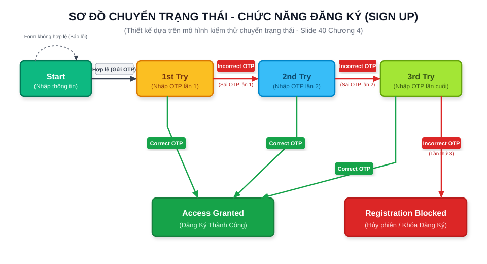
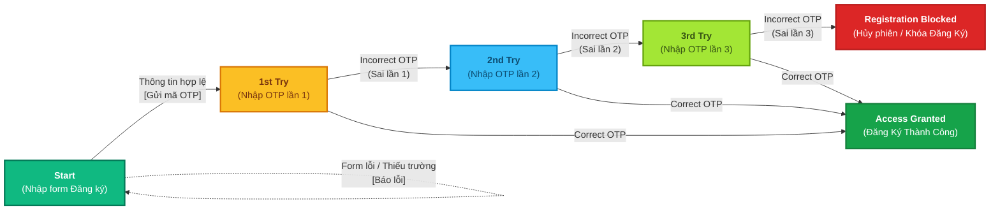

# SƠ ĐỒ CHUYỂN ĐỔI TRẠNG THÁI (STATE TRANSITION DIAGRAMS)

Tài liệu tổng hợp các sơ đồ chuyển đổi trạng thái và kịch bản kiểm thử tương ứng cho hệ thống NexusChat (Môn: Kiểm thử phần mềm - Kỹ thuật kiểm thử hộp đen, dựa trên Slide 40 Chương IV).

---

## 1. Chức năng Đăng nhập (Sign In)

---

## 2. Chức năng Đăng ký (Sign Up)

> **Cơ sở thiết kế:** Áp dụng mô hình kiểm thử chuyển đổi trạng thái theo **Slide 40 - Chương IV** (Mô hình giới hạn 3 lần thử xác thực OTP / 3-Try Limit Pattern).

### 2.1. Hình ảnh sơ đồ trạng thái Đăng ký (Vector SVG)

---

### 2.2. Sơ đồ Mermaid (Tự động render trực tiếp trên GitHub)

---

### 2.3. Bảng thiết kế Ca kiểm thử chuyển trạng thái (State Transition Test Cases)

| Test Case ID | Trạng thái ban đầu | Sự kiện / Dữ liệu vào | Kết quả mong đợi (Expected Output) | Trạng thái kết thúc | Loại Test |
|:---:|:---:|:---|:---|:---:|:---:|
| **TC_ST_01** | `Start` | Để trống Họ tên/Email/Password | Báo lỗi *"Bạn cần nhập đủ thông tin!"*, ở lại form | `Start` | Negative |
| **TC_ST_02** | `Start` | Điền thông tin hợp lệ và bấm Đăng ký | Gửi mã OTP 6 số qua email, chuyển sang form OTP | `1st Try` | Positive |
| **TC_ST_03** | `1st Try` | Nhập đúng mã OTP ngay lần 1 | Báo *"Đăng ký thành công"*, tạo User, chuyển sang `/signin` | `Access Granted` | Positive |
| **TC_ST_04** | `1st Try` | Nhập sai OTP lần 1 (VD: `000000`) | Báo *"Mã OTP không chính xác, còn 2 lần thử"* | `2nd Try` | Negative |
| **TC_ST_05** | `2nd Try` | Nhập đúng OTP ở lần thử thứ 2 | Báo *"Đăng ký thành công"*, tạo User, chuyển sang `/signin` | `Access Granted` | Positive |
| **TC_ST_06** | `2nd Try` | Nhập sai OTP lần 2 (VD: `111111`) | Báo *"Mã OTP không chính xác, còn 1 lần thử"* | `3rd Try` | Negative |
| **TC_ST_07** | `3rd Try` | Nhập đúng OTP ở lần thử thứ 3 | Báo *"Đăng ký thành công"*, hoàn tất kích hoạt | `Access Granted` | Positive |
| **TC_ST_08** | `3rd Try` | Nhập sai OTP lần 3 (VD: `222222`) | Báo *"Đã vượt quá số lần cho phép. Phiên đăng ký bị hủy!"* | `Registration Blocked` | Negative |
