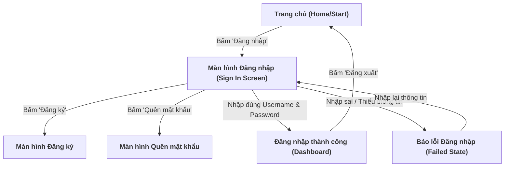

# Thiết kế test case Black-box cho chức năng Đăng nhập (Sign In)

**Họ và tên sinh viên:** Giang Tỷ  
**MSSV:** 091205001046  
**Chức năng:** Đăng nhập hệ thống (Authentication & Session Management - FR-AUT-03)

---

## 1. Mục tiêu

Kiểm thử chức năng xác thực danh tính người dùng khi đăng nhập vào hệ thống NexusChat dựa trên dữ liệu đầu vào và kết quả đầu ra mong đợi, không xét cấu trúc mã nguồn bên trong. Tài liệu áp dụng đầy đủ bốn kỹ thuật kiểm thử hộp đen (Black-box Testing) được giảng dạy trong **Chương IV - Các Kỹ Thuật Thiết Kế Test**:

1. **Phân hoạch lớp tương đương (Equivalence Partitioning - EP)**
2. **Phân tích giá trị biên (Boundary Value Analysis - BVA)**, bao gồm *Standard BVA* và *Robustness BVA*
3. **Kiểm thử chuyển trạng thái (State Transition Testing)** dựa trên sơ đồ luồng đăng nhập của dự án và Slide 36 - 40
4. **Bảng quyết định (Decision Table Testing)** với quy trình rút gọn bảng quyết định (Slide 41 - 46)

---

## 2. Phạm vi và giả định

Căn cứ theo tài liệu đặc tả yêu cầu phần mềm ([SRS.md](../SRS.md) - Mục 3.1 `FR-AUT-03`), mã nguồn Backend `backend/src/controllers/authController.js` (hàm `signIn`) và sơ đồ trạng thái `docs/Diagrams/dang_nhap.png`:

| Thuộc tính đầu vào | Điều kiện hợp lệ | Điều kiện không hợp lệ |
|---|---|---|
| **Tên đăng nhập (`username`)** | Là Username hợp lệ ([3, 20] ký tự) HOẶC Email hợp lệ đã đăng ký và đang tồn tại trong cơ sở dữ liệu `users` | Để trống; Chưa từng đăng ký; Chứa ký tự không được phép |
| **Mật khẩu (`password`)** | Độ dài [6, 32] ký tự; Trùng khớp chính xác với mật khẩu đã lưu (so khớp `bcrypt.compare`) | Để trống; Mật khẩu sai; Độ dài ngoài khoảng [6, 32] |
| **Trạng thái tài khoản** | Tài khoản đang hoạt động bình thường (`isBlocked: false` hoặc không bị đình chỉ) | Tài khoản bị vô hiệu hóa hoặc tạm khóa do vi phạm / bảo mật |

**Kỳ vọng phản hồi HTTP từ API `POST /api/auth/signin`:**
- **Đăng nhập thành công (`200 OK`)**: Trả về `accessToken` trong body JSON và tự động gán `refreshToken` vào Cookie (`HttpOnly`, `SameSite=Strict`).
- **Thiếu trường dữ liệu (`400 Bad Request`)**: Trả về thông báo lỗi: *"Thiếu username hoặc password."*.
- **Thông tin xác thực sai (`401 Unauthorized`)**: Trả về thông báo bảo mật chung: *"Tên đăng nhập hoặc mật khẩu không chính xác"*.
- **Tài khoản bị cấm (`403 Forbidden`)**: Trả về thông báo tài khoản bị khóa.

---

## 3. Phân hoạch lớp tương đương (Equivalence Partitioning - EP)

Kỹ thuật EP phân chia tập dữ liệu đầu vào thành các lớp tương đương hợp lệ (Valid Partitions) và không hợp lệ (Invalid Partitions). Chỉ cần chọn một giá trị đại diện cho mỗi lớp để kiểm thử, tránh dư thừa nhưng vẫn đảm bảo phát hiện lỗi.

### 3.1. Phân chia các lớp tương đương

| Điều kiện kiểm tra | Lớp tương đương hợp lệ | Lớp tương đương không hợp lệ |
|---|---|---|
| **Định danh `username`** | - Username tồn tại trong DB<br>- Email tồn tại trong DB | - Để trống<br>- Username/Email không tồn tại trong DB<br>- Username < 3 ký tự<br>- Username > 20 ký tự (không phải email) |
| **Mật khẩu `password`** | - Mật khẩu chính xác khớp với hash trong DB | - Để trống<br>- Mật khẩu sai<br>- Mật khẩu < 6 ký tự<br>- Mật khẩu > 32 ký tự |
| **Trạng thái người dùng** | - Tài khoản Active (bình thường) | - Tài khoản bị khóa (Blocked) |

### 3.2. Bảng kịch bản kiểm thử tương đương (EP Test Cases)

*Giả định đã có sẵn tài khoản mẫu trong cơ sở dữ liệu:*
- User A: `username`: `giangty01`, `email`: `giangty@example.com`, `password`: `NexusChat@2026`, Trạng thái: Active.
- User B: `username`: `lockeduser`, `email`: `locked@example.com`, `password`: `Locked@123`, Trạng thái: Blocked.

| ID | Dữ liệu kiểm thử | Kết quả mong đợi | Loại Test |
|---|---|---|:---:|
| **EP-01** | `username`: "giangty01"<br>`password`: "NexusChat@2026" | Đăng nhập thành công, HTTP `200 OK`, trả về `accessToken` | Positive |
| **EP-02** | `username`: "giangty@example.com" (đăng nhập bằng Email)<br>`password`: "NexusChat@2026" | Đăng nhập thành công, HTTP `200 OK`, trả về `accessToken` | Positive |
| **EP-03** | `username`: ""` (để trống)<br>`password`: "NexusChat@2026" | Bị từ chối: HTTP `400` ("Thiếu username hoặc password.") | Negative |
| **EP-04** | `username`: "giangty01"<br>`password`: ""` (để trống) | Bị từ chối: HTTP `400` ("Thiếu username hoặc password.") | Negative |
| **EP-05** | Cả `username` và `password` đều để trống | Bị từ chối: HTTP `400` ("Thiếu username hoặc password.") | Negative |
| **EP-06** | `username`: "usernotfound999" (chưa đăng ký)<br>`password`: "NexusChat@2026" | Bị từ chối: HTTP `401` ("Tên đăng nhập hoặc mật khẩu không chính xác") | Negative |
| **EP-07** | `username`: "giangty01"<br>`password`: "WrongPassword@123" | Bị từ chối: HTTP `401` ("Tên đăng nhập hoặc mật khẩu không chính xác") | Negative |
| **EP-08** | `username`: "gt" (2 ký tự, ngắn hơn quy định)<br>`password`: "NexusChat@2026" | Bị từ chối: HTTP `401` ("Tên đăng nhập hoặc mật khẩu không chính xác") | Negative |
| **EP-09** | `username`: "giangty01"<br>`password`: "12345" (5 ký tự, < 6) | Bị từ chối: HTTP `401` ("Tên đăng nhập hoặc mật khẩu không chính xác") | Negative |
| **EP-10** | `username`: "lockeduser"<br>`password`: "Locked@123" | Bị từ chối: HTTP `403` hoặc thông báo tài khoản bị khóa | Negative |

---

## 4. Phân tích giá trị biên (Boundary Value Analysis - BVA)

Lỗi logic thường tập trung tại hoặc sát ngưỡng giới hạn của dữ liệu. Hai biến số định lượng được phân tích biên độc lập là:
- $X_1$: Độ dài `username` có miền giá trị hợp lệ $[3, 20]$ ký tự.
- $X_2$: Độ dài `password` có miền giá trị hợp lệ $[6, 32]$ ký tự.

Giữ các giá trị danh định (Nominal): `username` chuẩn dài 10 ký tự, `password` chuẩn dài 12 ký tự.

### 4.1. Standard BVA - Kiểm thử các biên hợp lệ ($4n + 1$)

Với $n = 2$ biến, số ca kiểm thử Standard BVA là:
$$4n + 1 = 4 \times 2 + 1 = 9 \text{ test cases}$$

Mỗi biến được thử tại các giá trị: **Min**, **Min+**, **Max-**, **Max**; test case còn lại thử tại **Nom** của cả hai biến.  
*(Các tài khoản ứng với độ dài biên này đã được tạo sẵn trong hệ thống với mật khẩu đúng).*

| ID | Biến được kiểm tra | Độ dài | Dữ liệu kiểm thử | Kết quả mong đợi |
|---|---|---:|---|---|
| **BVA-01** | `username` & `password` (Nom) | 10 & 12 | `username`: "bvauser001" (10)<br>`password`: "Aa1234567890" (12) | **Thành công - Giá trị chuẩn (Nom)**; HTTP `200 OK` |
| **BVA-02** | `username` (Min) | 3 | `username`: "bva" (3)<br>`password`: "Aa1234567890" (12) | **Thành công (Min)**; HTTP `200 OK` |
| **BVA-03** | `username` (Min+) | 4 | `username`: "bvaa" (4)<br>`password`: "Aa1234567890" (12) | **Thành công (Min+)**; HTTP `200 OK` |
| **BVA-04** | `username` (Max-) | 19 | `username`: "bvauuuuuuuuuuuuuuuu" (19)<br>`password`: "Aa1234567890" (12) | **Thành công (Max-)**; HTTP `200 OK` |
| **BVA-05** | `username` (Max) | 20 | `username`: "bvauuuuuuuuuuuuuuuuu" (20)<br>`password`: "Aa1234567890" (12) | **Thành công (Max)**; HTTP `200 OK` |
| **BVA-06** | `password` (Min) | 6 | `username`: "bvauser001" (10)<br>`password`: "Aa1234" (6) | **Thành công (Min)**; HTTP `200 OK` |
| **BVA-07** | `password` (Min+) | 7 | `username`: "bvauser001" (10)<br>`password`: "Aa12345" (7) | **Thành công (Min+)**; HTTP `200 OK` |
| **BVA-08** | `password` (Max-) | 31 | `username`: "bvauser001" (10)<br>`password`: "Aa" + 29 số '1' (31) | **Thành công (Max-)**; HTTP `200 OK` |
| **BVA-09** | `password` (Max) | 32 | `username`: "bvauser001" (10)<br>`password`: "Aa" + 30 số '1' (32) | **Thành công (Max)**; HTTP `200 OK` |

### 4.2. Robustness BVA - Kiểm thử các giá trị ngoài biên ($6n + 1$)

Kiểm tra khả năng bắt lỗi và xử lý ngoại lệ của hệ thống đối với các giá trị vi phạm biên: **Min-** ($Min - 1$) và **Max+** ($Max + 1$).

| ID | Biến được kiểm tra | Độ dài | Dữ liệu kiểm thử | Kết quả mong đợi |
|---|---|---:|---|---|
| **RBVA-01** | `username` (Min-) | 2 | `username`: "gt" (2) | Bị từ chối: HTTP `401` (Không tồn tại trong DB) |
| **RBVA-02** | `username` (Max+) | 21 | `username`: "bvauuuuuuuuuuuuuuuuuu" (21) | Bị từ chối: HTTP `401` (Không tồn tại trong DB) |
| **RBVA-03** | `password` (Min-) | 5 | `password`: "Aa123" (5) | Bị từ chối: HTTP `401` (Không khớp mật khẩu hash) |
| **RBVA-04** | `password` (Max+) | 33 | `password`: "Aa" + 31 số '1' (33) | Bị từ chối: HTTP `401` (Không khớp mật khẩu hash) |

---

## 5. Kiểm thử chuyển trạng thái (State Transition Testing)

Dựa trên sơ đồ luồng `dang_nhap.png` tại `docs/Diagrams/` kết hợp mô hình kiểm thử chuyển trạng thái (Slide 36 - 40 Chương IV), hệ thống quản lý trạng thái đăng nhập như sau:



### Bảng kịch bản chuyển đổi trạng thái (State Transition Test Cases)

| ID | Trạng thái ban đầu | Sự kiện / Dữ liệu đầu vào | Kết quả mong đợi (Output) | Trạng thái tiếp theo | Loại Test |
|---|---|---|---|---|:---:|
| **ST-01** | `Home/Start` | Nhấn nút "Đăng nhập" trên thanh điều hướng | Chuyển đến form đăng nhập | `Màn hình Đăng nhập` | Positive |
| **ST-02** | `Màn hình Đăng nhập` | Nhấn liên kết "Đăng ký tài khoản" | Chuyển hướng sang trang đăng ký `/signup` | `Màn hình Đăng ký` | Positive |
| **ST-03** | `Màn hình Đăng nhập` | Nhấn liên kết "Quên mật khẩu?" | Chuyển hướng sang trang khôi phục `/forgot-password` | `Màn hình Quên MK` | Positive |
| **ST-04** | `Màn hình Đăng nhập` | Nhập đúng Username và Mật khẩu | Đăng nhập thành công, cấp Token, chuyển trang `/` | `Dashboard` | Positive |
| **ST-05** | `Màn hình Đăng nhập` | Để trống trường Username hoặc Password | Hiển thị cảnh báo lỗi thiếu thông tin | `Báo lỗi Đăng nhập` | Negative |
| **ST-06** | `Màn hình Đăng nhập` | Nhập sai Mật khẩu | Hiển thị thông báo *"Tên đăng nhập hoặc mật khẩu không chính xác"* | `Báo lỗi Đăng nhập` | Negative |
| **ST-07** | `Báo lỗi Đăng nhập` | Xóa dữ liệu cũ và nhập thông tin mới | Cho phép nhập lại form đăng nhập | `Màn hình Đăng nhập` | Positive |
| **ST-08** | `Dashboard` | Người dùng nhấn nút "Đăng xuất" | Thu hồi cookie refresh token, xóa session, trở về Home | `Home/Start` | Positive |

---

## 6. Bảng quyết định (Decision Table Testing)

Phương pháp Bảng quyết định (Slide 41 - 46 Chương IV) được áp dụng để bao phủ toàn bộ sự phối hợp giữa các điều kiện logic đầu vào của chức năng đăng nhập. Ký hiệu `—` thể hiện điều kiện không ảnh hưởng đến kết quả khi điều kiện trước đó đã vi phạm (kỹ thuật rút gọn bảng).

| Điều kiện (Conditions) / Kết quả (Actions) | R1 (Thành công) | R2 (Thiếu trường) | R3 (Sai User) | R4 (Sai Pass) | R5 (Khóa TK) |
|---|:---:|:---:|:---:|:---:|:---:|
| **C1: Đã nhập đầy đủ Username & Password** | Có | **Không** | Có | Có | Có |
| **C2: Username/Email tồn tại trong hệ thống** | Có | — | **Không** | Có | Có |
| **C3: Mật khẩu chính xác (khớp bcrypt hash)** | Có | — | — | **Không** | Có |
| **C4: Tài khoản đang hoạt động (không bị khóa)** | Có | — | — | — | **Không** |
| **A1: Đăng nhập thành công, cấp JWT Token (HTTP 200)** | **X** | — | — | — | — |
| **A2: Báo lỗi thiếu thông tin form (HTTP 400)** | — | **X** | — | — | — |
| **A3: Báo lỗi "Tài khoản hoặc MK không chính xác" (HTTP 401)** | — | — | **X** | **X** | — |
| **A4: Báo lỗi tài khoản bị khóa/đình chỉ (HTTP 403)** | — | — | — | — | **X** |

---

## 7. Hướng dẫn chạy kiểm thử bằng Postman

1. **Khởi động hệ thống:**
   - Đảm bảo Backend Node.js đang chạy tại `http://localhost:5001` và MongoDB kết nối thành công.
2. **Cấu hình Request trong Postman:**
   - **Method:** `POST`
   - **URL:** `{{baseUrl}}/api/auth/signin`
   - **Headers:** `Content-Type: application/json`
   - **Body (raw JSON):**
     ```json
     {
       "username": "{{testUsername}}",
       "password": "{{testPassword}}"
     }
     ```
3. **Thực thi kiểm thử biên và phân hoạch:**
   - Tạo bộ dữ liệu Data File (JSON/CSV) chứa các ca kiểm thử từ `BVA-01` đến `BVA-09` và `EP-01` đến `EP-10`.
   - Mở **Collection Runner**, nạp file dữ liệu và chạy.
4. **Viết Test Script xác minh (Assertion Script):**
   ```javascript
   pm.test("Kiểm tra mã trạng thái HTTP", function () {
       if (pm.variables.get("expectedStatus") === 200) {
           pm.response.to.have.status(200);
           pm.expect(pm.response.json().accessToken).to.exist;
       } else if (pm.variables.get("expectedStatus") === 400) {
           pm.response.to.have.status(400);
       } else if (pm.variables.get("expectedStatus") === 401) {
           pm.response.to.have.status(401);
       }
   });
   ```

---

## 8. Giải thích ngắn gọn lý thuyết áp dụng (Chương IV)

- **Phân hoạch lớp tương đương (EP):** Phân định ranh giới giữa tập dữ liệu hợp lệ (tài khoản đúng, đang active) và không hợp lệ (sai mật khẩu, tài khoản không tồn tại, để trống) nhằm giảm số lần thử lặp lại.
- **Phân tích giá trị biên (BVA):** Đảm bảo backend xử lý chính xác độ dài username ($[3, 20]$) và password ($[6, 32]$) tại các giá trị nhạy cảm `Min`, `Min+`, `Max-`, `Max` và các trường hợp lỗi tràn biên `Min-`, `Max+`.
- **Chuyển đổi trạng thái (State Transition):** Mô hình hóa chu trình điều hướng giữa các màn hình và trạng thái của người dùng từ khi chưa đăng nhập, đăng nhập thất bại đến khi đăng nhập thành công.
- **Bảng quyết định (Decision Table):** Đảm bảo tính chặt chẽ của logic xác thực nhiều bước (Kiểm tra rỗng $\to$ Kiểm tra User $\to$ So khớp Pass $\to$ Kiểm tra khóa).

---

## 9. Kết luận

Tài liệu thiết kế kiểm thử Black-box cho chức năng **Đăng nhập (Sign In)** tuân thủ chính xác phương pháp luận của Chương IV. Toàn bộ kịch bản từ phân hoạch tương đương, phân tích biên, chuyển đổi trạng thái đến bảng quyết định đều bám sát đặc tả kỹ thuật và mã nguồn API thực tế của hệ thống NexusChat, đảm bảo độ bao phủ kiểm thử cao và tính sẵn sàng khi thực thi.

