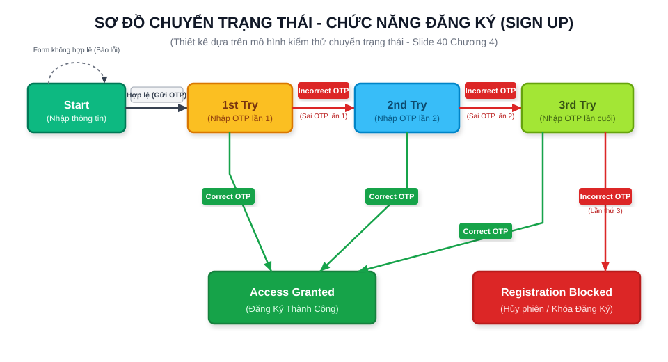
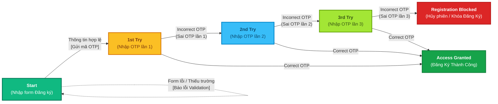
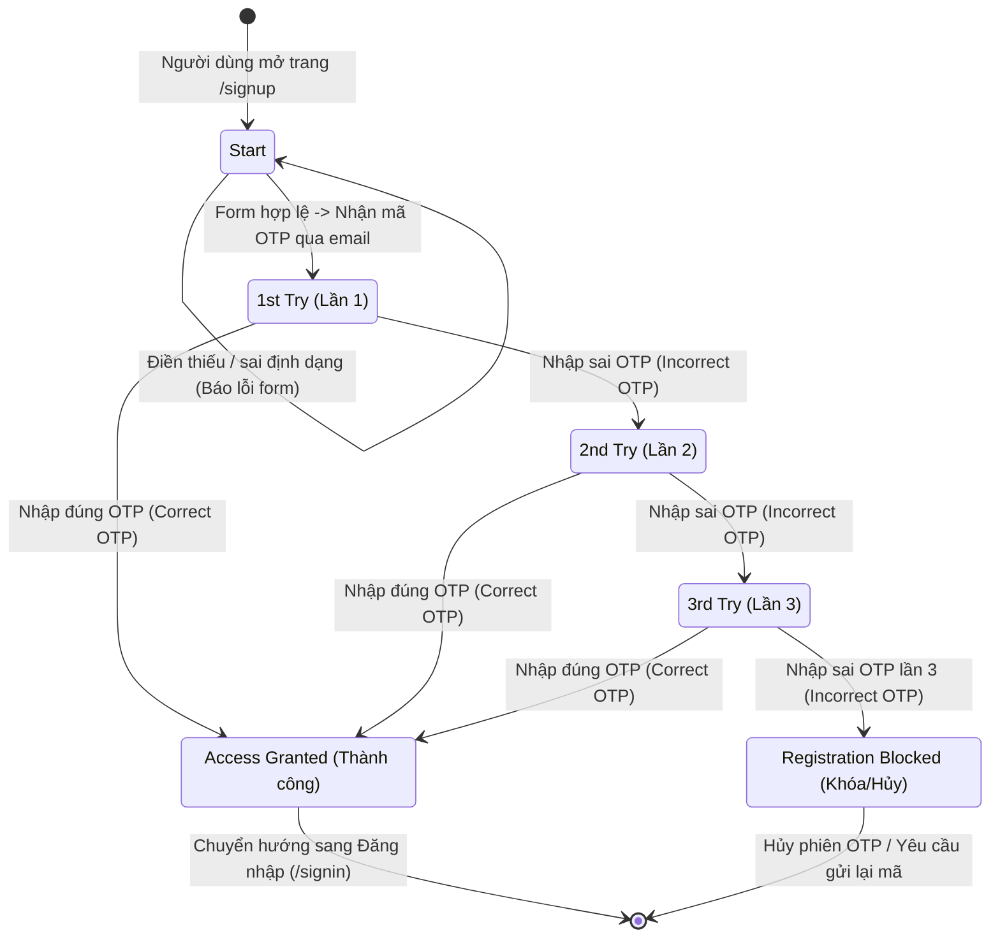

# KIỂM THỬ CHUYỂN TRẠNG THÁI (STATE TRANSITION TESTING)
## Chức năng: Đăng Ký Tài Khoản (User Registration / Authentication)
> **Môn học:** Kiểm thử phần mềm (Software Testing) — Chương IV: Các kỹ thuật thiết kế test  
> **Cơ sở tham chiếu:** Dựa trên mô hình chuyển trạng thái tại **Slide 40 - Chương IV**  
> **Dự án kiểm thử:** Hệ thống tin nhắn NexusChat  

---

## 1. Cơ sở lý thuyết và Mô hình hóa (Dựa theo Slide 40 Chương 4)

Trong **Slide 40 Chương IV**, mô hình kiểm thử chuyển trạng thái được áp dụng cho quy trình xác thực/nhập mã với giới hạn số lần thử (Retry Limit Pattern):
- Quá trình bắt đầu từ trạng thái ban đầu (`Start`).
- Người dùng có tối đa **3 lần thử** (`1st Try`, `2nd Try`, `3rd Try`).
- Tại bất kỳ lần thử nào (lần 1, 2 hoặc 3), nếu cung cấp mã xác thực chính xác (`Correct`), hệ thống chuyển sang trạng thái thành công (`Access Granted`).
- Nếu nhập sai liên tiếp qua 3 lần (`Incorrect`), hệ thống chuyển sang trạng thái khóa/hủy phiên (`Account Blocked / Registration Blocked`).

### Áp dụng vào Chức năng Đăng ký tài khoản (NexusChat):
1. **Trạng thái bắt đầu (`Start` / Điền thông tin):**
   - Người dùng truy cập trang Đăng ký `/signup` và nhập: Họ, tên, Username, Email, Mật khẩu, Nhập lại mật khẩu.
   - Nếu thông tin vi phạm validation (bỏ trống, mật khẩu không khớp, email/username đã tồn tại): Giữ nguyên tại màn hình Đăng ký kèm thông báo lỗi.
   - Nếu thông tin hợp lệ: Hệ thống tạo và gửi mã xác thực OTP 6 số qua email của người dùng, chuyển sang trạng thái chờ xác thực **1st Try**.
2. **Trạng thái xác thực OTP 3 lần (`1st Try` $\rightarrow$ `2nd Try` $\rightarrow$ `3rd Try`):**
   - **1st Try (Nhập OTP lần 1):**
     - Nhập đúng mã OTP $\rightarrow$ Chuyển sang **Access Granted** (Đăng ký thành công).
     - Nhập sai mã OTP $\rightarrow$ Hệ thống cảnh báo và chuyển sang **2nd Try**.
   - **2nd Try (Nhập OTP lần 2):**
     - Nhập đúng mã OTP $\rightarrow$ Chuyển sang **Access Granted** (Đăng ký thành công).
     - Nhập sai mã OTP $\rightarrow$ Hệ thống cảnh báo và chuyển sang **3rd Try**.
   - **3rd Try (Nhập OTP lần 3 - Lần cuối):**
     - Nhập đúng mã OTP $\rightarrow$ Chuyển sang **Access Granted** (Đăng ký thành công).
     - Nhập sai mã OTP $\rightarrow$ Chuyển sang **Registration Blocked** (Khóa/Hủy phiên đăng ký, OTP bị vô hiệu hóa).
3. **Các trạng thái kết thúc (Terminal States):**
   - **Access Granted (Đăng ký thành công):** Tài khoản được kích hoạt trong cơ sở dữ liệu, hiển thị thông báo thành công và chuyển hướng về trang Đăng nhập `/signin`.
   - **Registration Blocked (Khóa / Hủy phiên đăng ký):** Hủy mã OTP hiện tại, yêu cầu người dùng quay lại tạo yêu cầu mới hoặc chờ hết thời gian khóa.

---

## 2. Sơ đồ chuyển trạng thái (Hiển thị trực tiếp trên GitHub)

*(GitHub hỗ trợ hiển thị đồ họa trực tiếp qua cả khối mã **Mermaid** và định dạng ảnh vector **SVG** đính kèm dưới đây).*

### 2.1. Hình ảnh đồ họa Vector (Chuẩn giao diện Slide 40)

---

### 2.2. Sơ đồ Mermaid (Tự động render đồ họa trên GitHub Markdown)

---

### 2.3. Sơ đồ trạng thái UML chuẩn (State Diagram)

---

## 3. Bảng phân tích trạng thái và sự kiện (State Transition Matrix)

| Trạng thái hiện tại (Current State) | Sự kiện / Dữ liệu vào (Event / Input) | Hành động của hệ thống (Action) | Trạng thái tiếp theo (Next State) |
|:---|:---|:---|:---|
| **Start** | Nhập form không hợp lệ (trống, pass yếu, username trùng) | Báo lỗi tại trường vi phạm | **Start** |
| **Start** | Nhập form hợp lệ và bấm Đăng ký | Gửi mã OTP 6 số đến email | **1st Try** |
| **1st Try** | Nhập đúng mã OTP | Tạo tài khoản, lưu DB | **Access Granted** |
| **1st Try** | Nhập sai mã OTP (lần 1) | Báo lỗi OTP sai (còn 2 lần thử) | **2nd Try** |
| **2nd Try** | Nhập đúng mã OTP | Tạo tài khoản, lưu DB | **Access Granted** |
| **2nd Try** | Nhập sai mã OTP (lần 2) | Báo lỗi OTP sai (còn 1 lần thử) | **3rd Try** |
| **3rd Try** | Nhập đúng mã OTP | Tạo tài khoản, lưu DB | **Access Granted** |
| **3rd Try** | Nhập sai mã OTP (lần 3) | Khóa đăng ký, vô hiệu hóa OTP | **Registration Blocked** |

---

## 4. Thiết kế ca kiểm thử chuyển trạng thái (State Transition Test Cases)

Theo phương pháp kiểm thử chuyển trạng thái (State Transition Testing - tương ứng Slide 37, 39 và 40):

| Test Case ID | Trạng thái ban đầu (Start State) | Sự kiện / Dữ liệu đầu vào (Event / Input) | Kết quả mong đợi (Expected Output) | Trạng thái kết thúc (End State) | Phân loại |
|:---:|:---:|:---|:---|:---:|:---:|
| **TC_ST_01** | `Start` | Nhập thiếu thông tin form (để trống Họ tên / Email) | Hiển thị thông báo *"Bạn cần nhập đủ thông tin!"*, không gửi OTP | `Start` | Negative |
| **TC_ST_02** | `Start` | Nhập đầy đủ thông tin hợp lệ | Hệ thống gửi OTP đến email, chuyển sang bước nhập OTP | `1st Try` | Positive |
| **TC_ST_03** | `1st Try` | Nhập đúng mã OTP 6 số ngay lần 1 | Thông báo *"Đăng ký thành công"*, tài khoản được lưu vào MongoDB, chuyển hướng sang `/signin` | `Access Granted` | Positive |
| **TC_ST_04** | `1st Try` | Nhập sai mã OTP lần 1 (VD: `000000`) | Thông báo *"Mã OTP không chính xác, bạn còn 2 lần thử"* | `2nd Try` | Negative |
| **TC_ST_05** | `2nd Try` | Nhập đúng mã OTP ở lần thử thứ 2 | Thông báo *"Đăng ký thành công"*, tài khoản được lưu vào MongoDB, chuyển hướng sang `/signin` | `Access Granted` | Positive |
| **TC_ST_06** | `2nd Try` | Nhập sai mã OTP lần 2 (VD: `111111`) | Thông báo *"Mã OTP không chính xác, bạn còn 1 lần thử"* | `3rd Try` | Negative |
| **TC_ST_07** | `3rd Try` | Nhập đúng mã OTP ở lần thử thứ 3 | Thông báo *"Đăng ký thành công"*, hoàn tất kích hoạt tài khoản | `Access Granted` | Positive |
| **TC_ST_08** | `3rd Try` | Nhập sai mã OTP lần 3 (VD: `222222`) | Thông báo *"Đã vượt quá số lần nhập cho phép. Phiên đăng ký bị hủy!"*, vô hiệu hóa mã OTP | `Registration Blocked` | Negative |

---

## 5. Đánh giá độ bao phủ kiểm thử (Coverage Analysis)

- **100% State Coverage (Độ bao phủ trạng thái):** Tất cả 6 trạng thái (`Start`, `1st Try`, `2nd Try`, `3rd Try`, `Access Granted`, `Registration Blocked`) đều được thực thi và kiểm chứng ít nhất 1 lần.
- **100% Transition Coverage (Độ bao phủ chuyển tiếp):** Toàn bộ 8 đường chuyển tiếp giữa các trạng thái đều có kịch bản test tương ứng (từ TC_ST_01 đến TC_ST_08).

