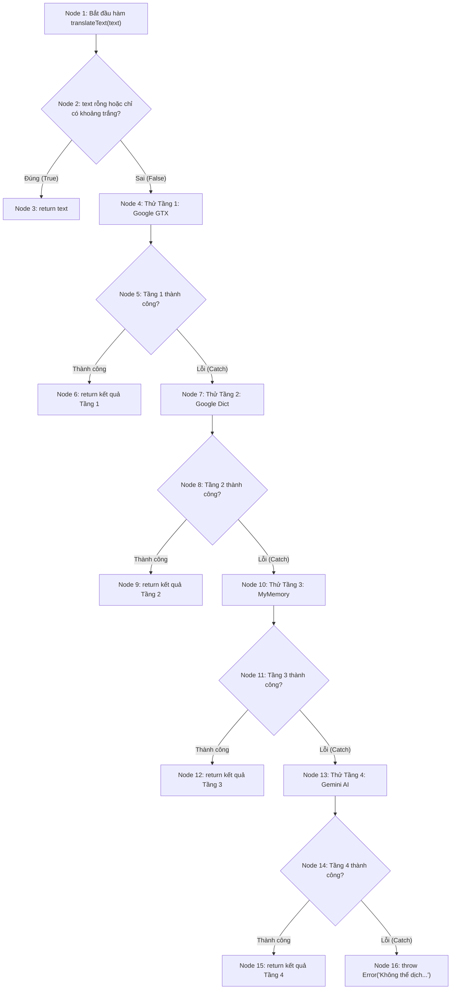

# QUY TRÌNH THỰC HIỆN KIỂM THỬ HỘP TRẮNG (WHITE-BOX TESTING)
## Dành cho các thành viên nhóm NexusChat

---

## 1. Tổng quan quy trình (6 bước)

```
[Bước 1: Đọc hiểu mã nguồn]
            ↓
[Bước 2: Vẽ đồ thị dòng điều khiển (CFG)]
            ↓
[Bước 3: Tính độ phức tạp Cyclomatic V(G)]
            ↓
[Bước 4: Thiết kế ma trận Test Cases độc lập]
            ↓
[Bước 5: Viết code kiểm thử Jest (Dựa trên Starter Template)]
            ↓
[Bước 6: Chạy test & Đo lường Coverage (Mục tiêu: Statement ≥ 90%, Branch ≥ 80%)]
```

---

## 2. Chi tiết từng bước thực hiện

### Bước 1: Đọc hiểu mã nguồn hàm được phân công
- Mở file mã nguồn tương ứng trong thư mục `backend/src/`.
- Xác định rõ:
  - Đầu vào (`req.body`, `req.params`, `req.query`, `req.user`).
  - Các câu lệnh điều kiện (Decision Points): `if`, `else if`, `switch`, `while`, `for`, `try/catch`, toán tử ba ngôi `? :`.
  - Đầu ra mong đợi: `res.status(...).json(...)`, `return`, `throw new Error(...)`.

---

### Bước 2: Vẽ đồ thị dòng điều khiển (CFG — Control Flow Graph)
- **Quy tắc đánh số Node (Nút)**:
  - Node bắt đầu: Điểm vào hàm.
  - Mỗi câu lệnh rẽ nhánh (`if`, `catch`) là một Predicate Node (Nút quyết định).
  - Node xử lý: Các khối lệnh thực thi tuần tự.
  - Node kết thúc: Các lệnh `return`, `throw` hoặc kết thúc hàm.
- **Có thể vẽ bằng Mermaid Markdown trực tiếp trong tài liệu báo cáo**:

*Ví dụ minh họa hàm `translateText` (TV4)*:


---

### Bước 3: Tính độ phức tạp Cyclomatic (Cyclomatic Complexity - $V(G)$)

Áp dụng một trong các công thức chuẩn sau:

1. **Công thức theo Cung và Nút**:
   $$V(G) = E - N + 2P$$
   - $E$ (Edges): Số cung (mũi tên nối giữa các nút).
   - $N$ (Nodes): Tổng số nút trong đồ thị.
   - $P$ (Connected Components): Số thành phần liên thông (thường $P = 1$).

2. **Công thức theo Điểm quyết định (Predicate Nodes)**:
   $$V(G) = P_{redicate} + 1$$
   - $P_{redicate}$: Số câu lệnh rẽ nhánh hai chiều (`if`, toán tử logic `&&`, `||`).

3. **Công thức theo Miền kín (Regions)**:
   $$V(G) = R$$
   - $R$: Số miền kín được bao quanh bởi các cung cộng với 1 miền mở vô tận bên ngoài.

**Ý nghĩa**: Giá trị $V(G)$ chính là **số lượng test case tối thiểu** cần có để đạt được **100% Path Coverage (Độ bao phủ đường dẫn cơ sở)**.

---

### Bước 4: Thiết kế ma trận Test Cases độc lập (Basis Path Testing)
- Liệt kê tập hợp các đường dẫn độc lập (Basis Paths):
  - Đường dẫn 1 (Path 1): $N_1 \to N_2 \to N_3$
  - Đường dẫn 2 (Path 2): $N_1 \to N_2 \to N_4 \to N_5 \to N_6$
  - Đường dẫn 3 (Path 3): $N_1 \to N_2 \to N_4 \to N_5 \to N_7 \to N_8 \to N_9$
  - ...
- Với mỗi đường dẫn, xác định bộ dữ liệu kiểm thử cụ thể (Input) và kết quả mong muốn (Expected Output).

---

### Bước 5: Viết code kiểm thử Jest từ Starter Template
Hệ thống đã chuẩn bị sẵn file starter template trong thư mục `tests/whitebox/<module>/`. Mỗi thành viên thực hiện:
1. Mở file test của mình.
2. Tìm các dòng có `it.todo("...")`.
3. Thay `it.todo` bằng hàm kiểm thử thực tế `it("Mã TC: Mô tả", async () => { ... })`.
4. Thiết lập mock dữ liệu tương ứng:
   ```javascript
   // Ví dụ mock DB trả về null
   mockUserFindOne.mockResolvedValueOnce(null);

   // Ví dụ mock DB ném lỗi Exception
   mockUserFindOne.mockRejectedValueOnce(new Error("DB connection timeout"));
   ```
5. Gọi hàm cần test và kiểm tra kết quả mong đợi với `expect(...)`:
   ```javascript
   await myController(req, res);
   expect(res.status).toHaveBeenCalledWith(400);
   expect(res.json).toHaveBeenCalledWith(expect.objectContaining({ ... }));
   ```

---

### Bước 6: Chạy kiểm thử & Xem báo cáo độ bao phủ (Coverage)

Mở terminal tại thư mục `backend`:
```bash
cd backend

# Chạy kiểm thử kiểm tra pass/fail:
npm run test:whitebox

# Chạy đo độ bao phủ chi tiết:
npm run test:coverage
```

- Sau khi chạy xong lệnh `npm run test:coverage`, mở file HTML sau bằng trình duyệt để xem báo cáo trực quan:
  `NexusChat_Testing/coverage/lcov-report/index.html`
- Tại đây, hệ thống sẽ tô màu:
  - **Màu xanh lá**: Code đã được test bao phủ.
  - **Màu vàng**: Nhánh điều kiện chỉ mới chạy 1 chiều (chưa đủ True/False).
  - **Màu đỏ**: Dòng code chưa từng được chạy qua trong bất kỳ bài test nào.
- Thành viên bổ sung thêm test case cho những vùng màu vàng/đỏ cho đến khi đạt:
  - **Statement Coverage $\ge 90\%$**
  - **Branch Coverage $\ge 80\%$**

