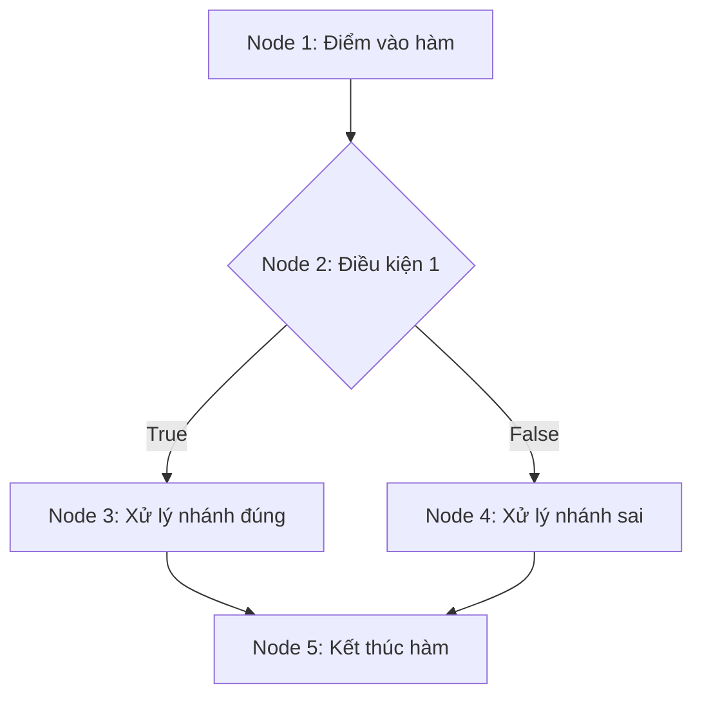

# MẪU ĐẶC TẢ TEST CASE HỘP TRẮNG (WHITE-BOX TEST CASES)
## Module: [Tên Module] — Người thực hiện: [Tên Thành Viên]

---

## 1. Thông tin chung
- **Thành viên thực hiện**: [Họ và tên - TV số...]
- **File mã nguồn phụ trách**: `backend/src/...`
- **File kiểm thử Jest tương ứng**: `tests/whitebox/...`
- **Chỉ tiêu độ bao phủ đạt được**:
  - Statement Coverage: `...%` (Mục tiêu $\ge 90\%$)
  - Branch Coverage: `...%` (Mục tiêu $\ge 80\%$)

---

## 2. Sơ đồ dòng điều khiển (CFG) cho hàm mục tiêu
- **Tên hàm**: `[Ví dụ: checkFriendship]`
- **Mã nguồn hàm**:
```javascript
// Dán đoạn mã nguồn hàm mục tiêu vào đây (đánh số dòng/node tương ứng)
```

- **Sơ đồ CFG (Vẽ bằng Mermaid)**:


---

## 3. Tính toán độ phức tạp Cyclomatic ($V(G)$)

- **Số cung ($E$)**: `[Điền số lượng cung]`
- **Số nút ($N$)**: `[Điền số lượng nút]`
- **Số nút quyết định ($P$)**: `[Điền số lượng nút điều kiện]`
- **Áp dụng công thức**:
  $$V(G) = E - N + 2 = \dots$$
  hoặc
  $$V(G) = P + 1 = \dots$$
- **Danh sách các đường dẫn độc lập (Basis Paths)**:
  - **Đường dẫn 1 (Path 1)**: $N_1 \to N_2 \to N_3 \to N_5$
  - **Đường dẫn 2 (Path 2)**: $N_1 \to N_2 \to N_4 \to N_5$
  - *(Tiếp tục liệt kê cho đủ $V(G)$ đường dẫn)*

---

## 4. Ma trận Test Cases Hộp Trắng

| STT | Mã Test Case | Tên hàm kiểm thử | Đường dẫn CFG / Nhánh kiểm tra | Dữ liệu đầu vào (Input) | Điều kiện Tiền đề (Pre-condition / Mock) | Kết quả mong đợi (Expected Output) | Kỹ thuật áp dụng | Trạng thái (Pass/Fail) |
|:---:|:---|:---|:---|:---|:---|:---|:---|:---:|
| 1 | `TC-XX-01` | `tenHam` | Path 1: $N_1 \to N_2 \dots$ | `{ param: "" }` | Mặc định | `HTTP 400`, JSON: `{ message: "..." }` | Branch Coverage | Pass |
| 2 | `TC-XX-02` | `tenHam` | Path 2: $N_1 \to \dots$ | `{ param: "valid" }` | Mock DB trả về null | `HTTP 404`, JSON: `{ message: "..." }` | Branch Coverage | Pass |
| 3 | `TC-XX-03` | `tenHam` | Path 3: $N_1 \to \dots$ | `{ param: "valid" }` | Mock DB trả về dữ liệu | `HTTP 200`, JSON: `{ data: ... }` | Path Coverage | Pass |
| 4 | `TC-XX-04` | `tenHam` | Path 4: Catch Exception | `{ param: "valid" }` | Mock DB ném lỗi Error | `HTTP 500`, JSON: `{ message: "Lỗi..." }` | Exception Path | Pass |

---

## 5. Kết quả đo độ bao phủ thực tế (Ảnh chụp hoặc Bảng thống kê)

| File mã nguồn | % Statements | % Branches | % Functions | % Lines | Đạt mục tiêu (Yes/No) |
|:---|:---:|:---:|:---:|:---:|:---:|
| `tên_file.js` | `...%` | `...%` | `...%` | `...%` | Yes |

