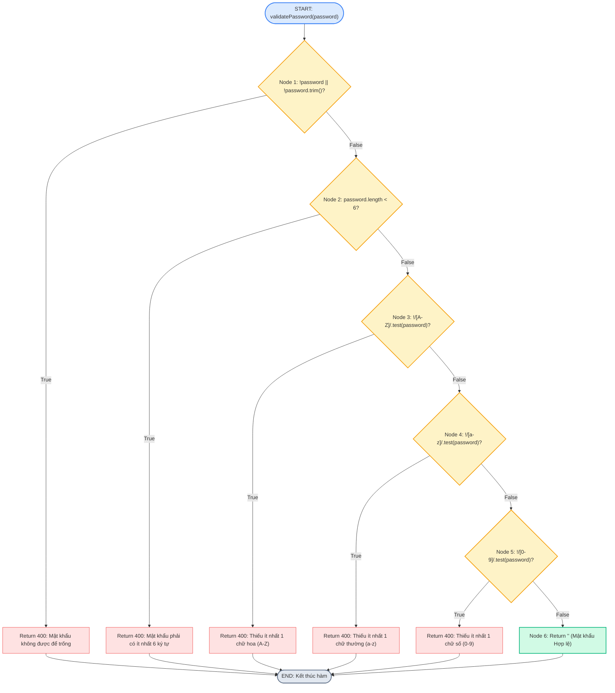
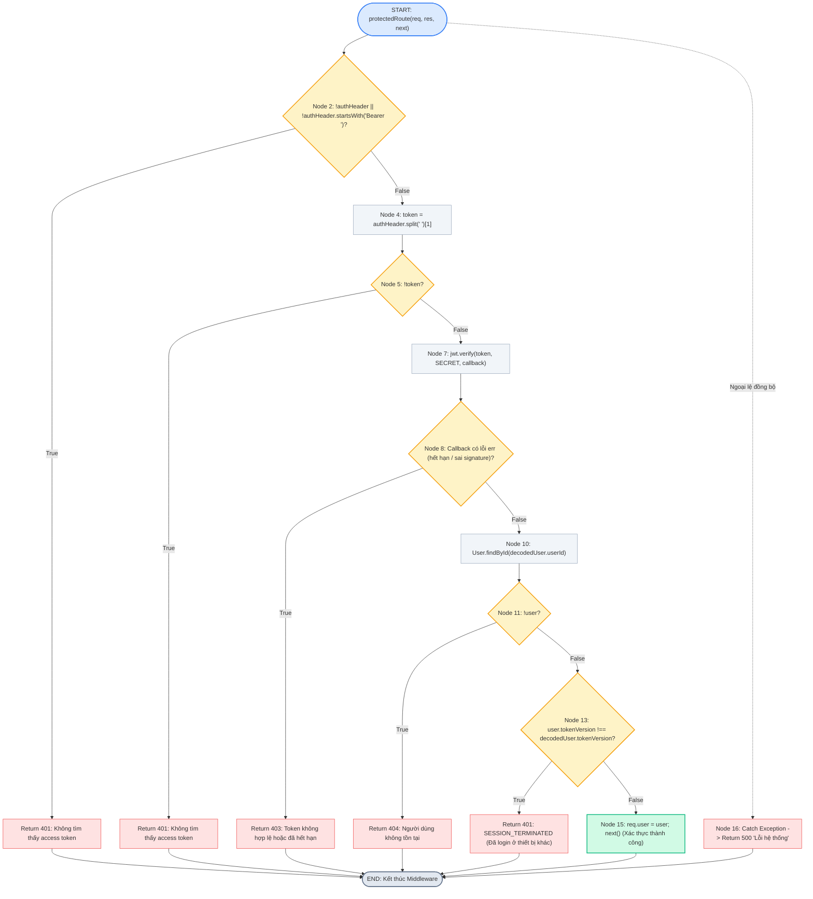
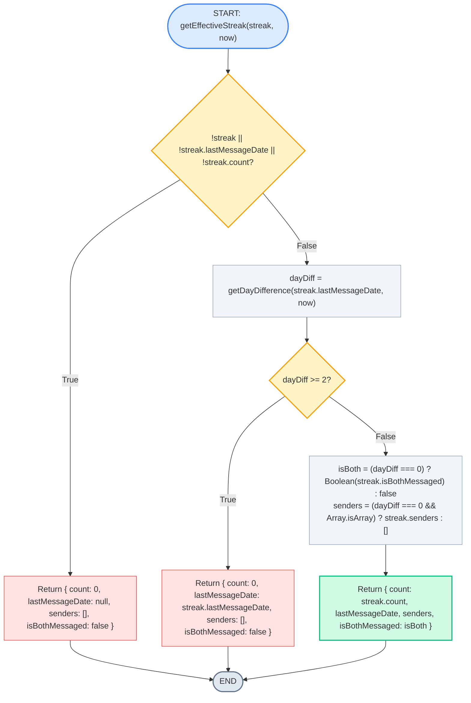
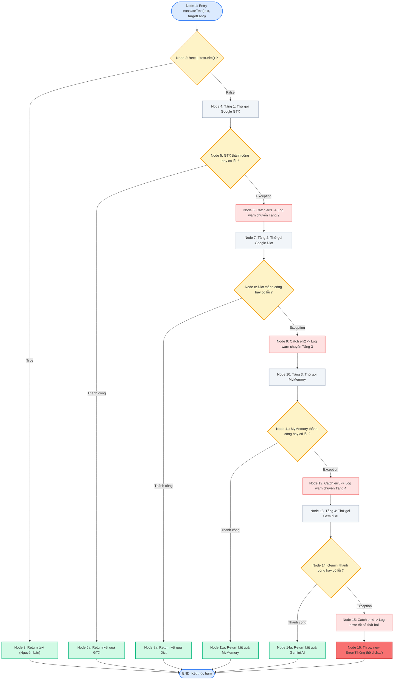
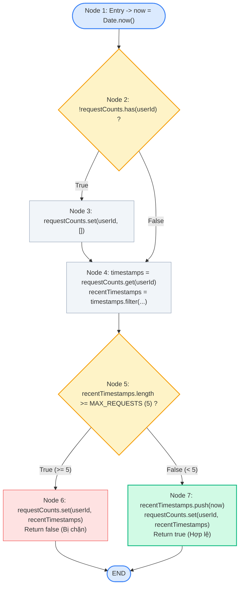

# TỔNG HỢP KIỂM THỬ HỘP TRẮNG (WHITE-BOX TESTING) — NEXUSCHAT

Thư mục này lưu trữ toàn bộ tài liệu đặc tả, sơ đồ dòng điều khiển (Control Flow Graph - CFG) và báo cáo kiểm thử hộp trắng của **Nhóm 5 thành viên**.

---

## 📋 Bảng tổng hợp tiến độ các Module

| STT | Thành viên | Module đảm nhiệm | File đặc tả Test Cases | File sơ đồ Draw.io | Sơ đồ CFG trực quan | Trạng thái |
|:---:|:---|:---|:---|:---|:---:|:---:|
| **TV1** | **Vinh Phú** | **Xác thực & Bảo mật (Auth & Security)** | [`auth_test_cases.md`](./auth_test_cases.md) | [`auth_CFG.drawio`](./auth_CFG.drawio) | [Xem sơ đồ](#1-module-xác-thực--bảo-mật-tv1--vinh-phú) | ✅ **Hoàn thành (65/65 Passed)** |
| **TV2** | **Phuong Bao** | **Tin nhắn & Streak (Messages & Streak)** | [`message_test_cases.md`](./message_test_cases.md) | [`message_CFG.drawio`](./message_CFG.drawio) | [Xem sơ đồ](#2-module-tin-nhắn--chuỗi-streak-tv2--PhuongBao) | ✅ **87/87 tests passed; coverage đạt ngưỡng** |
| **TV3** | **Trung Chiến** | **Bạn bè & Quyền riêng tư (Friendship & Privacy)** | `friend_test_cases.md` | `friend_CFG.drawio` | [Xem sơ đồ](#3-module-bạn-bè--quyền-riêng-tư-tv3--trung-chiến) | 🔄 Đang hoàn thiện |
| **TV4** | **Nhật Duy ** | **Người dùng & Dịch thuật/AI Services** | [`user_service_test_cases.md`](./user_service_test_cases.md) | [`user_service_CFG.drawio`](./user_service_CFG.drawio) | [Xem sơ đồ](#4-module-người-dùng--dịch-thuật-tv4--nhật-duy) | ✅ **Hoàn thành (42/42 Passed)** |
| **TV5** | **Giang Tỷ / Thành viên 5** | **Lập lịch & Đánh giá (Schedule & Reviews)** | `WHITEBOX_REPORT.md` | `schedule_CFG.drawio` | [Xem sơ đồ](#5-module-lập-lịch--đánh-giá-tv5--giang-tỷ) | 🔄 Đang hoàn thiện |

---

## 1. Module Xác thực & Bảo mật (TV1 — Vinh Phú)
- **Tài liệu đặc tả**: [`auth_test_cases.md`](./auth_test_cases.md) (65 Test Cases, Statement 98.26%, Branch 93.38%)
- **File Draw.io gốc**: [`auth_CFG.drawio`](./auth_CFG.drawio)

### 1.1 Sơ đồ CFG: Hàm `validatePassword()`
- **Độ phức tạp Cyclomatic**: $V(G) = E - N + 2 = 12 - 8 + 2 = \mathbf{6}$

### 1.2 Sơ đồ CFG: Middleware `protectedRoute()`
- **Độ phức tạp Cyclomatic**: $V(G) = E - N + 2 = 22 - 17 + 2 = \mathbf{7}$

---

## 2. Module Tin nhắn & Chuỗi Streak (TV2 — Phuong Bao)
- **Tài liệu đặc tả và coverage**: [`message_test_cases.md`](./message_test_cases.md)
- **File Draw.io**: [`message_CFG.drawio`](./message_CFG.drawio) (CFG cho `sendDirectMessage`, `getEffectiveStreak` và `updateConversationAfterCreateMessage`)
- **Jest tests**: [`messageController.test.js`](../../tests/whitebox/message/messageController.test.js), [`messageControllerOther.test.js`](../../tests/whitebox/message/messageControllerOther.test.js), [`messageHelper.test.js`](../../tests/whitebox/message/messageHelper.test.js)
- **Kết quả**: 87/87 tests passed. `messageController.js` đạt Statements 99.07% / Branches 90.19%; `messageHelper.js` đạt Statements 100% / Branches 93.75%. Các giới hạn còn lại (model `Game.js` thiếu và export `sendDirectMessageFile` không tồn tại) được ghi trong báo cáo.

### Sơ đồ CFG: Hàm `getEffectiveStreak()`
- **Độ phức tạp Cyclomatic source-level**: $V(G) = 23 - 17 + 2 = \mathbf{8}$ (tách short-circuit)

---

## 3. Module Bạn bè & Quyền riêng tư (TV3 — Trung Chiến)
- **Tài liệu đặc tả**: `friend_test_cases.md` *(Đang hoàn thiện)*
- **File Draw.io**: `friend_CFG.drawio` *(Đang hoàn thiện)*
- **Hàm trọng tâm**: `checkFriendship` trong `friendMiddleware.js`
- *(Thành viên 3 sẽ dán biểu đồ Mermaid và link file vẽ vào đây khi hoàn thành)*

---

## 4. Module Người dùng & Dịch thuật (TV4 — Nhật Duy)
- **Tài liệu đặc tả**: [`user_service_test_cases.md`](./user_service_test_cases.md) (42 Test Cases, Statement 100%, Branch 85.45%)
- **File Draw.io gốc**: [`user_service_CFG.drawio`](./user_service_CFG.drawio)
- **Hàm trọng tâm**: `translateText` (Multi-tier Fallback 4 tầng, $V(G) = 6$) trong `translateService.js` và `checkAIRateLimit` trong `aiRateLimiter.js`.

### 4.1 Sơ đồ CFG: Hàm `translateText()` (Dịch thuật đa tầng Fallback 4 cấp)
- **Kiến trúc**: Multi-tier Fallback: Google GTX $\to$ Google Dict $\to$ MyMemory $\to$ Gemini AI $\to$ Exception.
- **Độ phức tạp Cyclomatic**: $V(G) = P + 1 = 5 + 1 = \mathbf{6}$ (hoặc $V(G) = E - N + 2 = 20 - 16 + 2 = \mathbf{6}$).
- **6 Basis Paths**:
  1. **Path 1**: Text rỗng/khoảng trắng $\to$ Return chuỗi gốc.
  2. **Path 2**: Gọi Google GTX thành công $\to$ Return kết quả GTX.
  3. **Path 3**: GTX lỗi $\to$ Fallback Google Dict thành công $\to$ Return kết quả Dict.
  4. **Path 4**: GTX & Dict lỗi $\to$ Fallback MyMemory thành công $\to$ Return kết quả MyMemory.
  5. **Path 5**: GTX, Dict & MyMemory lỗi $\to$ Fallback Gemini 2.5 Flash thành công $\to$ Return kết quả AI.
  6. **Path 6**: Cả 4 tầng đều lỗi $\to$ Throw Error thông báo thử lại sau.

### 4.2 Sơ đồ CFG: Hàm `checkAIRateLimit()` (Giới hạn tần suất AI Sliding Window)
- **Độ phức tạp Cyclomatic**: $V(G) = P + 1 = 2 + 1 = \mathbf{3}$
- **3 Đường dẫn cơ sở**:
  - **Path 1**: User mới chưa có trong Map $\to$ Khởi tạo mảng rỗng $\to$ Lưu timestamp và cho phép (`true`).
  - **Path 2**: User đã tồn tại, số request trong 60s $< 5$ $\to$ Thêm timestamp và cho phép (`true`).
  - **Path 3**: User đã tồn tại, số request trong 60s $\ge 5$ $\to$ Chặn request (`false`).

### 4.3 Phân tích Luồng Dữ Liệu (Data Flow Analysis) cho `checkAIRateLimit`
| Biến (Variable) | Node | Hành động (Action) | Ý nghĩa (Description) | DU-Path |
|---|:---:|:---:|---|---|
| `timestamps` | 4 | **def** | Gán từ `requestCounts.get(userId)` | (Node 4 $\to$ Node 4) |
| `timestamps` | 4 | **c-use** | Sử dụng trong `.filter(...)` tính `recentTimestamps` | (Được bao phủ 100%) |
| `recentTimestamps` | 4 | **def** | Khởi tạo mảng kết quả sau khi lọc theo `WINDOW_MS` | (Node 4 $\to$ Node 5, 6, 7) |
| `recentTimestamps` | 5 | **p-use** | Kiểm tra độ dài `.length >= MAX_REQUESTS` | (Node 4 $\to$ Node 5 [True/False]) |
| `recentTimestamps` | 6 | **c-use** | Ghi đè vào `requestCounts` khi bị chặn rate limit | (Node 4 $\to$ Node 5 $\to$ Node 6) |
| `recentTimestamps` | 7 | **c-use** | Gọi `.push(now)` và ghi đè vào `requestCounts` khi hợp lệ | (Node 4 $\to$ Node 5 $\to$ Node 7) |

---

## 5. Module Lập lịch & Đánh giá (TV5 — Giang Tỷ)
- **Tài liệu đặc tả**: `WHITEBOX_REPORT.md` *(Đang hoàn thiện)*
- **File Draw.io**: `schedule_CFG.drawio` *(Đang hoàn thiện)*
- **Hàm trọng tâm**: `processScheduledMessages` trong `scheduleWorker.js` và `submitReview` trong `reviewController.js`.
- *(Thành viên 5 sẽ dán biểu đồ Mermaid và link file vẽ vào đây khi hoàn thành)*

---

## 🛠️ Hướng dẫn các thành viên cập nhật vào file README này

Khi thành viên hoàn thành xong phần của mình:
1. Đặt file vẽ vào thư mục: `docs/whitebox/<tên_module>_CFG.drawio`.
2. Đặt file đặc tả test case vào: `docs/whitebox/<tên_module>_test_cases.md`.
3. Mở file `docs/whitebox/README.md` này, tìm đến mục của mình và:
   - Cập nhật link file và trạng thái tại bảng tổng hợp ở đầu trang.
   - Thêm biểu đồ Mermaid tương ứng của hàm bạn đã vẽ để hiển thị trực quan ngay trên GitHub.
4. Commit lên GitHub theo cú pháp Jira: `git commit -m "KAN-XX: Hoan thanh kiem thu White-box module ..."`

