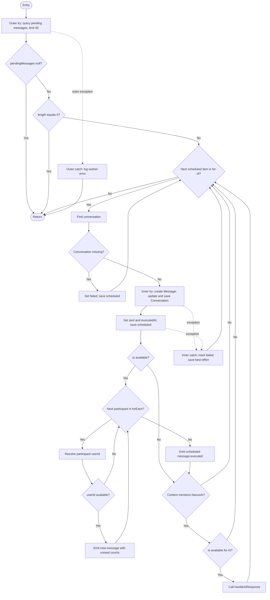

# White-Box Testing Report - Schedule, Review & Feedback

## 1. Mục tiêu và phạm vi

Báo cáo ghi lại kiểm thử Jest cho:

- `backend/src/services/scheduleWorker.js`: xử lý tin nhắn hẹn giờ, reset streak và vòng đời worker.
- `backend/src/controllers/reviewController.js`: gửi review, kiểm duyệt AI/fallback, danh sách review và thống kê.
- `backend/src/controllers/feedbackController.js`: xác thực và lưu góp ý.

Các model, socket và dịch vụ AI bên ngoài được mock để kiểm thử luồng điều khiển của module mà không cần MongoDB, Socket.IO server hoặc gọi dịch vụ AI thật.

## 2. Cấu hình và lệnh chạy

Jest sử dụng cấu hình ở `backend/jest.config.js`, test ở `tests/whitebox/`, và JUnit reporter `jest-junit`.

Chạy từ thư mục `backend`:

```powershell
npm run test:whitebox -- --runInBand
npm run test:coverage -- --runInBand
```

Kết quả:

- JUnit XML: `output/junit/whitebox-junit.xml`
- Coverage HTML: `coverage/lcov-report/index.html`
- Coverage LCOV: `coverage/lcov.info`

## 3. CFG và Cyclomatic Complexity: `processScheduledMessages`

### CFG



### Tính CC

Đếm các predicate trong CFG, tách các toán tử short-circuit `||`/`&&` thành các nút quyết định:

| Nhóm quyết định | Số nút |
|---|---:|
| Outer catch và catch của mỗi scheduled item | 2 |
| Kiểm tra danh sách chờ (null và rỗng) | 2 |
| Vòng lặp `for...of` và vòng `forEach` người tham gia | 2 |
| Hội thoại không tồn tại | 1 |
| Socket `io` trước khi phát sự kiện | 1 |
| Biểu thức chọn user ID (`a || b || c`) và kiểm tra ID | 3 |
| Fallback `unreadCounts || new Map()` | 1 |
| Điều kiện nhắc AI (`content`, `mentions`, ID AI) | 3 |
| Socket `io` trước khi gọi AI | 1 |
| Fallback `err.message || "Unknown error"` | 1 |
| **Tổng predicate nodes** | **17** |

`V(G) = P + 1 = 17 + 1 = 18`.

Con số trên tính ở mức source-level, bao gồm các nhánh short-circuit và hai vòng lặp. Đây là số đường dẫn cơ sở độc lập, không phải số test duy nhất bắt buộc cho toàn bộ yêu cầu; các test có thể cùng bao phủ nhiều nhánh.

## 4. Ma trận test case

### 4.1 `scheduleWorker.js`

Test file: `tests/whitebox/services/scheduleWorker.test.js` — **18 test**.

| Mã | Tình huống / nhánh chính | Kết quả mong đợi |
|---|---|---|
| TC-SW-01 | Không có lịch đến hạn | Không truy vấn hội thoại/tạo message |
| TC-SW-02 | Hội thoại không tồn tại | Lịch chuyển `failed`, lưu lý do |
| TC-SW-03 | Gửi thành công | Tạo message, cập nhật hội thoại, đánh dấu `sent`, phát socket |
| TC-SW-03B | Không có `unreadCounts` | Socket nhận object unread rỗng |
| TC-SW-04 | Nội dung có `@NexusAI` | Gọi xử lý AI |
| TC-SW-04B | `mentions` chứa ID NexusAI | Gọi xử lý AI |
| TC-SW-04C | Có mention AI nhưng không có `io` | Gửi lịch thành công, không gọi AI |
| TC-SW-05 | Một item lỗi giữa batch | Item lỗi thành `failed`; worker tiếp tục item sau |
| TC-SW-05B | Participant thiếu ID | Bỏ qua socket participant đó |
| TC-SW-05C | Lưu trạng thái lỗi cũng thất bại | Lỗi lưu được nuốt theo best-effort; worker không thoát |
| TC-SW-05D | Error không có message | Dùng `Unknown error` |
| TC-SW-06 | Truy vấn lịch lỗi | Outer catch ghi log; hàm không reject |
| TC-SW-07 | Không có streak hết hạn | Không lưu/phát sự kiện |
| TC-SW-08 | Có streak hết hạn | Reset dữ liệu, `markModified`, lưu và emit |
| TC-SW-09 | Reset không có `io` | Vẫn reset và lưu |
| TC-SW-10 | Truy vấn streak lỗi | Catch lỗi; hàm không reject |
| TC-SW-11 | Chạy worker qua 6 chu kỳ | Chạy ngay, reset streak ở chu kỳ 6 và dừng timer |
| TC-SW-12 | Khởi động worker lần hai | Clear timer cũ trước khi tạo timer mới |

### 4.2 `reviewController.js`

Test file: `tests/whitebox/review/reviewController.test.js` — **16 test**.

Bao phủ thiếu trường bắt buộc, độ dài 500/501 ký tự, AI approved/rejected/pending, JSON bọc Markdown hoặc sai định dạng, fallback keyword cho nội dung vi phạm/sạch, lỗi ghi DB, lấy danh sách approved và các nhánh thống kê review rỗng/có dữ liệu/lỗi. Các lời gọi DB và AI đều được mock.

### 4.3 `feedbackController.js`

Test file: `tests/whitebox/review/feedbackController.test.js` — **4 test**.

Bao phủ nội dung rỗng, giá trị mặc định tên/email, trim dữ liệu hợp lệ và lỗi lưu DB.

## 5. Kết quả coverage

Lệnh xác minh toàn bộ suite:

```text
npm run test:coverage -- --runInBand
Test Suites: 13 passed, 13 total
Tests: 251 passed, 7 todo, 258 total
```

`todo` là các test đang chờ ở module khác, không phải test thất bại.

| File mã nguồn | Statements | Branches | Functions | Lines | Test mục tiêu |
|---|---:|---:|---:|---:|---:|
| `scheduleWorker.js` | 100% | 100% | 100% | 100% | 18 |
| `reviewController.js` | 100% | 100% | 100% | 100% | 16 |
| `feedbackController.js` | 100% | 100% | 100% | 100% | 4 |
| **Ba file mục tiêu** | **100%** | **100%** | **100%** | **100%** | **38** |
| **Toàn bộ `backend/src` trong Jest config** | **36.90%** | **36.35%** | **32.50%** | **37.47%** | **251 passed** |

Coverage toàn dự án thấp hơn coverage của ba file được giao vì cấu hình thu thập tất cả `backend/src/**/*.js`, trong khi một số controller/service/model khác chưa có test hộp trắng. Các số liệu là kết quả lần chạy nêu trên; chạy lại test sẽ cập nhật report sinh ra.

## 6. Kết luận

Ba file mục tiêu đạt Statement ≥ 90% và Branch ≥ 80%; đồng thời toàn bộ statement, branch, function và line của phạm vi mục tiêu đã được thực thi trong test. Coverage toàn backend chưa đạt cùng mức do nhiều module ngoài phạm vi chưa được kiểm thử.
