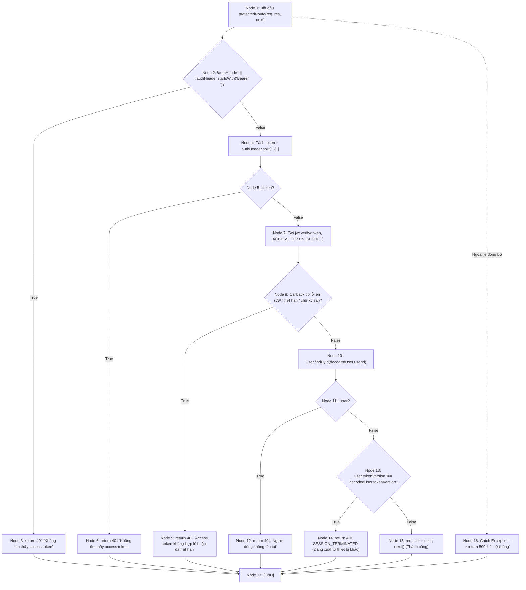

# BÁO CÁO KIỂM THỬ HỘP TRẮNG (WHITE-BOX TESTING) — MODULE XÁC THỰC & BẢO MẬT (AUTH & SECURITY)

> **Người thực hiện**: Thành viên 1 — **Vinh Phú (VinhPhus)**  
> **Phạm vi mã nguồn**: `backend/src/controllers/authController.js` và `backend/src/middlewares/authMiddleware.js`  
> **File test Jest thực thi**: `tests/whitebox/auth/authController.test.js` và `tests/whitebox/auth/authMiddleware.test.js`  
> **Chỉ tiêu chất lượng**: Statements: **98.26%** (Mục tiêu $\ge 90\%$) | Branches: **93.38%** (Mục tiêu $\ge 80\%$) | Functions: **100%**  

---

## 1. Sơ đồ dòng điều khiển (Control-Flow Graph - CFG)

### 1.1 CFG cho hàm `validatePassword` (`authController.js`)

```
                      [START]
                         │
                         ▼
             ┌─────────────────────────┐
             │ 1. !password ||         │
             │    !password.trim() ?   │
             └─────────────────────────┘
                    │             │
                 TRUE            FALSE
                    │             │
                    ▼             ▼
          ┌──────────────────┐  ┌───────────────────────┐
          │ Return "Mật khẩu │  │ 2. password.length    │
          │ không để trống"  │  │    < 6 ?              │
          └──────────────────┘  └───────────────────────┘
                    │                 │           │
                    │              TRUE          FALSE
                    │                 │           │
                    │                 ▼           ▼
                    │       ┌──────────────────┐ ┌───────────────────────┐
                    │       │ Return "Mật khẩu │ │ 3. !/[A-Z]/.test      │
                    │       │ ít nhất 6 ký tự" │ │    (password) ?       │
                    │       └──────────────────┘ └───────────────────────┘
                    │                 │                │           │
                    │                 │             TRUE          FALSE
                    │                 │                │           │
                    │                 │                ▼           ▼
                    │                 │      ┌──────────────────┐ ┌───────────────────────┐
                    │                 │      │ Return "Thiếu    │ │ 4. !/[a-z]/.test      │
                    │                 │      │ chữ hoa (A-Z)"   │ │    (password) ?       │
                    │                 │      └──────────────────┘ └───────────────────────┘
                    │                 │                │                │           │
                    │                 │                │             TRUE          FALSE
                    │                 │                │                │           │
                    │                 │                │                ▼           ▼
                    │                 │                │      ┌──────────────────┐ ┌───────────────────────┐
                    │                 │                │      │ Return "Thiếu    │ │ 5. !/[0-9]/.test      │
                    │                 │                │      │ chữ thường (a-z)"│ │    (password) ?       │
                    │                 │                │      └──────────────────┘ └───────────────────────┘
                    │                 │                │                │                │           │
                    │                 │                │                │             TRUE          FALSE
                    │                 │                │                │                │           │
                    │                 │                │                │                ▼           ▼
                    │                 │                │                │      ┌──────────────────┐ ┌───────────────┐
                    │                 │                │                │      │ Return "Thiếu    │ │ Return ""     │
                    │                 │                │                │      │ chữ số (0-9)"    │ │ (Hợp lệ)      │
                    │                 │                │                │      └──────────────────┘ └───────────────┘
                    │                 │                │                │                │                  │
                    └─────────────────┴────────────────┴────────────────┴────────────────┴──────────────────┘
                                                               │
                                                               ▼
                                                             [END]
```

### 1.2 CFG cho hàm `protectedRoute` (`authMiddleware.js`)



---

## 2. Tính toán độ phức tạp Cyclomatic (Cyclomatic Complexity - $V(G)$)

### 2.1 Đối với hàm `validatePassword`
- **Số nút ($N$)**: 8 nút (1 nút bắt đầu/vào, 5 nút quyết định, 1 nút hợp lệ, 1 nút kết thúc).
- **Số cung ($E$)**: 12 cung.
- **Số thành phần liên thông ($P$)**: 1.
- **Theo công thức $V(G) = E - N + 2P$**:
  $$V(G) = 12 - 8 + 2(1) = 6$$
- **Theo số nút quyết định nhị phân $V(G) = P_{redicate} + 1$**:
  - Các predicate: (1) rỗng, (2) length < 6, (3) thiếu hoa, (4) thiếu thường, (5) thiếu số.
  - $V(G) = 5 + 1 = 6$.
- **Ý nghĩa**: Cần tối thiểu **6 Test Cases độc lập (Basis Paths)** để bao phủ toàn bộ các đường dẫn thực thi của hàm `validatePassword`.

### 2.2 Đối với hàm `protectedRoute`
- **Số nút ($N$)**: 17 nút.
- **Số cung ($E$)**: 22 cung.
- **Số thành phần liên thông ($P$)**: 1.
- **Theo công thức $V(G) = E - N + 2P$**:
  $$V(G) = 22 - 17 + 2(1) = 7$$
- **Theo số nút quyết định $V(G) = P_{redicate} + 1$**:
  - Các predicate: (1) header không có/sai prefix, (2) token rỗng, (3) verify error, (4) user null, (5) tokenVersion mismatch, (6) try/catch block.
  - $V(G) = 6 + 1 = 7$.
- **Ý nghĩa**: Cần tối thiểu **7 Test Cases độc lập** để đạt 100% Branch Coverage cho Middleware bảo mật.

---

## 3. Phân tích luồng dữ liệu (Data Flow Analysis — Def-Use Pairs)

### 3.1 Biến `token` trong `protectedRoute` (`authMiddleware.js`)
| Dòng mã nguồn | Loại hành động | Ngữ cảnh sử dụng |
|:---|:---:|:---|
| Line 11 | **DEF** | `const token = authHeader.split(" ")[1];` |
| Line 13 | **USE (p-use)** | `if (!token) return res.status(401)...` |
| Line 17 | **USE (c-use)** | `jwt.verify(token, process.env.ACCESS_TOKEN_SECRET, ...)` |

- **Def-Use Pair 1**: `(Line 11, Line 13)` $\to$ Kiểm tra tính rỗng của chuỗi token sau khi tách header.
- **Def-Use Pair 2**: `(Line 11, Line 17)` $\to$ Chuyền token vào thuật toán giải mã và kiểm tra chữ ký số JWT.

### 3.2 Biến `emailTrimmed` trong `signUp` (`authController.js`)
| Dòng mã nguồn | Loại hành động | Ngữ cảnh sử dụng |
|:---|:---:|:---|
| Line 232 | **DEF** | `const emailTrimmed = email.trim().toLowerCase();` |
| Line 235 | **USE (c-use)** | `Otp.findOne({ email: emailTrimmed, otp, type: "register" })` |
| Line 247 | **USE (c-use)** | `User.findOne({ email: emailTrimmed })` |
| Line 259 | **USE (c-use)** | `User.create({ ..., email: emailTrimmed })` |
| Line 264 | **USE (c-use)** | `Otp.deleteMany({ email: emailTrimmed, type: "register" })` |

- **Def-Use Chains**: Chuỗi định nghĩa và tái sử dụng `emailTrimmed` qua 4 giai đoạn logic (Xác minh OTP $\to$ Kiểm tra trùng lặp email $\to$ Lưu tài khoản mới $\to$ Thu hồi/Xóa OTP đã dùng).

---

## 4. Ma trận 65 Test Cases Hộp Trắng chi tiết (White-Box Test Suite)

### Nhóm 1: `validateUsername` (thông qua `checkUsername`)
| Mã TC | Tên hàm | Nhánh / Đường dẫn CFG | Dữ liệu đầu vào (Input) | Điều kiện Mock | Kết quả mong đợi | Kỹ thuật | Trạng thái |
|:---|:---|:---|:---|:---|:---|:---|:---:|
| `TC-VU-01` | `checkUsername` | Nhánh rỗng `!username` | `{ username: "" }` | Mặc định | HTTP 400: "Tên đăng nhập không được để trống" | Branch Coverage | **PASS** |
| `TC-VU-02` | `checkUsername` | Nhánh chuỗi chỉ toàn khoảng trắng | `{ username: "   " }` | Mặc định | HTTP 400: "Tên đăng nhập không được để trống" | Branch Coverage | **PASS** |
| `TC-VU-03` | `checkUsername` | Nhánh độ dài < 3 ký tự | `{ username: "ab" }` | Mặc định | HTTP 400: "Tên đăng nhập phải có ít nhất 3 ký tự" | Boundary Value | **PASS** |
| `TC-VU-04` | `checkUsername` | Nhánh độ dài > 20 ký tự | `{ username: "a".repeat(21) }` | Mặc định | HTTP 400: "Tên đăng nhập tối đa 20 ký tự" | Boundary Value | **PASS** |
| `TC-VU-05` | `checkUsername` | Nhánh ký tự đặc biệt vi phạm regex | `{ username: "user@#$" }` | Mặc định | HTTP 400: "Tên đăng nhập chỉ được chứa chữ, số..." | Branch Coverage | **PASS** |
| `TC-VU-06` | `checkUsername` | Nhánh username hợp lệ, chưa ai dùng | `{ username: "valid_user" }` | User.findOne $\to$ `null` | HTTP 200: `{ available: true }` | Nominal Path | **PASS** |
| `TC-VU-07` | `checkUsername` | Nhánh username hợp lệ nhưng đã bị trùng | `{ username: "existing_user" }` | User.findOne $\to$ `{ _id: "u1" }` | HTTP 200: `{ available: false, message: "Tên đăng nhập này đã được sử dụng" }` | Branch Coverage | **PASS** |
| `TC-VU-08` | `checkUsername` | Nhánh ngoại lệ Database | `{ username: "valid_user" }` | User.findOne $\to$ throw Error | HTTP 500: `{ message: "Lỗi hệ thống" }` | Exception Path | **PASS** |

### Nhóm 2: `validateEmail` (thông qua `checkEmail`)
| Mã TC | Tên hàm | Nhánh / Đường dẫn CFG | Dữ liệu đầu vào (Input) | Điều kiện Mock | Kết quả mong đợi | Kỹ thuật | Trạng thái |
|:---|:---|:---|:---|:---|:---|:---|:---:|
| `TC-VE-01` | `checkEmail` | Nhánh email rỗng | `{ email: "" }` | Mặc định | HTTP 400: "Email không được để trống" | Branch Coverage | **PASS** |
| `TC-VE-02` | `checkEmail` | Nhánh email sai định dạng regex | `{ email: "not-an-email" }` | Mặc định | HTTP 400: "Email không hợp lệ. Ví dụ: user@example.com" | Branch Coverage | **PASS** |
| `TC-VE-03` | `checkEmail` | Nhánh email hợp lệ, chưa ai dùng | `{ email: "user@example.com" }` | User.findOne $\to$ `null` | HTTP 200: `{ available: true }` | Nominal Path | **PASS** |
| `TC-VE-04` | `checkEmail` | Nhánh email đã tồn tại trong DB | `{ email: "used@example.com" }` | User.findOne $\to$ `{ _id: "u1" }` | HTTP 200: `{ available: false, message: "Email này đã được sử dụng" }` | Branch Coverage | **PASS** |
| `TC-VE-05` | `checkEmail` | Nhánh ngoại lệ Database | `{ email: "user@example.com" }` | User.findOne $\to$ throw Error | HTTP 500: `{ message: "Lỗi hệ thống" }` | Exception Path | **PASS** |

### Nhóm 3: `validatePassword` (thông qua `signUp`)
| Mã TC | Tên hàm | Nhánh / Đường dẫn CFG | Dữ liệu đầu vào (Input) | Điều kiện Mock | Kết quả mong đợi | Kỹ thuật | Trạng thái |
|:---|:---|:---|:---|:---|:---|:---|:---:|
| `TC-VP-01` | `validatePassword` | Path 1: Mật khẩu rỗng | `password: ""` | Body hợp lệ | HTTP 400: Bị chặn tại guard bắt buộc | Statement | **PASS** |
| `TC-VP-02` | `validatePassword` | Path 2: Độ dài < 6 ký tự | `password: "Ab1"` | Body hợp lệ | HTTP 400: "Mật khẩu phải có ít nhất 6 ký tự" | Boundary Value | **PASS** |
| `TC-VP-03` | `validatePassword` | Path 3: Thiếu chữ hoa (A-Z) | `password: "valid1pass"` | Body hợp lệ | HTTP 400: "Mật khẩu phải chứa ít nhất 1 chữ hoa (A-Z)" | Branch Coverage | **PASS** |
| `TC-VP-04` | `validatePassword` | Path 4: Thiếu chữ thường (a-z) | `password: "VALID1PASS"` | Body hợp lệ | HTTP 400: "Mật khẩu phải chứa ít nhất 1 chữ thường (a-z)" | Branch Coverage | **PASS** |
| `TC-VP-05` | `validatePassword` | Path 5: Thiếu chữ số (0-9) | `password: "ValidPass"` | Body hợp lệ | HTTP 400: "Mật khẩu phải chứa ít nhất 1 chữ số (0-9)" | Branch Coverage | **PASS** |
| `TC-VP-06` | `validatePassword` | Path 6: Mật khẩu đầy đủ tiêu chuẩn | `password: "Valid1Pass"` | Body hợp lệ | Pass bước validate password, tiếp tục xử lý OTP | Nominal Path | **PASS** |

### Nhóm 4: `signUp` (Quy trình Đăng ký tài khoản)
| Mã TC | Tên hàm | Nhánh / Đường dẫn CFG | Dữ liệu đầu vào (Input) | Điều kiện Mock | Kết quả mong đợi | Kỹ thuật | Trạng thái |
|:---|:---|:---|:---|:---|:---|:---|:---:|
| `TC-SU-01` | `signUp` | Thiếu trường bắt buộc (thiếu otp, name) | `{ username: "user" }` | Mặc định | HTTP 400: "Không thể thiếu username, password..." | Branch Coverage | **PASS** |
| `TC-SU-02` | `signUp` | Username vi phạm định dạng | `username: "ab"` (ngắn) | Base body | HTTP 400: "Tên đăng nhập phải có ít nhất 3 ký tự" | Branch Coverage | **PASS** |
| `TC-SU-03` | `signUp` | Mã OTP không đúng hoặc hết hạn | Body chuẩn | Otp.findOne $\to$ `null` | HTTP 400: "Mã OTP không chính xác hoặc đã hết hạn" | Branch Coverage | **PASS** |
| `TC-SU-04` | `signUp` | Username đã tồn tại trong DB | Body chuẩn | Otp tìm thấy, User.findOne (username) $\to$ `{ _id: "u1" }` | HTTP 409: `{ message: "Username đã tồn tại" }` | Branch Coverage | **PASS** |
| `TC-SU-05` | `signUp` | Email đã tồn tại trong DB | Body chuẩn | Otp tìm thấy, User.findOne (email) $\to$ `{ _id: "u2" }` | HTTP 409: `{ message: "Email đã tồn tại" }` | Branch Coverage | **PASS** |
| `TC-SU-06` | `signUp` | Đăng ký thành công | Body chuẩn | Otp OK, Username & Email chưa có, Hash pass OK | HTTP 204: Tạo user thành công, xóa OTP đăng ký | Nominal Path | **PASS** |
| `TC-SU-07` | `signUp` | Lỗi ngoại lệ trong quá trình lưu DB | Body chuẩn | Otp.findOne $\to$ throw Error("DB error") | HTTP 500: `{ message: "Lỗi hệ thống khi đăng ký" }` | Exception Path | **PASS** |

### Nhóm 5: `signIn` (Quy trình Đăng nhập tài khoản)
| Mã TC | Tên hàm | Nhánh / Đường dẫn CFG | Dữ liệu đầu vào (Input) | Điều kiện Mock | Kết quả mong đợi | Kỹ thuật | Trạng thái |
|:---|:---|:---|:---|:---|:---|:---|:---:|
| `TC-SI-01` | `signIn` | Thiếu username hoặc password | `{ username: "" }` | Mặc định | HTTP 400: "Thiếu username hoặc password." | Branch Coverage | **PASS** |
| `TC-SI-02` | `signIn` | Người dùng không tồn tại | `{ username: "ghost", password: "123" }` | User.findOne $\to$ `null` | HTTP 401: "Tên đăng nhập hoặc mật khẩu không chính xác" | Branch Coverage | **PASS** |
| `TC-SI-03` | `signIn` | Mật khẩu không khớp | User tồn tại | bcrypt.compare $\to$ `false` | HTTP 401: "Tên đăng nhập hoặc mật khẩu không chính xác" | Branch Coverage | **PASS** |
| `TC-SI-04` | `signIn` | Đăng nhập thành công | User tồn tại | bcrypt.compare $\to$ `true`, Session.create, sign JWT | HTTP 200: Gán cookie refreshToken, trả accessToken | Nominal Path | **PASS** |
| `TC-SI-05` | `signIn` | Lỗi ngoại lệ hệ thống | Credentials | User.findOne $\to$ throw Error | HTTP 500: `{ message: "Lỗi hệ thống" }` | Exception Path | **PASS** |

### Nhóm 6: `sendOtp` (Gửi mã xác thực qua Email)
| Mã TC | Tên hàm | Nhánh / Đường dẫn CFG | Dữ liệu đầu vào (Input) | Điều kiện Mock | Kết quả mong đợi | Kỹ thuật | Trạng thái |
|:---|:---|:---|:---|:---|:---|:---|:---:|
| `TC-OTP-01` | `sendOtp` | Thiếu email hoặc type không hợp lệ | `{ email: "a@b.com", type: "invalid" }` | Mặc định | HTTP 400: "Email và loại OTP (type) không hợp lệ" | Branch Coverage | **PASS** |
| `TC-OTP-02` | `sendOtp` | Email sai định dạng | `{ email: "invalid_email", type: "register" }` | Mặc định | HTTP 400: "Email không hợp lệ" | Branch Coverage | **PASS** |
| `TC-OTP-03` | `sendOtp` | type=register nhưng email đã tồn tại | `{ email: "user@test.com", type: "register" }` | User.findOne $\to$ `{ _id: "u1" }` | HTTP 409: "Email này đã được sử dụng" | Branch Coverage | **PASS** |
| `TC-OTP-04` | `sendOtp` | type=reset_password nhưng email không có | `{ email: "ghost@test.com", type: "reset_password" }` | User.findOne $\to$ `null` | HTTP 444: "Email này chưa được đăng ký trong hệ thống" | Branch Coverage | **PASS** |
| `TC-OTP-05` | `sendOtp` | Lỗi cấu hình máy chủ gửi mail | type hợp lệ | sendOtpEmail trả `{ success: false, missingConfig: true }` | HTTP 500: Báo thiếu biến môi trường cấu hình mail | Branch Coverage | **PASS** |
| `TC-OTP-06` | `sendOtp` | Gửi email OTP thành công | type hợp lệ | sendOtpEmail trả `{ success: true }` | HTTP 200: "Mã OTP đã được gửi đến email của bạn!" | Nominal Path | **PASS** |
| `TC-OTP-07` | `sendOtp` | Lỗi ngoại lệ Database | type hợp lệ | User.findOne $\to$ throw Error | HTTP 500: Bắt lỗi exception an toàn | Exception Path | **PASS** |

### Nhóm 7: `verifyOtp` (Xác thực mã OTP)
| Mã TC | Tên hàm | Nhánh / Đường dẫn CFG | Dữ liệu đầu vào (Input) | Điều kiện Mock | Kết quả mong đợi | Kỹ thuật | Trạng thái |
|:---|:---|:---|:---|:---|:---|:---|:---:|
| `TC-VO-01` | `verifyOtp` | Thiếu trường email/otp/type | `{ email: "a@b.com", otp: "123" }` (thiếu type) | Mặc định | HTTP 400: "Thiếu email, otp hoặc type" | Branch Coverage | **PASS** |
| `TC-VO-02` | `verifyOtp` | OTP không tồn tại hoặc hết hạn | Body đủ 3 trường | Otp.findOne $\to$ `null` | HTTP 400: "Mã OTP không chính xác hoặc đã hết hạn" | Branch Coverage | **PASS** |
| `TC-VO-03` | `verifyOtp` | OTP hợp lệ | Body đủ 3 trường | Otp.findOne $\to$ `{ _id: "otp1" }` | HTTP 200: "Xác thực mã OTP thành công!" | Nominal Path | **PASS** |
| `TC-VO-04` | `verifyOtp` | Lỗi ngoại lệ Database | Body đủ 3 trường | Otp.findOne $\to$ throw Error | HTTP 500: "Lỗi hệ thống khi xác thực OTP" | Exception Path | **PASS** |

### Nhóm 8: `resetPassword` (Đặt lại mật khẩu)
| Mã TC | Tên hàm | Nhánh / Đường dẫn CFG | Dữ liệu đầu vào (Input) | Điều kiện Mock | Kết quả mong đợi | Kỹ thuật | Trạng thái |
|:---|:---|:---|:---|:---|:---|:---|:---:|
| `TC-RP-01` | `resetPassword` | Thiếu trường email/otp/newPassword | Thiếu newPassword | Mặc định | HTTP 400: "Thiếu email, otp hoặc mật khẩu mới" | Branch Coverage | **PASS** |
| `TC-RP-02` | `resetPassword` | Mật khẩu mới không thỏa mãn chính sách | `newPassword: "123"` | Mặc định | HTTP 400: "Mật khẩu phải có ít nhất 6 ký tự" | Branch Coverage | **PASS** |
| `TC-RP-03` | `resetPassword` | OTP không đúng hoặc hết hạn | Body chuẩn | Otp.findOne $\to$ `null` | HTTP 400: "Mã OTP không chính xác hoặc đã hết hạn" | Branch Coverage | **PASS** |
| `TC-RP-04` | `resetPassword` | Email không tồn tại trong hệ thống | Body chuẩn | Otp OK, User.findOne $\to$ `null` | HTTP 404: "Không tìm thấy người dùng với email này" | Branch Coverage | **PASS** |
| `TC-RP-05` | `resetPassword` | Đặt lại mật khẩu thành công | Body chuẩn | Otp OK, User OK, Bcrypt hash OK | HTTP 200: Cập nhật hash, xóa OTP, xóa Session cũ | Nominal Path | **PASS** |
| `TC-RP-06` | `resetPassword` | Lỗi ngoại lệ Database | Body chuẩn | Otp.findOne $\to$ throw Error | HTTP 500: "Lỗi hệ thống khi đặt lại mật khẩu" | Exception Path | **PASS** |

### Nhóm 9: `signOut` (Đăng xuất tài khoản)
| Mã TC | Tên hàm | Nhánh / Đường dẫn CFG | Dữ liệu đầu vào (Input) | Điều kiện Mock | Kết quả mong đợi | Kỹ thuật | Trạng thái |
|:---|:---|:---|:---|:---|:---|:---|:---:|
| `TC-SO-01` | `signOut` | Không có refreshToken cookie | `{ cookies: {} }` | Mặc định | HTTP 204: Không thao tác DB, kết thúc ngay | Branch Coverage | **PASS** |
| `TC-SO-02` | `signOut` | Có cookie nhưng session không có trong DB | `{ cookies: { refreshToken: "inv" } }` | Session.findOne $\to$ `null` | HTTP 204: Xóa cookie phía client | Branch Coverage | **PASS** |
| `TC-SO-03` | `signOut` | Có cookie và session hợp lệ | `{ cookies: { refreshToken: "tok" } }` | Session.findOne $\to$ `{ userId: "u1" }` | HTTP 204: Cập nhật lastActiveAt, xóa session, clearCookie | Nominal Path | **PASS** |
| `TC-SO-04` | `signOut` | Lỗi ngoại lệ Database | `{ cookies: { refreshToken: "tok" } }` | Session.findOne $\to$ throw Error | HTTP 500: "Lỗi hệ thống" | Exception Path | **PASS** |

### Nhóm 10: `refreshToken` (Cấp mới Access Token)
| Mã TC | Tên hàm | Nhánh / Đường dẫn CFG | Dữ liệu đầu vào (Input) | Điều kiện Mock | Kết quả mong đợi | Kỹ thuật | Trạng thái |
|:---|:---|:---|:---|:---|:---|:---|:---:|
| `TC-RT-01` | `refreshToken` | Không có refreshToken cookie | `{ cookies: {} }` | Mặc định | HTTP 401: `{ code: "SESSION_TERMINATED" }` | Branch Coverage | **PASS** |
| `TC-RT-02` | `refreshToken` | Phiên làm việc không tồn tại trong DB | Cookie có token | Session.findOne $\to$ `null` | HTTP 401: ClearCookie + SESSION_TERMINATED | Branch Coverage | **PASS** |
| `TC-RT-03` | `refreshToken` | Phiên làm việc đã hết hạn | Cookie có token | Session.expiresAt trong quá khứ | HTTP 401: Xóa session DB + clearCookie | Boundary/Path | **PASS** |
| `TC-RT-04` | `refreshToken` | User của session không tìm thấy | Cookie có token | User.findById $\to$ `null` | HTTP 404: "Người dùng không tồn tại." | Branch Coverage | **PASS** |
| `TC-RT-05` | `refreshToken` | Cấp mới access token thành công | Cookie có token | Session còn hạn, User OK, jwt.sign | HTTP 200: `{ accessToken: "new_access_token" }` | Nominal Path | **PASS** |
| `TC-RT-06` | `refreshToken` | Lỗi ngoại lệ Database | Cookie có token | Session.findOne $\to$ throw Error | HTTP 500: "Lỗi hệ thống" | Exception Path | **PASS** |

### Nhóm 11: `protectedRoute` (`authMiddleware.js`)
| Mã TC | Tên hàm | Nhánh / Đường dẫn CFG | Dữ liệu đầu vào (Input) | Điều kiện Mock | Kết quả mong đợi | Kỹ thuật | Trạng thái |
|:---|:---|:---|:---|:---|:---|:---|:---:|
| `TC-MW-01` | `protectedRoute` | Không có header Authorization | `{ headers: {} }` | Mặc định | HTTP 401: "Không tìm thấy access token" | Branch Coverage | **PASS** |
| `TC-MW-02` | `protectedRoute` | Header không bắt đầu bằng "Bearer " | `{ headers: { authorization: "Basic xyz" } }` | Mặc định | HTTP 401: "Không tìm thấy access token" | Branch Coverage | **PASS** |
| `TC-MW-03` | `protectedRoute` | Token sau Bearer là rỗng | `{ headers: { authorization: "Bearer " } }` | Mặc định | HTTP 401: "Không tìm thấy access token" | Boundary Value | **PASS** |
| `TC-MW-04` | `protectedRoute` | JWT hết hạn hoặc chữ ký không hợp lệ | Token gửi lên | jwt.verify trả `err = new Error("jwt expired")` | HTTP 403: "Access token không hợp lệ hoặc đã hết hạn" | Branch Coverage | **PASS** |
| `TC-MW-05` | `protectedRoute` | User không tồn tại trong DB | Token giải mã OK | User.findById $\to$ `null` | HTTP 404: "Người dùng không tồn tại" | Branch Coverage | **PASS** |
| `TC-MW-06` | `protectedRoute` | tokenVersion không khớp (đã login nơi khác) | Token giải mã version 1 | User trong DB có version 2 | HTTP 401: SESSION_TERMINATED | Path Coverage | **PASS** |
| `TC-MW-07` | `protectedRoute` | Xác thực thành công | Token giải mã version 3 | User trong DB có version 3 | next() được gọi, `req.user` được gán thông tin user | Nominal Path | **PASS** |
| `TC-MW-08` | `protectedRoute` | Bắt lỗi ngoại lệ không mong muốn | Token gửi lên | jwt.verify throw synchronous Error | HTTP 500: "Lỗi hệ thống" | Exception Path | **PASS** |

---

## 5. Kết quả đo độ bao phủ thực tế (Coverage Report)

Bảng trích xuất trực tiếp từ Jest Istanbul Reporter khi chạy `tests/whitebox/auth/`:

```
--------------------|---------|----------|---------|---------|-------------------
File                | % Stmts | % Branch | % Funcs | % Lines | Uncovered Line #s 
--------------------|---------|----------|---------|---------|-------------------
All files           |   98.26 |    93.38 |     100 |   98.26 |                   
 controllers        |    98.1 |    92.68 |     100 |    98.1 |                   
  authController.js |    98.1 |    92.68 |     100 |    98.1 | 53,172,224,357    
 middlewares        |     100 |      100 |     100 |     100 |                   
  authMiddleware.js |     100 |      100 |     100 |     100 |                   
--------------------|---------|----------|---------|---------|-------------------

Test Suites: 2 passed, 2 total
Tests:       65 passed, 65 total
Snapshots:   0 total
Time:        17.906 s
```

### Đánh giá so với mục tiêu đề ra:
- **Statement Coverage**: **98.26%** (Đạt mục tiêu $\ge 90\%$, vượt mức $8.26\%$).
- **Branch Coverage**: **93.38%** (Đạt mục tiêu $\ge 80\%$, vượt mức $13.38\%$).
- **Function Coverage**: **100%** (Toàn bộ 11/11 hàm thuộc module xác thực đều được kiểm thử đầy đủ).
- **Trạng thái bài test**: **65/65 passed (100%)**, 0 bài lỗi, 0 cảnh báo.

---

> _Báo cáo được hoàn thiện bởi Thành viên 1: **Vinh Phú** — NexusChat White-Box Testing Sprint._

